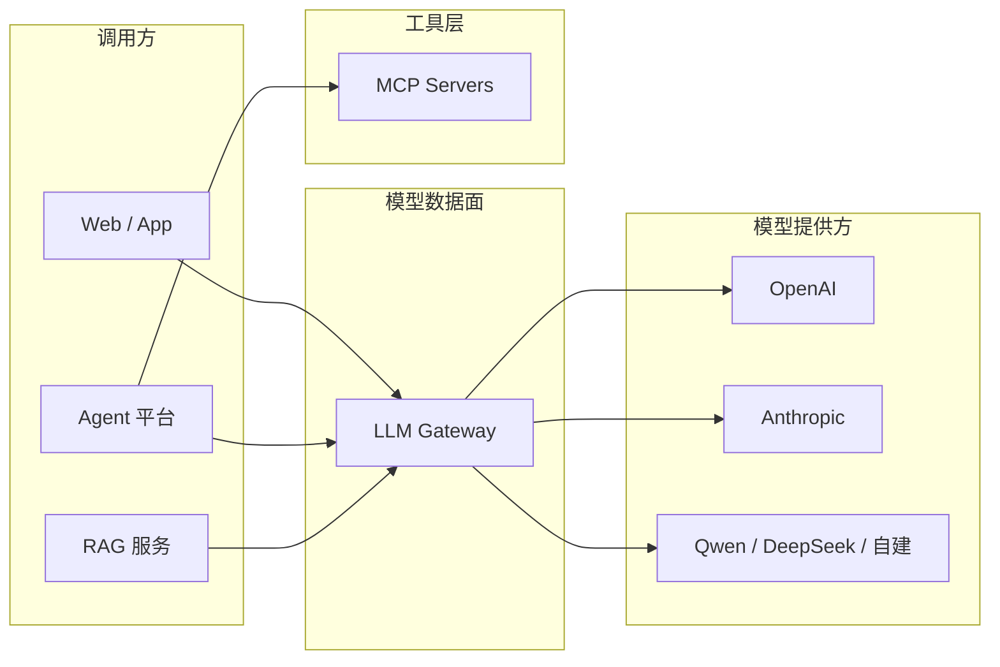
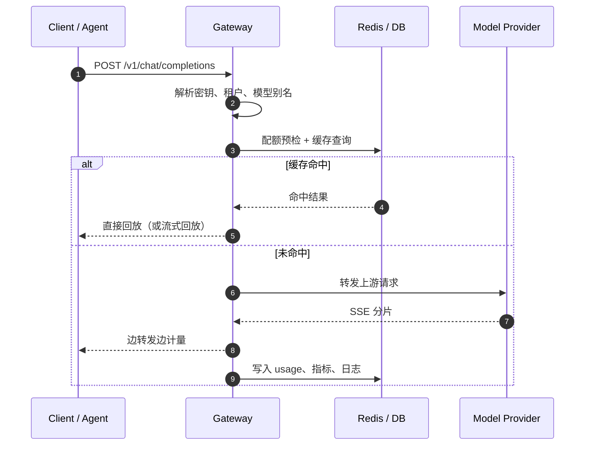

# 网关在 AI 架构中的位置

把网关放错位置，比不做网关更麻烦：它可能变成业务逻辑的垃圾桶、Agent 编排的第二实现，或者一个没人敢动的单点。

这一篇只做一件事：把边界画清楚。

## 一张全局图



三条边界：

- **LLM Gateway** 管「模型怎么被调用」：协议、密钥、路由、配额、重试、计量。
- **Agent** 管「为什么调用、调用几次、拿到结果后做什么」：规划、工具选择、记忆、评测。
- **MCP** 管「工具怎么被暴露和调用」：工具协议、服务发现、工具级权限。

三者会协作，但**不要互相吞并**。网关里塞 Agent 循环，或让 Agent 直接持有厂商密钥，最后都会变成难以测试的耦合。

## 职责边界表

| 能力 | LLM Gateway | Agent 平台 | MCP 服务 |
| --- | --- | --- | --- |
| 厂商鉴权与密钥托管 | ✅ 核心 | ❌ | ❌ |
| 统一模型协议 | ✅ 核心 | 消费方 | ❌ |
| 模型路由 / 兜底 | ✅ 核心 | 可提语义要求 | ❌ |
| 租户配额与计费 | ✅ 核心 | 可做业务配额 | 工具级配额 |
| 多步规划与工具选择 | ❌ | ✅ 核心 | ❌ |
| 工具执行与结果返回 | ❌ | 发起方 | ✅ 核心 |
| 向量检索 / 文档切分 | ❌ | 可编排 | 可由工具提供 |
| 端到端 Trace | 提供模型段 Span | ✅ 串联全链路 | 提供工具段 Span |

::: tip 一句话记忆
**网关是模型数据面，Agent 是控制面，MCP 是工具面。** 数据面追求稳定、可计量；控制面追求灵活；工具面追求权限清晰。
:::

## 一次请求的生命周期



把它拆成七步，并标注「必须在首字节前完成」还是「可以异步」：

| 步骤 | 做什么 | 时机 |
| --- | --- | --- |
| 1. 鉴权 | 校验网关密钥，解析租户/项目/权限 | 首字节前 |
| 2. 归一化 | 校验请求体，补默认值，解析模型别名 | 首字节前 |
| 3. 配额预检 | RPM/TPM/预算是否足够，必要时预留额度 | 首字节前 |
| 4. 路由 | 选目标、查健康状态、决定兜底链 | 首字节前 |
| 5. 缓存 | 查精确缓存 / 语义缓存 | 首字节前 |
| 6. 转发 | 建立上游连接，流式透传 | 首字节前建立连接 |
| 7. 计量与观测 | usage、延迟、错误、成本、Trace | 可异步，但必须可靠 |

::: warning 流式的特殊约束
一旦向客户端写出第一个字节，HTTP 状态码就固定了。此后的上游错误只能通过 SSE 的 `event: error` 表达，不能再改成 502。第 1～5 步必须在首字节前完成，第 7 步要能接受「流中断」这种半成品状态。
:::

## 控制面与数据面

自研网关最常见的架构问题，是把配置、管理接口和请求转发揉在一个进程里，然后互相拖垮。

| 平面 | 内容 | 要求 |
| --- | --- | --- |
| 数据面 | 请求解析、路由、转发、限流、计量 | 低延迟、高并发、无状态、可水平扩展 |
| 控制面 | 模型目录、路由配置、租户与密钥、配额策略 | 强一致、可审计、变更可回滚 |

早期可以同进程部署，但要保持**接口隔离**：数据面只读配置快照，控制面负责写入与推送。否则一次后台批量改配置，可能把线上请求一起卡住。

## 部署形态怎么选

| 形态 | 延迟 | 隔离性 | 运维复杂度 | 适合 |
| --- | --- | --- | --- | --- |
| 进程内 SDK | 最低 | 弱，随业务发布 | 低 | 单团队、统一技术栈 |
| Sidecar | 低（本机回环） | 中，按 Pod 隔离 | 中 | K8s、延迟敏感、多语言 |
| 中心化服务 | 多一跳 | 强，统一治理 | 中高 | 多团队、配额与计费 |
| 托管网关 | 取决于厂商 | 中 | 低 | 无运维团队、快速上线 |

多数组织最终是混合形态：**中心化网关做治理与配额，Sidecar 或 SDK 做超低延迟通道**。但不要一开始就上混合架构，先把中心化的最小闭环跑通。

## 和 RAG 的关系

RAG 服务负责检索与拼装上下文，网关不碰向量库。两者的交集只有三点：

1. RAG 最终调用生成模型时，应该走网关，享受统一配额、兜底与计量。
2. 长 system prompt 与固定文档适合做 **Prompt/KV Cache**，网关可以负责前缀稳定化与缓存命中统计。
3. Embedding 调用也可以走网关，但要注意它的计费单位与聊天模型不同。

## 和 Agent 的关系

Agent 一次任务可能调用模型十几次。网关看到的是「十几次独立请求」，Agent 看到的是「一次任务」。要打通两者，需要：

- 请求头携带 `x-agent-run-id`、`x-agent-name`、`x-tenant-id`；
- 网关按 run id 聚合成本与 token；
- Trace 里 Agent Span 作为父 Span，模型调用作为子 Span；
- 为单次 run 设置 token/费用上限，防止 Agent 循环失控。

具体接法见[对接 better-agent](../04-scenarios/better-agent.md)。

## 和 MCP 的关系

MCP 管工具，网关管模型。**不要让网关去执行工具**，也不要把模型密钥塞进 MCP Server。两者共享的是租户身份、配额体系和 Trace 上下文。

一个常见的组合调用链是：

```text
Agent -> MCP Server（查订单） -> Agent -> LLM Gateway（生成回复） -> 用户
```

网关只负责最后一段模型调用，但它的 Trace 要能挂在同一个 run 上，成本也要能算进同一个任务。详见[对接 mcp-patterns](../04-scenarios/mcp-patterns.md)。

## 四个常见误区

::: danger 误区一：网关变成业务逻辑层
在网关里写 prompt 模板、业务校验、结果后处理，短期很快，长期无法测试、无法复用、无法独立发布。
:::

::: danger 误区二：把 Agent 编排塞进网关
「反正是调模型，顺便帮我循环几次」——这会让网关从无状态数据面变成有状态执行引擎，容量模型完全改变。
:::

::: danger 误区三：只做协议转换
协议转换只是入口。没有配额、超时、重试、计量，网关只是一个更好看的位置，不是更好的系统。
:::

::: danger 误区四：网关成为隐形单点
没有多副本、没有健康检查、没有容量规划、没有值班人。它挂了，所有模型调用一起挂。
:::

## 小结

- 网关是模型数据面，核心职责是**稳定、可控、可计量**。
- Agent、MCP、RAG 各有边界，通过租户身份、Trace 和配额协作，而不是互相吞并。
- 请求生命周期里，鉴权、配额、路由、缓存必须在首字节前完成。
- 部署形态从中心化服务起步，延迟确实成为瓶颈时再考虑 Sidecar/SDK。

下一篇：[开源网关对比与选型](./comparison.md)，看看哪些轮子已经有人造过。
