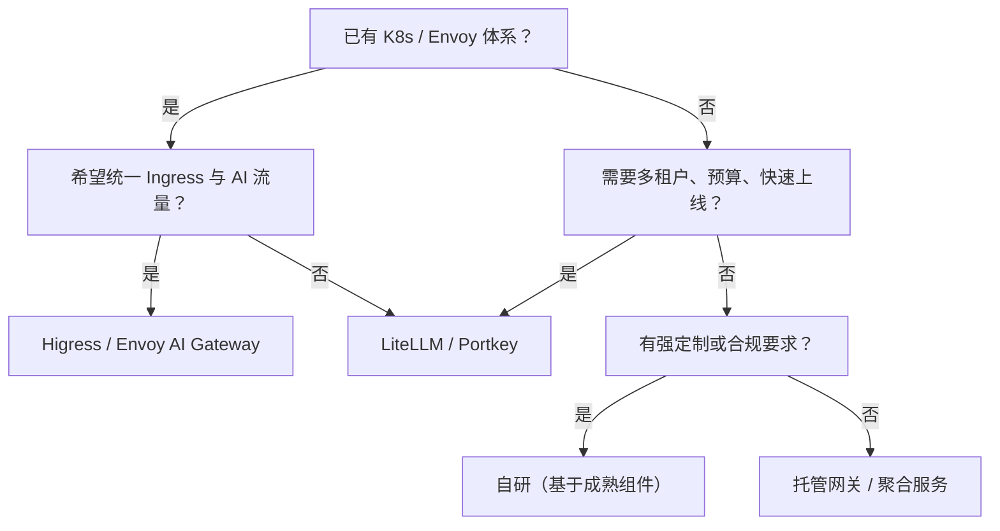

# 开源网关对比与选型

先泼一盆冷水：**没有一款开源网关能开箱满足「多租户 + 精细计费 + 自定义路由 + 企业合规」的全部需求。** 选型不是找最强者，而是找最合适的起点。

::: tip 先说结论
- 想最快跑通 OpenAI 兼容 + 多厂商 + 虚拟密钥：**LiteLLM**。
- 已经在 Kubernetes / Envoy 体系里：**Higress** 或 **Envoy AI Gateway**。
- TypeScript 团队、需要 Guardrails 和条件路由：**Portkey Gateway**。
- 有强定制、强性能或特殊合规要求：**基于成熟组件自研**，别从零写 HTTP 代理。
:::

## 先分清四类项目

「网关」这个词被用得很宽，先分类再比较：

| 类型 | 代表 | 你得到什么 | 你还要自己做什么 |
| --- | --- | --- | --- |
| 独立 AI 网关 | LiteLLM、Portkey Gateway | 协议归一、路由、密钥、预算、回调 | 业务配额、组织模型、深度定制 |
| 云原生网关的 AI 插件 | Higress、Envoy AI Gateway、APISIX | Ingress、流量治理、AI 代理与限流 | 计费、租户体系、业务控制面 |
| 可观测性工具 | OpenLLMetry | LLM 调用的 Trace 与指标 | 它**不是**网关，不负责转发与配额 |
| 托管 / 聚合服务 | OpenRouter、Cloudflare AI Gateway 等 | 免运维、统一账单、快速接入 | 数据边界、成本溢价、厂商锁定 |

::: warning 不要把 OpenLLMetry 当网关
OpenLLMetry 解决的是「看见」，不是「控制」。把它和网关并列比较，就像把监控摄像头和门禁系统混为一谈。
:::

## 横向对比

以下只列工程上最影响决策的维度，具体能力以各项目当期文档为准。

| 项目 | 技术栈 | 多厂商 | 路由 / 兜底 | 虚拟密钥 / 预算 | 可观测 | 部署复杂度 | 最适合 |
| --- | --- | --- | --- | --- | --- | --- | --- |
| LiteLLM | Python | 很广 | 权重、延迟、fallback | 原生支持 | 回调、OTel、Prometheus | 低 | 快速上线、多租户 MVP |
| Portkey Gateway | TypeScript | 很广 | 条件路由、fallback、负载均衡 | 有 | 内置与 OTel | 低～中 | TS 团队、Guardrails |
| Higress | Go / Envoy | 广 | 插件化、K8s 流量治理 | 需配合控制面 | 插件 + 生态 | 中 | K8s、Ingress 统一入口 |
| Envoy AI Gateway | Go / Envoy | 增长中 | K8s 原生、Token 限流 | 依赖生态 | OTel 友好 | 中～高 | Envoy 体系、平台团队 |
| Apache APISIX | Lua / Nginx | 广 | `ai-proxy` 等插件 | 需自建 | 插件生态 | 中 | 已有 APISIX 网关 |
| One API / New API 类 | Go | 广 | 轻量 | 有 | 基础 | 低 | 小团队、聚合中转 |
| 自研 | 任意 | 取决于你 | 完全可控 | 完全可控 | 完全可控 | 高 | 特殊需求、长期平台 |

### LiteLLM

最像「AI 网关默认答案」的项目：OpenAI 兼容代理、大量厂商适配、虚拟密钥、预算、路由与回调都比较完整。Python 技术栈意味着二次开发门槛低，但也意味着高并发场景要更认真地做容量规划。

**适合**：想在一两周内跑通多厂商接入、租户密钥和预算的团队。
**注意**：企业级组织模型、复杂配额继承、深度业务计费仍可能需要外挂控制面。

### Portkey Gateway

TypeScript 实现，配置文件驱动，支持条件路由、fallback、负载均衡、缓存与 Guardrails。对 Node/TS 团队友好，也适合把「路由策略」写成可读的配置。

**适合**：前端/全栈团队、需要在网关层做输入输出护栏的场景。
**注意**：复杂多租户计费仍需自建或配合其平台能力。

### Higress

基于 Envoy 的云原生网关，提供 AI 代理、AI 缓存、Token 限流等插件，和 Kubernetes Ingress、微服务治理结合紧密。国内文档与生态较友好。

**适合**：已经有 K8s 与 Envoy 体系，希望把 AI 流量纳入统一入口的平台团队。
**注意**：它更像「云原生网关 + AI 能力」，租户计费与业务配额需要额外设计。

### Envoy AI Gateway

Envoy Gateway 生态中的 AI 网关方向，强调 K8s 原生、Token 级限流、提供商接入与可观测。适合平台工程团队做标准化数据面。

**适合**：已经重度使用 Envoy / Gateway API，追求数据面统一。
**注意**：项目仍在快速演进，能力边界要以版本为准。

### Apache APISIX

通过 `ai-proxy` 等插件接入多家模型，适合已有 APISIX 网关、希望复用现有鉴权、限流、可观测体系的团队。AI 专属能力（如 Prompt 缓存、Token 计费）不如专用网关完整。

### One API / New API 类项目

轻量聚合与密钥管理，部署简单，适合个人或小团队快速接入多家模型。路由策略、熔断、精细配额和可观测通常较基础，不建议直接承载核心生产流量。

### 自研

自研的合理理由只有三个：**性能/部署形态有硬约束、业务模型开源网关表达不了、组织要求完全掌控数据面**。如果只是「想要一个自己的网关」，先问清楚长期维护人是谁。

## 选型决策树

这张图只给起点，不给终点。真实选型通常还要过下面这张清单。

## 选型六问

1. **协议兼容**：是否原生兼容 OpenAI Chat Completions？工具调用、流式、usage 字段是否完整？
2. **租户模型**：是否支持组织 → 项目 → 密钥的层级？配额能否继承与覆盖？
3. **配额粒度**：RPM、TPM、并发、日/月预算是否都能管？超限行为是否可配置？
4. **路由能力**：权重、标签、优先级、故障切流、灰度是否原生支持？配置能否热更新？
5. **可观测**：是否输出 OTel Trace？指标能否按租户/模型/目标聚合？日志能否脱敏？
6. **扩展与退出**：二次开发语言是否匹配团队？数据能否导出？是否容易被单一厂商锁定？

::: tip 一个实用做法
把六问做成 1～5 分打分表，给「必须项」设一票否决。选型讨论最容易跑偏成功能列表比拼，打分表能把它拉回业务约束。
:::

## 开源 ≠ 免费

| 隐性成本 | 具体表现 |
| --- | --- |
| 升级成本 | 版本迭代快，配置与数据库迁移需要测试 |
| 容量成本 | Python 网关在高并发流式场景下的内存与连接数 |
| 定制成本 | 二次开发后如何跟进上游，避免 fork 越走越远 |
| 运维成本 | 多副本、Redis、数据库、监控、值班 |
| 合规成本 | 日志留存、数据出境、密钥托管 |

如果团队没有为这些成本留人，托管方案往往更便宜。

## 推荐的三阶段路线

| 阶段 | 目标 | 建议 |
| --- | --- | --- |
| 0～1 个月 | 跑通统一入口 | LiteLLM / Portkey 起步，接 2 家模型，打通日志与 Trace |
| 1～3 个月 | 可治理 | 虚拟密钥、租户配额、预算告警、基础路由与兜底 |
| 3～6 个月 | 可运营 | 成本归因、SLA、灰度、容灾演练，评估是否替换数据面 |

::: warning 不要第一天就自研
自研网关最容易低估的不是转发，而是**配额一致性、流式错误处理、密钥生命周期、可观测和升级维护**。先用开源方案把业务跑起来，再决定哪些部分值得自己写。
:::

## 参考资料

- [LiteLLM 文档](https://docs.litellm.ai/)
- [Portkey Gateway（GitHub）](https://github.com/Portkey-AI/gateway)
- [Higress 官网](https://higress.io/)
- [Envoy AI Gateway](https://aigateway.envoyproxy.io/)
- [Apache APISIX AI 插件](https://apisix.apache.org/docs/apisix/plugins/ai-proxy/)
- [OpenLLMetry（GitHub）](https://github.com/traceloop/openllmetry)
- [OpenAI Chat Completions API](https://platform.openai.com/docs/api-reference/chat)
