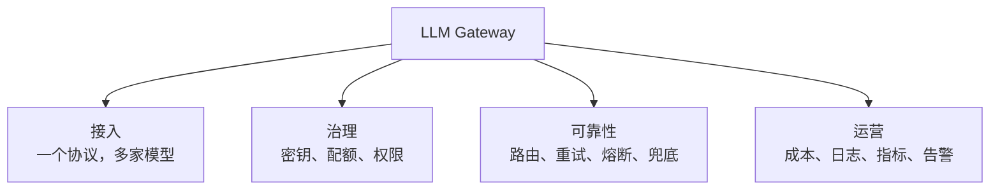

# 为什么需要 LLM 网关

第一版通常长这样：业务代码里一行 `client.chat.completions.create(...)`，密钥放在环境变量，跑得挺好。

直到第二个团队也要用模型，第二个厂商给了更便宜的价格，老板开始问「这个月模型花了多少钱」，线上偶尔冒出 429 和超时——你才发现，真正难的不是调用模型，而是让几十个调用点同时**可控**。

::: tip 先说结论
当模型调用从「一个函数的实现细节」变成「多个团队共享的基础设施」，网关就该出现了。它不生产智能，它生产**确定性**。
:::

## 一段常见的演进史

| 阶段 | 典型形态 | 主要痛点 |
| --- | --- | --- |
| Demo | 一个服务、一个厂商、一把密钥 | 几乎没有，SDK 直连最省事 |
| 多团队 | 每个服务各存一份密钥、各写一套重试 | 密钥扩散、行为不一致、账单说不清 |
| 多厂商 | 不同业务接不同模型，代码里到处是 `if provider ==` | 协议差异、故障无兜底、成本失控 |
| 平台化 | 统一模型入口，按租户/业务治理 | 需要配额、审计、灰度、可观测与成本分摊 |

多数团队不是在「阶段一」需要网关，而是在从「阶段二」往「阶段三」走的时候被现实推着做。提前半步是架构，提前三步是负担。

## 直接调用模型的七类风险

### 1. 密钥扩散

每个服务、每个环境、每个开发同学都有一份厂商密钥。任何一处日志打印、前端误打包、仓库误提交，影响面都是整把密钥的额度。

网关把真实密钥收口到一处，对外只发可撤销、可限额、可审计的网关密钥。

### 2. 协议差异渗透进业务

OpenAI、Anthropic、Gemini 的请求体、流式事件、工具调用格式都不同。没有归一化层，业务代码会长出一堆厂商分支，换模型等于改业务。

### 3. 流量失控与 429 放大

一个上游超时，三个服务各自重试三次，瞬间把 429 放大九倍。网关能在入口做配额、并发控制和重试预算，避免「好心办坏事」。

### 4. 故障裸奔

主模型 5xx 时，业务只能报错。网关可以按标签和优先级切到备用模型，把「厂商故障」降级成「质量波动」。

### 5. 成本黑盒

月底账单只有一个总数，不知道是哪个租户、哪个功能、哪次 Agent 循环烧掉的。没有归因，就没有优化。

### 6. 无审计、无边界

谁在什么时候调用了哪个模型、带了多少数据、是否命中敏感内容？直连模式下，这些问题只能靠猜。

### 7. 模型升级与下线

厂商改模型版本、调整限流、下线旧模型，业务代码被迫跟着改。网关用**模型别名**隔离这种变化：业务认 `chat-default`，网关决定它今天是谁。

::: warning 一个常见误解
「我们只有一家厂商，所以不需要网关。」厂商数量不是判断标准，**调用点数量、团队数量、成本敏感度和故障容忍度**才是。
:::

## 网关到底提供什么

四类价值可以再压缩成一句话：**把横切关注点从业务代码里拿出来，放到一个可以独立演进、独立扩容、独立值班的边界里。**

## 什么时候**不需要**网关

这一节比上一节更重要。下面这些场景，直连 + 薄封装通常更划算：

| 场景 | 更合适的选择 | 原因 |
| --- | --- | --- |
| 单人项目 / 单体应用，日调用量很低 | SDK + 简单封装 | 网关的部署、升级、值班成本高于收益 |
| 只有一个模型、一个团队、无计费需求 | SDK + 统一超时与日志 | 先把可观测补齐，比加一层代理更急 |
| 延迟极其敏感的同机房调用 | 进程内 SDK 或 Sidecar | 少一跳网络，少一个故障点 |
| 没有运维能力的小团队 | 托管网关 / 厂商聚合服务 | 自建网关需要有人对可用性负责 |

网关不是免费的正确性。它引入了一跳网络、一套配置、一个需要监控的新服务，以及一个必须有人负责的单点。

## 一笔粗账：网关成本 vs 事故成本

下面的数字只用于建立量级感，不是报价：

| 项目 | 量级 | 说明 |
| --- | --- | --- |
| 自建网关固定成本 | 1～2 人维护 + 2～4 台小机器 | 配置、升级、告警、故障处理 |
| 一次密钥泄露 | 额度被盗刷 + 应急 + 合规沟通 | 影响面取决于密钥权限 |
| 一次 429 风暴 | 核心功能不可用数十分钟 | 重试放大比单点故障更常见 |
| 一个月账单失控 | 10%～数倍的预算偏差 | 没有归因时很难定位 |

如果上面任何一行让你觉得「这事发生过」，网关的投入通常很快回本。

## 网关不解决什么

- **不提升模型质量**：路由和兜底只能止损，不能把弱模型变强。
- **不替代 Agent 逻辑**：规划、工具选择、记忆仍然在 Agent 层。
- **不自动保证合规**：它提供审计与隔离能力，策略仍要人来定。
- **不是装上就高可用**：网关自己也会挂，需要多副本、健康检查和容量规划。

## 一分钟自测

以下问题有 **3 个以上**回答「是」，就值得把网关提上日程：

- [ ] 有 3 个以上服务或团队直接调用模型 API？
- [ ] 密钥出现在 2 个以上仓库或环境里？
- [ ] 用过 2 家以上模型厂商，或计划这么做？
- [ ] 需要按租户/业务拆分账单或配额？
- [ ] 上游故障时，业务只能报错，没有兜底方案？
- [ ] 出问题时，无法用一个 request id 串起整条调用链？

::: tip 下一步
如果你已经决定要建，先看[网关在架构中的位置](./architecture.md)，把边界划清楚；再对照[能力清单](./capabilities.md)决定第一版做什么。
:::
