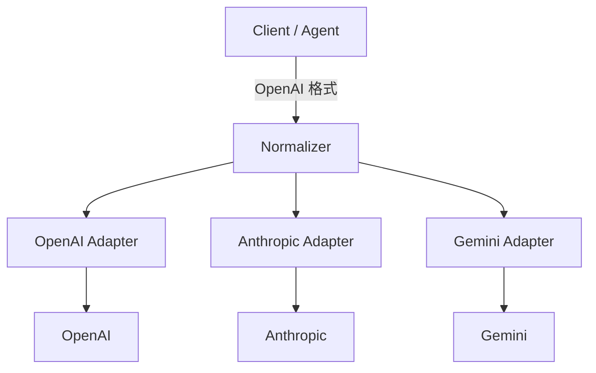

# 统一协议：对齐 OpenAI

多厂商接入的第一道坎不是网络，而是**每种模型都说自己的方言**。业务代码如果直接依赖方言，换模型就等于改业务。

网关的核心动作之一，是选一个「普通话」，把方言翻译进来。行业事实标准是 **OpenAI Chat Completions**——不是因为它最优雅，而是因为 SDK、框架和开发者心智都围绕它。

## 一个入口，三种方言

| 维度 | OpenAI | Anthropic | Gemini |
| --- | --- | --- | --- |
| 端点 | `POST /v1/chat/completions` | `POST /v1/messages` | `POST /v1beta/models/{model}:generateContent` |
| 鉴权 | `Authorization: Bearer` | `x-api-key` + `anthropic-version` | `x-goog-api-key`（或查询参数） |
| 系统提示 | `messages` 里的 `system` 角色 | 顶层 `system` 字段 | `systemInstruction` |
| 消息内容 | 字符串或多模态数组 | content blocks 数组 | `contents[].parts[]` |
| 工具调用 | `tool_calls` | `tool_use` / `tool_result` block | `functionCall` / `functionResponse` |
| 结束原因 | `finish_reason` | `stop_reason` | `finishReason` |
| 流式 | `data: {...}` + `[DONE]` | 具名事件（`message_start` 等） | SSE 分片 |
| 用量字段 | `prompt_tokens` / `completion_tokens` | `input_tokens` / `output_tokens` | `promptTokenCount` / `candidatesTokenCount` |

::: tip 为什么选 Chat Completions，而不是 Responses API
OpenAI 的 Responses API 更适合 Agent 与内置工具，但生态兼容面还不如 Chat Completions。网关可以同时提供两种入口，但**归一化的最小公分母**建议仍是 Chat Completions。
:::

## 归一化层的结构



三层职责：

1. **入口校验**：只接受一种请求格式，字段边界清晰。
2. **适配器**：请求映射、响应映射、流式事件映射、错误映射。
3. **透传区**：厂商特有功能通过 `provider_options` 原样带过去，不强行归一。

### 内部规范模型

不要在适配器之间直接互转，先落地一个内部结构：

```python
@dataclass
class CanonicalRequest:
    model_alias: str
    messages: list[dict]
    max_tokens: int | None
    temperature: float | None
    top_p: float | None
    stop: list[str] | None
    tools: list[dict] | None
    stream: bool
    provider_options: dict   # 厂商特有字段，原样透传
```

这样新增厂商时只写一个适配器，不动入口和路由。

## 请求映射：OpenAI → Anthropic

核心差异：系统提示在顶层、内容用 block 数组、工具 schema 字段不同、`max_tokens` 必填。

```python
import json

def to_anthropic(body: dict, target_model: str) -> dict:
    system_parts: list[str] = []
    messages: list[dict] = []

    for msg in body["messages"]:
        role = msg["role"]

        if role == "system":
            system_parts.append(msg.get("content") or "")
            continue

        if role == "tool":
            messages.append({
                "role": "user",
                "content": [{
                    "type": "tool_result",
                    "tool_use_id": msg["tool_call_id"],
                    "content": msg.get("content") or "",
                }],
            })
            continue

        if role == "assistant" and msg.get("tool_calls"):
            blocks = []
            if msg.get("content"):
                blocks.append({"type": "text", "text": msg["content"]})
            for call in msg["tool_calls"]:
                blocks.append({
                    "type": "tool_use",
                    "id": call["id"],
                    "name": call["function"]["name"],
                    "input": json.loads(call["function"].get("arguments") or "{}"),
                })
            messages.append({"role": "assistant", "content": blocks})
            continue

        messages.append({"role": role, "content": msg.get("content") or ""})

    out = {
        "model": target_model,
        # Anthropic 要求必填；缺失时给一个保守默认值
        "max_tokens": body.get("max_tokens", 1024),
        "messages": messages,
    }
    if system_parts:
        out["system"] = "\n\n".join(system_parts)
    if body.get("temperature") is not None:
        out["temperature"] = body["temperature"]
    if body.get("top_p") is not None:
        out["top_p"] = body["top_p"]
    if body.get("stop"):
        stop = body["stop"]
        out["stop_sequences"] = stop if isinstance(stop, list) else [stop]
    if body.get("stream"):
        out["stream"] = True
    if body.get("tools"):
        out["tools"] = [
            {
                "name": tool["function"]["name"],
                "description": tool["function"].get("description", ""),
                "input_schema": tool["function"].get("parameters", {"type": "object"}),
            }
            for tool in body["tools"]
            if tool.get("type") == "function"
        ]
    return out
```

::: warning 默认 `max_tokens` 是一个产品决策
给太小会截断回答，给太大会放大成本与超时风险。建议在网关层配置「默认值 + 硬上限」，并按租户覆盖，而不是简单抄一个 4096。
:::

## 响应映射：Anthropic → OpenAI

```python
import time

STOP_REASON_MAP = {
    "end_turn": "stop",
    "stop_sequence": "stop",
    "max_tokens": "length",
    "tool_use": "tool_calls",
}

def from_anthropic_response(data: dict, model_alias: str) -> dict:
    text_parts: list[str] = []
    tool_calls: list[dict] = []

    for block in data.get("content", []):
        if block["type"] == "text":
            text_parts.append(block["text"])
        elif block["type"] == "tool_use":
            tool_calls.append({
                "id": block["id"],
                "type": "function",
                "function": {
                    "name": block["name"],
                    "arguments": json.dumps(block.get("input", {}), ensure_ascii=False),
                },
            })

    message: dict = {"role": "assistant", "content": "".join(text_parts) or None}
    if tool_calls:
        message["tool_calls"] = tool_calls

    usage = data.get("usage", {})
    prompt = usage.get("input_tokens", 0)
    completion = usage.get("output_tokens", 0)

    return {
        "id": data.get("id", ""),
        "object": "chat.completion",
        "created": int(time.time()),
        "model": model_alias,
        "choices": [{
            "index": 0,
            "message": message,
            "finish_reason": STOP_REASON_MAP.get(data.get("stop_reason"), "stop"),
        }],
        "usage": {
            "prompt_tokens": prompt,
            "completion_tokens": completion,
            "total_tokens": prompt + completion,
        },
    }
```

几个容易漏的点：

- OpenAI 的 `message.content` 在纯工具调用时可以是 `null`，不要硬塞空字符串。
- `finish_reason` 必须映射，否则 Agent 框架无法判断「要不要继续执行工具」。
- `usage` 缺失时宁可标记 `estimated=true`，也不要伪造精确值。

## 流式映射：事件语义不同

Anthropic 的流是**具名事件**，OpenAI 是**统一的 data 分片 + [DONE]**。文本场景的映射关系：

| Anthropic 事件 | 处理 |
| --- | --- |
| `message_start` | 记录 `input_tokens`，可发 role delta |
| `content_block_start`（text） | 忽略或发空 delta |
| `content_block_delta`（text_delta） | 转成 `delta.content` |
| `content_block_start`（tool_use） | 初始化 `delta.tool_calls`（id / name） |
| `content_block_delta`（input_json_delta） | 把 `partial_json` 追加到 `function.arguments` |
| `message_delta` | 取 `stop_reason` 与 `output_tokens`，发 `finish_reason` |
| `message_stop` | 发 `data: [DONE]` |
| `ping` | 忽略，或用作心跳 |
| `error` | 转成 SSE error 事件 |

文本流的最小实现：

```python
async def anthropic_sse_to_openai(lines, model_alias: str):
    async for line in lines:
        if not line.startswith("data:"):
            continue
        payload = line[5:].strip()
        if not payload:
            continue

        event = json.loads(payload)
        etype = event.get("type")

        if etype == "content_block_delta" and event["delta"].get("type") == "text_delta":
            chunk = {
                "object": "chat.completion.chunk",
                "model": model_alias,
                "choices": [{
                    "index": 0,
                    "delta": {"content": event["delta"]["text"]},
                    "finish_reason": None,
                }],
            }
            yield f"data: {json.dumps(chunk, ensure_ascii=False)}\n\n"

        elif etype == "message_delta":
            reason = STOP_REASON_MAP.get(event["delta"].get("stop_reason"), "stop")
            chunk = {
                "object": "chat.completion.chunk",
                "model": model_alias,
                "choices": [{"index": 0, "delta": {}, "finish_reason": reason}],
            }
            yield f"data: {json.dumps(chunk, ensure_ascii=False)}\n\n"

        elif etype == "message_stop":
            yield "data: [DONE]\n\n"
```

::: warning 工具调用的流式映射最容易被低估
`input_json_delta` 是**不完整的 JSON 片段**，必须按顺序拼接后再解析。不要在每一片上都 `json.loads()`，否则会在第一个分片就报错。
:::

## 工具调用的字段映射

OpenAI：

```json
{
  "type": "function",
  "function": {
    "name": "get_weather",
    "description": "查询天气",
    "parameters": {"type": "object", "properties": {"city": {"type": "string"}}}
  }
}
```

Anthropic：

```json
{
  "name": "get_weather",
  "description": "查询天气",
  "input_schema": {"type": "object", "properties": {"city": {"type": "string"}}}
}
```

工具结果回传也完全不同：

```json
// OpenAI：role = tool
{"role": "tool", "tool_call_id": "call_123", "content": "{\"temp\": 21}"}

// Anthropic：user 消息里的 tool_result block
{"role": "user", "content": [{"type": "tool_result", "tool_use_id": "toolu_123", "content": "{\"temp\": 21}"}]}
```

映射时注意：

- `tool_use.id` 与 `tool_call_id` 必须一一对应，错了 Agent 会拿不到结果。
- `arguments` 是 JSON 字符串，`input` 是对象，需要双向转换。
- 并行工具调用要保留顺序与 `index`。

## 不要过度归一化

统一协议的目标是「常见能力可移植」，不是「抹平所有差异」。下面这些能力，建议通过扩展字段透传：

| 能力 | 透传方式 |
| --- | --- |
| Anthropic `cache_control` | `provider_options.anthropic.cache_control` |
| 推理/思考模式 | `provider_options.*.thinking` |
| Gemini safety settings | `provider_options.gemini.safety_settings` |
| 严格 JSON Schema | 优先用 OpenAI `response_format`，不支持时降级并明确报错 |
| 厂商专属参数 | 原样透传，不静默丢弃 |

::: danger 静默丢弃参数是事故源头
客户端传了 `response_format`，网关觉得上游不支持就悄悄删掉，结果业务拿到一段无法解析的文本。**不支持就明确报错**，或者返回 `degraded: true` 并写日志。
:::

## 兼容性测试怎么做

不要只测「能返回一句话」。至少覆盖：

- [ ] 非流式文本
- [ ] 流式文本，且把 fixture 切在 JSON 中间
- [ ] 单工具调用
- [ ] 并行工具调用
- [ ] 工具结果回传后的第二轮
- [ ] `max_tokens` 截断（`finish_reason=length`）
- [ ] 上游 429 / 401 / 500 的错误映射
- [ ] usage 字段存在性与数值合理性
- [ ] 多模态输入（如果业务需要）
- [ ] 空内容、纯工具调用、超长 system prompt

推荐把每个厂商的真实响应存成 fixture，在 CI 里跑契约测试。协议一变，测试先红。

## 上线检查清单

- [ ] 只暴露一种客户端协议
- [ ] 每个厂商都有独立适配器与 fixture
- [ ] `finish_reason` / `stop_reason` 完整映射
- [ ] 工具调用与工具结果双向映射
- [ ] 流式事件按语义映射，不按字符串替换
- [ ] usage 缺失时有估算与标记
- [ ] 厂商特有参数可透传，不静默丢弃
- [ ] 不支持的能力返回明确错误

## 参考资料

- [OpenAI Chat Completions](https://platform.openai.com/docs/api-reference/chat)
- [OpenAI Streaming](https://platform.openai.com/docs/api-reference/streaming)
- [Anthropic Messages API](https://platform.claude.com/docs/en/api/messages)
- [Gemini API：generateContent](https://ai.google.dev/api/generate-content)
- [OpenAI 错误码](https://platform.openai.com/docs/guides/error-codes)

下一篇把错误和超时收口：[超时、异常与错误码](./errors-timeout.md)。
