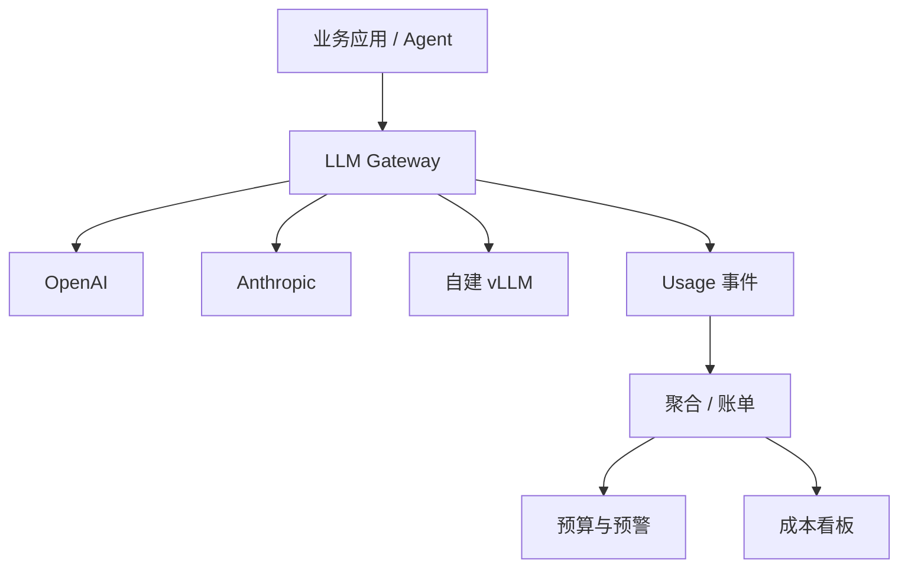
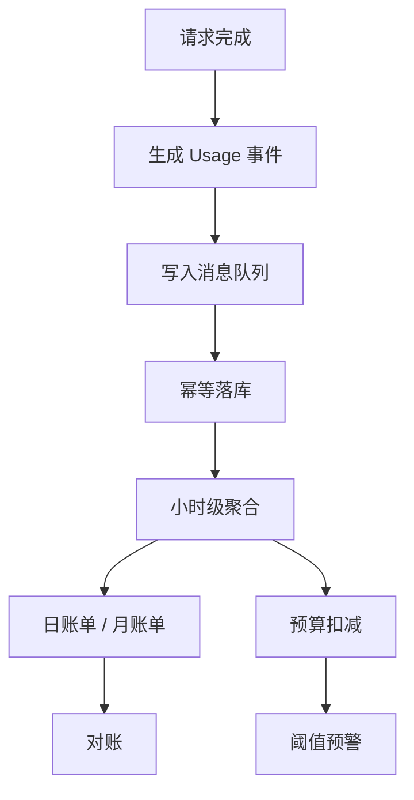

# 成本统计与预算预警

大模型账单最常见的两种事故：**月底才发现超支**，以及**超支了但不知道是谁用的**。前者是预警缺失，后者是归因缺失。网关是补上这两块的最佳位置——所有请求都从这里过，也只有这里同时掌握「谁在用、用的哪个模型、用了多少 token」。

## 先说结论

- **成本统计的主键是请求，不是账单**。每条请求落一条 usage 事件，账单是事件的聚合结果。
- **流式请求也要拿 usage**：OpenAI 系加 `stream_options: {"include_usage": true}`，Anthropic/Gemini 在流末尾有独立事件。
- **价格不要写死在代码里**，用一张可按模型、按时间生效的价格表。
- **预算检查放在转发之前，扣减放在响应之后**。先查后扣会有并发穿透，必须用「预留 + 结算」。
- **内部账和供应商账一定对不上**，差异要能解释，而不是假装相等。

## 为什么放在网关



如果让每个业务自己记账，会出现三个必然问题：

1. **口径不一致**：有人算输入输出，有人只算输出，有人按字符估算。
2. **漏记**：异步任务、失败重试、后台批处理最容易被漏掉。
3. **无法对账**：你不知道内部数字和供应商账单差在哪。

网关统一记账后，业务只需要在请求头里带上归属信息，剩下的交给平台。

## 第一步：把 usage 拿全

### 非流式响应

主流厂商都会在响应体里返回 usage，字段名不同但语义一致：

| 厂商 | 输入字段 | 输出字段 | 缓存字段 | 备注 |
| --- | --- | --- | --- | --- |
| OpenAI | `prompt_tokens` | `completion_tokens` | `prompt_tokens_details.cached_tokens` | 推理模型另有 `reasoning_tokens` |
| Anthropic | `input_tokens` | `output_tokens` | `cache_read_input_tokens` / `cache_creation_input_tokens` | 缓存写入通常更贵 |
| Gemini | `promptTokenCount` | `candidatesTokenCount` | `cachedContentTokenCount` | 字段在 `usageMetadata` 下 |
| DeepSeek | `prompt_tokens` | `completion_tokens` | `prompt_cache_hit_tokens` / `prompt_cache_miss_tokens` | 命中与未命中分别计价 |
| vLLM / SGLang | `prompt_tokens` | `completion_tokens` | 取决于前缀缓存配置 | 自建通常无金额，只记 token |

::: tip 不要自己估算 token
`len(text) / 4` 这类估算只适合做限流的粗预估，**绝不能用于计费**。计费一律以响应返回的 usage 为准；拿不到 usage 时记 `usage_missing` 并告警，而不是猜一个数。
:::

### 流式响应

流式默认不返回 usage。OpenAI 兼容接口需要显式开启：

```json
{
  "model": "gpt-4o-mini",
  "stream": true,
  "stream_options": { "include_usage": true },
  "messages": [{ "role": "user", "content": "你好" }]
}
```

开启后，最后一个 chunk 的 `choices` 为空、`usage` 有值。转发时**不要把这个 chunk 丢掉**——它对客户端无害（大多数 SDK 会忽略空 choices），但对计费是必需的。

Anthropic 的流式在 `message_delta` 事件里带 `usage`；Gemini 在最后一个 chunk 的 `usageMetadata` 里。适配层要做的是：**在流结束时产出一个统一的 Usage 对象**，而不是让上层去认各家字段。

```python
from dataclasses import dataclass


@dataclass
class Usage:
    input_tokens: int = 0
    output_tokens: int = 0
    cached_input_tokens: int = 0
    cache_write_tokens: int = 0
    reasoning_tokens: int = 0

    @property
    def total_tokens(self) -> int:
        return self.input_tokens + self.output_tokens
```

### 流中断了怎么算

客户端断开、上游超时、网关重启，都可能让流没有正常结束。这时的原则是：

| 情况 | 计费策略 |
| --- | --- |
| 已收到 usage 后断开 | 按 usage 正常计费 |
| 未收到 usage，但已输出部分内容 | 输入按请求估算，输出按已转发 chunk 估算，标记 `usage_estimated` |
| 连接建立前失败 | 不计费，记一条失败事件用于分析 |
| 上游 429 且未产生 token | 不计费 |

关键不是算得多准，而是**每一类都要有明确规则，且规则可查询**。

## 第二步：价格表

价格会变、会分时段、会有阶梯，所以价格必须是数据而不是常量：

```python
from dataclasses import dataclass
from datetime import date
from decimal import Decimal


@dataclass(frozen=True)
class Price:
    model: str
    effective_from: date
    input_per_mtok: Decimal        # 每百万输入 token 的价格
    output_per_mtok: Decimal
    cached_input_per_mtok: Decimal | None = None
    cache_write_per_mtok: Decimal | None = None
    currency: str = "USD"


PRICE_BOOK: list[Price] = [
    Price("gpt-4o-mini", date(2025, 1, 1), Decimal("0.15"), Decimal("0.60"),
          cached_input_per_mtok=Decimal("0.075")),
    Price("claude-sonnet", date(2025, 1, 1), Decimal("3.00"), Decimal("15.00"),
          cached_input_per_mtok=Decimal("0.30"),
          cache_write_per_mtok=Decimal("3.75")),
]


def resolve_price(model: str, on: date) -> Price:
    candidates = [p for p in PRICE_BOOK if p.model == model and p.effective_from <= on]
    if not candidates:
        raise LookupError(f"no price for model={model} on={on}")
    return max(candidates, key=lambda p: p.effective_from)
```

几个容易踩的坑：

- **币种**：供应商账单可能是 USD，你的租户合同是 CNY。汇率要单独存一张表，按账单日锁定，不要用实时汇率回算历史。
- **缓存价是分档的**：命中缓存通常便宜 50%–90%，缓存写入可能比普通输入更贵。只按 `input × price` 算会系统性高估或低估。
- **阶梯价**：部分厂商按月度用量分档。若你的量足够大，价格计算要支持「分段累进」而不是「一刀切」。
- **多模态**：图片按分辨率折算 token，音频按秒计价，别把它们混进文本 token。

## 第三步：成本公式

```python
from decimal import Decimal


def compute_cost(usage: Usage, price: Price) -> Decimal:
    cached = usage.cached_input_tokens
    uncached = max(usage.input_tokens - cached, 0)

    cached_rate = price.cached_input_per_mtok or price.input_per_mtok
    write_rate = price.cache_write_per_mtok or price.input_per_mtok

    cost = (
        Decimal(uncached) * price.input_per_mtok
        + Decimal(cached) * cached_rate
        + Decimal(usage.cache_write_tokens) * write_rate
        + Decimal(usage.output_tokens) * price.output_per_mtok
    ) / Decimal(1_000_000)

    return cost.quantize(Decimal("0.000001"))
```

注意 `reasoning_tokens`：OpenAI 的推理 token 通常已包含在 `completion_tokens` 里，**不要重复加**。Anthropic 的 `thinking` token 计入 `output_tokens`。以官方文档为准，并在代码里写一条断言或注释说明你的处理方式。

## 第四步：归因维度

一笔成本要能回答「谁、在什么场景、通过哪条链路花的」：

| 维度 | 来源 | 用途 |
| --- | --- | --- |
| `tenant_id` | API Key 绑定 | 分租户账单 |
| `project_id` | Key 或请求头 | 项目成本 |
| `key_id` | 认证结果 | 定位泄露/滥用 |
| `feature` | 请求头 `X-Feature` | 产品线成本 |
| `model_alias` | 请求体 | 用户视角的模型 |
| `model_target` | 路由结果 | 实际调用的是哪家 |
| `route_group` | 路由结果 | 降级/备份链路的成本占比 |
| `run_id` / `trace_id` | 请求头 | 关联到一次 Agent 任务 |
| `cache_hit` | 缓存层 | 省下多少钱 |

`feature` 这类字段**不能信任客户端随便传**，要校验白名单，否则归因数据会被污染。更稳妥的做法是从 Key 的元数据里带出来。

## 第五步：计费流水线



### 事件结构

```json
{
  "event_id": "ue_01J8Z3K4",
  "request_id": "req_9f2c1a",
  "occurred_at": "2026-10-30T12:34:56.789Z",
  "tenant_id": "t_1001",
  "project_id": "p_42",
  "key_id": "key_7d",
  "feature": "chat",
  "model_alias": "chat-default",
  "model_target": "deepseek-chat",
  "provider": "deepseek",
  "input_tokens": 1832,
  "output_tokens": 517,
  "cached_input_tokens": 1024,
  "usage_source": "upstream",
  "status": 200,
  "latency_ms": 2380,
  "ttft_ms": 410,
  "cost_usd": "0.001284",
  "price_version": "2025-01-01"
}
```

`usage_source` 很关键：`upstream` 表示来自厂商返回，`estimated` 表示网关估算，`missing` 表示拿不到。报表里要能按它拆分，否则财务会问你为什么有两套数。

### 幂等

重试、队列重投、补数脚本都会导致重复事件。用 `request_id` 做唯一键，落库用 `ON CONFLICT DO NOTHING`：

```sql
CREATE TABLE usage_events (
  event_id        TEXT PRIMARY KEY,
  request_id      TEXT NOT NULL,
  occurred_at     TIMESTAMPTZ NOT NULL,
  tenant_id       TEXT NOT NULL,
  project_id      TEXT,
  key_id          TEXT,
  feature         TEXT,
  model_alias     TEXT NOT NULL,
  model_target    TEXT NOT NULL,
  provider        TEXT NOT NULL,
  input_tokens    BIGINT NOT NULL DEFAULT 0,
  output_tokens   BIGINT NOT NULL DEFAULT 0,
  cached_input_tokens BIGINT NOT NULL DEFAULT 0,
  usage_source    TEXT NOT NULL,
  status          INT NOT NULL,
  latency_ms      INT,
  ttft_ms         INT,
  cost_usd        NUMERIC(18, 8) NOT NULL,
  price_version   TEXT NOT NULL,
  UNIQUE (request_id)
);

CREATE INDEX idx_usage_tenant_time ON usage_events (tenant_id, occurred_at);
CREATE INDEX idx_usage_model_time ON usage_events (model_target, occurred_at);
```

日聚合表用于看板和预算，避免每次都扫明细：

```sql
CREATE TABLE usage_daily (
  day         DATE NOT NULL,
  tenant_id   TEXT NOT NULL,
  model_target TEXT NOT NULL,
  requests    BIGINT NOT NULL,
  input_tokens  BIGINT NOT NULL,
  output_tokens BIGINT NOT NULL,
  cached_tokens BIGINT NOT NULL,
  cost_usd    NUMERIC(18, 6) NOT NULL,
  PRIMARY KEY (day, tenant_id, model_target)
);
```

聚合任务要**可重跑**：按天重算并覆盖，而不是增量累加。增量累加一旦出错，修起来非常痛苦。

## 第六步：预算与预警

### 三级预算

| 层级 | 作用 | 超限行为 |
| --- | --- | --- |
| 租户月预算 | 合同额度 | 硬限流或降级到便宜模型 |
| 项目/环境预算 | 防止测试环境烧钱 | 告警 + 限速 |
| Key 日预算 | 防止泄露被刷 | 直接封禁 |

### 预留 + 结算

只在请求结束后扣减，会导致并发请求全部通过检查。正确做法是两步：

```python
async def reserve_budget(redis, tenant_id: str, estimate_usd: float) -> str | None:
    """返回预留 id；预算不足返回 None。"""
    key = f"budget:{tenant_id}:{today()}"
    remaining = await redis.eval(RESERVE_LUA, 1, key, estimate_usd)
    if remaining is None:
        return None
    return f"rsv_{uuid4().hex[:12]}"


async def settle_budget(redis, tenant_id: str, reserved: float, actual: float) -> None:
    key = f"budget:{tenant_id}:{today()}"
    await redis.eval(SETTLE_LUA, 1, key, reserved, actual)
```

`RESERVE_LUA` 做的是「读余额 → 判断 → 扣预估」，`SETTLE_LUA` 做的是「退回预估 → 扣实际」。预估用「输入 token + 最大输出 token」算上界，宁可多留一点。

::: warning 预估不能太离谱
按 `max_tokens` 全额预留会让并发能力被严重低估。更实用的做法是：按最近同类请求 P95 输出长度预估，并给单请求设上限；超出上限的请求走人工审批或单独配额。
:::

### 阈值设计

| 阈值 | 动作 |
| --- | --- |
| 50% | 看板标记，周报提示 |
| 80% | 通知租户负责人，非生产环境开始限速 |
| 95% | 生产环境降级到便宜模型，通知平台值班 |
| 100% | 硬停或仅允许白名单 Key |

告警要带上下文：当前花费、预算、预计月底花费（按当前速率外推）、Top 3 消耗来源。只发一句「已超 80%」等于没发。

### 预算与限流的关系

预算不是限流的替代品。限流保护**上游容量**，预算保护**钱包**。两者都要有，且预算检查应该发生在限流之后、转发之前——先便宜地拒绝，再做贵的判断。

## 第七步：对账

内部账和供应商账对不上是常态，差异通常来自：

| 差异来源 | 表现 | 处理 |
| --- | --- | --- |
| 时区 | 月初/月末差一天的量 | 统一用 UTC 或账单时区，明确写进文档 |
| 重试 | 内部记一次，供应商记两次（或反之） | 按供应商实际请求计费，重试单独标记 |
| 缓存计价 | 内部按普通输入算 | 修正价格表，补缓存字段 |
| 未返回 usage | 内部估算 | 标记 `estimated`，单独统计偏差 |
| 免费额度/赠金 | 供应商账单已抵扣 | 内部账单独记录抵扣项 |
| 汇率 | 用实时汇率回算 | 锁定账单日汇率 |

对账流程建议：**每日小对账（按模型比 token 量），每月大对账（按金额比）**。差异超过 2% 就查，不要等到季度审计。

```sql
-- 每日按模型对比：内部 token 量 vs 供应商账单导入量
SELECT
  i.model_target,
  i.input_tokens  AS internal_input,
  v.input_tokens  AS vendor_input,
  ROUND((i.input_tokens - v.input_tokens)::numeric / NULLIF(v.input_tokens, 0) * 100, 2) AS diff_pct
FROM usage_daily i
JOIN vendor_daily v
  ON v.day = i.day AND v.model = i.model_target
WHERE i.day = CURRENT_DATE - 1
ORDER BY ABS(i.input_tokens - v.input_tokens) DESC;
```

## 第八步：异常检测

成本异常往往早于业务异常暴露问题：

- **单请求成本突增**：上下文被拼进了整份文档，或输出长度失控。
- **某 Key 成本曲线陡增**：泄露或被脚本刷。
- **缓存命中率下降**：prompt 前缀被动态内容污染（见[缓存](./caching.md)）。
- **重试率上升**：上游不稳定，失败请求也在烧配额。
- **同一 `run_id` 调用次数异常**：Agent 陷入循环。

这些都可以用简单规则实现，不必上复杂模型：

```python
def detect_anomaly(current: float, baseline_p95: float) -> str | None:
    if baseline_p95 <= 0:
        return None
    ratio = current / baseline_p95
    if ratio >= 10:
        return "critical"
    if ratio >= 3:
        return "warning"
    return None
```

基线用同租户、同模型、同时段的 P95，比全局均值更敏感也更少误报。

## 看板该看什么

| 指标 | 说明 |
| --- | --- |
| 日成本 / 月累计 | 最基础，按租户和模型拆分 |
| 单位成本 | 每千次请求成本、每百万 token 成本 |
| 缓存节省 | `按无缓存价格计算 - 实际成本` |
| 成本分布 | Top 10 租户/项目占比 |
| 预算消耗率 | 已用 / 预算，附外推值 |
| `usage_source` 占比 | 估算占比越高，账越不可信 |
| 失败请求成本 | 4xx/5xx 仍可能产生 token |

一张月度账单示例：

| 项目 | 请求数 | 输入 token | 输出 token | 缓存命中 | 金额 (USD) |
| --- | ---: | ---: | ---: | ---: | ---: |
| 智能客服 | 1,284,300 | 812M | 96M | 61% | 1,842.60 |
| 代码助手 | 402,115 | 1,930M | 210M | 44% | 4,918.22 |
| 内部知识库 | 88,402 | 310M | 22M | 72% | 402.15 |
| 测试环境 | 51,003 | 74M | 9M | 12% | 96.40 |
| **合计** | **1,825,820** | **3,126M** | **337M** | — | **7,259.37** |

## 反模式

| 反模式 | 后果 |
| --- | --- |
| 用字符数估算计费 | 账目系统性偏差，无法对账 |
| 价格硬编码在业务代码 | 调价要发版，历史账无法复算 |
| 只在响应成功后记账 | 流中断、超时的成本全部丢失 |
| 预算检查与扣减分离且无预留 | 并发下超支数倍 |
| 聚合表增量累加 | 一次错误永久污染 |
| 只看总额不看 `model_target` | 降级链路悄悄变贵却无人发现 |

## Checklist

- [ ] 非流式与流式都能拿到 usage，拿不到时有 `usage_source` 标记
- [ ] 价格表可按模型、按生效日期查询，缓存价单独配置
- [ ] 成本计算使用 `Decimal`，保留足够精度
- [ ] 事件以 `request_id` 幂等落库
- [ ] 归因字段齐全，且 `feature` 等字段来自可信来源
- [ ] 预算采用预留 + 结算，覆盖并发场景
- [ ] 50/80/95/100% 四档告警，通知带外推与 Top 来源
- [ ] 日聚合可重跑，支持按天覆盖
- [ ] 每日对账任务运行，差异有解释
- [ ] 看板包含单位成本、缓存节省与失败请求成本

## 下一篇

成本算清楚之后，下一步是让它**可观测**：一条请求慢在哪、错在哪、钱花在哪，都应该能在同一条链路里看到。

下一篇：[日志与链路追踪](../03-observability/logging-tracing.md)。
