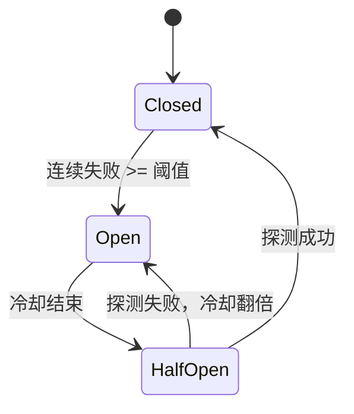

# 重试、熔断、降级与兜底

故障处理最怕两种极端：**什么都不做**，和**什么都重试**。前者让一次抖动变成一次故障，后者让一次故障变成一次雪崩。

这一篇给出一套有边界的容错策略。

## 失败分类

| 失败 | 是否重试 | 处理 |
| --- | --- | --- |
| DNS / TCP / TLS 失败 | ✅ | 换目标或退避重试 |
| 连接超时 | ✅ | 同上 |
| 首 Token 超时 | ✅（首字节前） | 换目标 |
| 408 / 504 | ✅ | 退避重试 |
| 429 | ✅ | 尊重 `Retry-After`，计入重试预算 |
| 500 / 502 / 503 | ✅ | 换目标或退避 |
| 400 / 422 | ❌ | 请求问题，重试无用 |
| 401 / 403 | ❌ | 配置/权限问题，必须暴露 |
| 404 | ❌ | 模型或路由配置错误 |
| 内容过滤 | ❌ | 策略拦截 |
| 流开始后中断 | ❌ | 无法回滚，只能报错 |
| 客户端主动断开 | ❌ | 立即取消上游，停止计费 |

::: warning 可重试 ≠ 应该重试
还要看：请求是否已产生费用、是否已发送给用户、当前重试率是否过高、租户是否还有预算。
:::

## 重试：指数退避 + 全抖动

固定间隔重试会让所有副本在同一时刻再次冲击上游。推荐 **full jitter**：

```python
import asyncio
import random

class RetryableError(Exception):
    def __init__(self, message: str, retry_after: float | None = None):
        self.message = message
        self.retry_after = retry_after

async def call_with_retry(fn, attempts: int = 3, base_delay: float = 0.3, max_delay: float = 5.0):
    last_error: Exception | None = None

    for attempt in range(1, attempts + 1):
        try:
            return await fn()
        except RetryableError as exc:
            last_error = exc
            if attempt == attempts:
                break
            delay = min(max_delay, base_delay * (2 ** (attempt - 1)))
            if exc.retry_after is not None:
                delay = max(delay, min(exc.retry_after, 30.0))
            await asyncio.sleep(random.uniform(0, delay))

    raise last_error or RuntimeError("retry failed")
```

| 尝试 | 指数延迟 | 全抖动范围 |
| --- | --- | --- |
| 1 → 2 | 0.3s | 0～0.3s |
| 2 → 3 | 0.6s | 0～0.6s |
| 3 → 4 | 1.2s | 0～1.2s |

### 重试预算

没有预算的重试，会把「10% 的失败」放大成「30% 的额外流量」。建议：

- 单请求最多 2 次重试；
- 全局重试率超过 10% 时，停止自动重试，只做故障切换；
- 按租户限制重试次数，避免单个用户放大；
- 流式请求只在首字节前重试。

## 熔断：给坏目标一个冷静期



```python
import asyncio
import time

class CircuitBreaker:
    def __init__(self, failure_threshold: int = 3, recovery_timeout: float = 15.0):
        self.failure_threshold = failure_threshold
        self.recovery_timeout = recovery_timeout
        self.failures = 0
        self.opened_at = 0.0
        self.state = "closed"
        self._lock = asyncio.Lock()

    async def allow(self) -> bool:
        async with self._lock:
            if self.state == "closed":
                return True
            if self.state == "open" and time.monotonic() - self.opened_at >= self.recovery_timeout:
                self.state = "half_open"
                return True
            return False

    async def success(self) -> None:
        async with self._lock:
            self.state = "closed"
            self.failures = 0

    async def failure(self) -> None:
        async with self._lock:
            self.failures += 1
            if self.state == "half_open" or self.failures >= self.failure_threshold:
                self.state = "open"
                self.opened_at = time.monotonic()
                self.recovery_timeout = min(self.recovery_timeout * 2, 300.0)
```

生产注意：

- 熔断维度：`target + model`，不要按厂商一刀切；
- 状态跨副本共享（Redis），否则每个副本各自试探；
- 半开只放 1 个探测请求，成功后再逐步放量；
- 429 不应直接把熔断打开，它通常代表「暂时限流」。

## 兜底：切过去之后还能用吗

兜底链最容易犯的错，是**只考虑可用性，不考虑能力**。

| 请求需要 | 主模型 | 备用模型 | 能否兜底 |
| --- | --- | --- | --- |
| 普通文本 | ✅ | ✅ | 可以 |
| 工具调用 | ✅ | ✅ | 需映射工具 schema |
| 视觉输入 | ✅ | ❌ | 不能，必须提前过滤 |
| 严格 JSON | ✅ | 仅文本 | 降级并标记，或直接失败 |
| 超长上下文 | ✅ | 窗口更小 | 不能，按标签路由 |

建议在路由配置里声明能力：

```json
{
  "model": "gpt-4o-mini",
  "tags": ["fast", "tools", "vision"],
  "fallback_of": null
}
```

请求携带 `required_tags`，只有满足全部标签的目标才能进入兜底链。

### 兜底也要有成本上限

备用模型可能更贵。兜底策略要回答：

- 单次请求费用上限是多少？
- 故障持续 30 分钟，额外成本预算是多少？
- 是否要对非关键业务先降级，而不是直接切到高价模型？

::: danger 静默降级是信任杀手
从 GPT-4o 切到小模型，用户可能察觉不到一次，但长期会问「为什么最近回答变差了」。响应头加 `x-fallback: true`，日志记录原因，业务侧可决定是否提示用户。
:::

## 降级：比切模型更细的手段

| 手段 | 适用 | 代价 |
| --- | --- | --- |
| 降低 `max_tokens` | 长回答超时 | 回答变短 |
| 切更便宜的模型 | 成本/容量压力 | 质量下降 |
| 关闭工具调用 | 工具上游故障 | 能力受限 |
| 关闭流式 | 流式链路异常 | 首屏变慢 |
| 排队 + 延后 | 短时峰值 | 延迟上升 |
| 静态兜底话术 | 全面故障 | 无智能 |

降级要有**明确开关**和**恢复条件**，不要写成永久的 `if error: return "稍后再试"`。

## 对冲请求（Hedged Requests）

对延迟极其敏感、且成本可接受的场景，可以在 p95 延迟后向第二个目标再发一次，谁先返回用谁，取消另一个。

```text
t=0     发往 A
t=p95   仍未首 Token，发往 B
t=x     A 返回 -> 取消 B
```

代价是成本上升、上游压力翻倍。只建议用于：

- 非流式、短输出；
- 无副作用；
- 有严格延迟 SLO；
- 对冲比例受控（例如只对 5% 的慢请求）。

## 舱壁隔离

不要让一个租户或一个上游拖垮全部：

- 每个上游目标独立连接池与并发信号量；
- 每个租户独立并发上限；
- 大客户使用独立目标或独立实例；
- 队列按租户隔离，避免一个租户排满全局队列。

## 故障演练清单

容错能力不是写出来的，是演练出来的：

- [ ] 把主模型 Key 改错：是否快速失败，且不会错误切流？
- [ ] 让上游返回 503：是否在 N 秒内切换，日志是否清晰？
- [ ] 让首 Token 延迟 30 秒：是否触发首 Token 超时？
- [ ] 流式中途断开：客户端是否收到错误事件？
- [ ] 制造 429 风暴：重试是否被预算限制？
- [ ] Redis 宕机：限流是 fail-open 还是 fail-closed？是否符合预期？
- [ ] 关闭一个副本：流式连接是否优雅迁移/重连？

每次演练记录：检测时间、切换时间、错误率峰值、成本变化、恢复时间。

## 检查清单

- [ ] 可重试错误与不可重试错误分开
- [ ] 重试有次数上限、指数退避、全抖动
- [ ] 尊重 `Retry-After`，有全局重试预算
- [ ] 熔断按 target + model，支持半开
- [ ] 熔断状态跨副本共享
- [ ] 兜底链按能力标签匹配
- [ ] 兜底有成本上限与可观测标记
- [ ] 降级有开关、有恢复条件
- [ ] 每个上游/租户有舱壁隔离
- [ ] 每季度至少一次故障演练

下一篇：[成本统计与预算预警](./cost.md)，把「烧了多少钱」算清楚。
