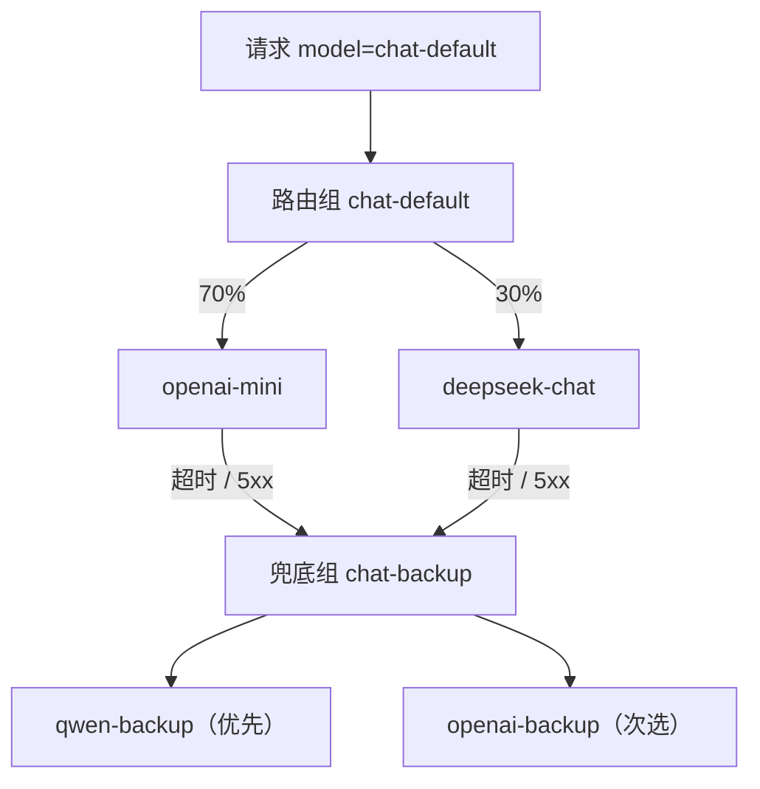
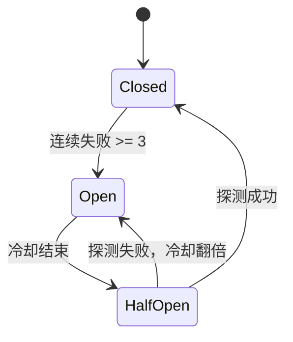

# 路由模式：权重、标签与切流

「多接几家模型」只是采购动作。真正的路由要回答四个问题：

1. 这次请求**应该**去哪个模型？
2. 去不了时，**谁能接**？
3. 怎么判断「去不了」？
4. 切过去以后，**质量与成本**还能接受吗？

这一篇用一个可运行的路由网关把这四件事串起来。

## 先分清四个概念

| 概念 | 作用 | 示例 |
| --- | --- | --- |
| 模型别名 | 客户端看到的稳定名字 | `chat-default` |
| 目标（Target） | 一个可调用的上游模型 | `openai-mini`、`deepseek-chat` |
| 路由组（Group） | 一组目标 + 策略 + 兜底 | `chat-default`、`chat-backup` |
| 健康状态 | 目标当前是否可用 | closed / open / half-open |

::: tip 模型别名是解耦的关键
业务代码只认 `chat-default`。今天它指向 GPT-4o mini，明天可以换成 DeepSeek，客户端一行不改。没有别名，路由就只是「在业务里写 if」。
:::

## 四种常用策略

| 策略 | 适用 | 关键点 |
| --- | --- | --- |
| 权重 | 灰度、成本分摊、A/B | 权重不是配额，不能替代限流 |
| 标签 | 能力、区域、合规、价格档 | 标签要少而稳定，别做成自由文本 |
| 优先级 | 主备、兜底链 | 后备模型必须能力对齐 |
| 粘性 | Prompt/KV Cache、会话一致性 | 故障切换会破坏缓存亲和性 |



## 完整 Demo

### 目录

```text
router-gateway/
├── router_gateway.py
├── routes.json
└── requirements.txt
```

`requirements.txt`：

```text
fastapi>=0.115
uvicorn[standard]>=0.30
httpx>=0.27
```

### 配置文件

`routes.json`。真实密钥不写在这里，只写环境变量名：

```json
{
  "targets": {
    "openai-mini": {
      "base_url": "https://api.openai.com/v1",
      "api_key_env": "OPENAI_API_KEY",
      "model": "gpt-4o-mini",
      "weight": 70,
      "priority": 1,
      "tags": ["fast", "cheap", "tools"]
    },
    "deepseek-chat": {
      "base_url": "https://api.deepseek.com/v1",
      "api_key_env": "DEEPSEEK_API_KEY",
      "model": "deepseek-chat",
      "weight": 30,
      "priority": 1,
      "tags": ["cheap", "cn", "tools"]
    },
    "qwen-backup": {
      "base_url": "https://dashscope.aliyuncs.com/compatible-mode/v1",
      "api_key_env": "DASHSCOPE_API_KEY",
      "model": "qwen-plus",
      "weight": 1,
      "priority": 1,
      "tags": ["fast", "cn", "tools"]
    },
    "openai-backup": {
      "base_url": "https://api.openai.com/v1",
      "api_key_env": "OPENAI_API_KEY",
      "model": "gpt-4o",
      "weight": 1,
      "priority": 2,
      "tags": ["fast", "quality", "tools"]
    }
  },
  "groups": {
    "chat-default": {
      "strategy": "weighted",
      "targets": ["openai-mini", "deepseek-chat"],
      "fallbacks": ["chat-backup"]
    },
    "chat-backup": {
      "strategy": "priority",
      "targets": ["qwen-backup", "openai-backup"]
    }
  }
}
```

### 网关代码

`router_gateway.py`：

```python
"""一个带权重、标签、健康检查与兜底链的最小路由网关。"""

from __future__ import annotations

import json
import os
import random
import time
import uuid
from contextlib import asynccontextmanager
from dataclasses import dataclass, field
from pathlib import Path
from typing import AsyncIterator

import httpx
from fastapi import FastAPI, Request
from fastapi.responses import JSONResponse, Response, StreamingResponse

CONFIG_PATH = Path(os.getenv("ROUTES_FILE", "routes.json"))
MAX_ATTEMPTS = int(os.getenv("MAX_ATTEMPTS", "3"))
FAILURE_THRESHOLD = 3
BASE_COOLDOWN_S = 15.0
MAX_COOLDOWN_S = 300.0
TIMEOUT = httpx.Timeout(connect=5.0, read=300.0, write=30.0, pool=5.0)


@dataclass
class Target:
    name: str
    base_url: str
    api_key_env: str
    model: str
    weight: int = 1
    priority: int = 100
    tags: set[str] = field(default_factory=set)

    @property
    def api_key(self) -> str:
        return os.getenv(self.api_key_env, "")


@dataclass
class Group:
    name: str
    strategy: str
    targets: list[str]
    fallbacks: list[str] = field(default_factory=list)


@dataclass
class TargetState:
    failures: int = 0
    open_until: float = 0.0
    cooldown_s: float = BASE_COOLDOWN_S

    def available(self) -> bool:
        return time.monotonic() >= self.open_until

    def record_success(self) -> None:
        self.failures = 0
        self.open_until = 0.0
        self.cooldown_s = BASE_COOLDOWN_S

    def record_failure(self) -> None:
        self.failures += 1
        if self.failures >= FAILURE_THRESHOLD:
            self.open_until = time.monotonic() + self.cooldown_s
            self.cooldown_s = min(self.cooldown_s * 2, MAX_COOLDOWN_S)


def load_config(path: Path):
    raw = json.loads(path.read_text(encoding="utf-8"))
    targets = {
        name: Target(
            name=name,
            base_url=cfg["base_url"].rstrip("/"),
            api_key_env=cfg["api_key_env"],
            model=cfg["model"],
            weight=cfg.get("weight", 1),
            priority=cfg.get("priority", 100),
            tags=set(cfg.get("tags", [])),
        )
        for name, cfg in raw["targets"].items()
    }
    groups = {
        name: Group(
            name=name,
            strategy=cfg.get("strategy", "weighted"),
            targets=cfg["targets"],
            fallbacks=cfg.get("fallbacks", []),
        )
        for name, cfg in raw["groups"].items()
    }
    return targets, groups


TARGETS, GROUPS = load_config(CONFIG_PATH)
STATES = {name: TargetState() for name in TARGETS}

client: httpx.AsyncClient | None = None


@asynccontextmanager
async def lifespan(app: FastAPI):
    global client
    client = httpx.AsyncClient(timeout=TIMEOUT)
    yield
    await client.aclose()


app = FastAPI(title="llm-router-demo", lifespan=lifespan)


class GatewayError(Exception):
    def __init__(self, status: int, code: str, message: str, retryable: bool = False):
        self.status = status
        self.code = code
        self.message = message
        self.retryable = retryable


@app.exception_handler(GatewayError)
async def gateway_error_handler(request: Request, exc: GatewayError):
    request_id = getattr(request.state, "request_id", "req_unknown")
    return JSONResponse(
        status_code=exc.status,
        headers={"x-request-id": request_id},
        content={
            "error": {
                "message": exc.message,
                "type": "gateway_error",
                "code": exc.code,
                "retryable": exc.retryable,
                "request_id": request_id,
            }
        },
    )


@app.middleware("http")
async def attach_request_id(request: Request, call_next):
    request.state.request_id = (
        (request.headers.get("x-request-id") or "").strip()[:128]
        or f"req_{uuid.uuid4().hex[:16]}"
    )
    response = await call_next(request)
    response.headers["x-request-id"] = request.state.request_id
    return response


def pick(group: Group, tags: set[str], exclude: set[str]) -> Target | None:
    pool = [
        TARGETS[name]
        for name in group.targets
        if name not in exclude
        and STATES[name].available()
        and tags.issubset(TARGETS[name].tags)
    ]
    if not pool:
        return None
    if group.strategy == "priority":
        return min(pool, key=lambda item: item.priority)
    return random.choices(pool, weights=[max(item.weight, 1) for item in pool])[0]


def attempt_plan(group: Group, tags: set[str], limit: int) -> list[Target]:
    """主组内按策略挑，失败后依次进入兜底组；同一次请求不重复目标。"""
    plan: list[Target] = []
    exclude: set[str] = set()

    def drain(current: Group) -> None:
        for _ in range(len(current.targets)):
            if len(plan) >= limit:
                return
            target = pick(current, tags, exclude)
            if target is None:
                return
            plan.append(target)
            exclude.add(target.name)

    drain(group)
    for fallback_name in group.fallbacks:
        fallback = GROUPS.get(fallback_name)
        if fallback is not None:
            drain(fallback)
        if len(plan) >= limit:
            break
    return plan


def retryable_status(status: int) -> bool:
    return status in (408, 429, 500, 502, 503, 504)


def upstream_message(raw: bytes) -> str:
    try:
        data = json.loads(raw)
        err = data.get("error", data)
        return str(err.get("message") or "Upstream request failed")[:300]
    except (json.JSONDecodeError, AttributeError):
        return raw.decode("utf-8", "replace")[:300]


def sse_error(code: str, message: str, request_id: str) -> bytes:
    payload = {"error": {"code": code, "message": message, "request_id": request_id}}
    return f"event: error\ndata: {json.dumps(payload, ensure_ascii=False)}\n\n".encode()


@app.get("/healthz")
async def healthz():
    return {
        "status": "ok",
        "targets": {
            name: {"available": state.available(), "failures": state.failures}
            for name, state in STATES.items()
        },
    }


@app.post("/v1/chat/completions")
async def chat_completions(request: Request):
    request_id = request.state.request_id
    try:
        body = await request.json()
    except json.JSONDecodeError as exc:
        raise GatewayError(400, "invalid_json", "Request body must be valid JSON.") from exc

    alias = body.get("model")
    group = GROUPS.get(alias)
    if group is None:
        raise GatewayError(
            404,
            "model_not_found",
            f"Unknown model alias '{alias}'. Available: {', '.join(sorted(GROUPS))}",
        )

    tags = {
        item.strip()
        for item in request.headers.get("x-route-tags", "").split(",")
        if item.strip()
    }
    stream = body.get("stream") is True
    plan = attempt_plan(group, tags, MAX_ATTEMPTS)
    if not plan:
        raise GatewayError(503, "no_target_available", "No target matches the requested tags.", True)

    assert client is not None
    failures: list[str] = []

    for attempt, target in enumerate(plan, start=1):
        if not target.api_key:
            failures.append(f"{target.name}:missing_key")
            continue

        payload = dict(body)
        payload["model"] = target.model
        headers = {
            "authorization": f"Bearer {target.api_key}",
            "content-type": "application/json",
            "x-request-id": request_id,
        }

        try:
            upstream = await client.send(
                client.build_request(
                    "POST",
                    f"{target.base_url}/chat/completions",
                    json=payload,
                    headers=headers,
                ),
                stream=stream,
            )
        except httpx.HTTPError as exc:
            STATES[target.name].record_failure()
            failures.append(f"{target.name}:{type(exc).__name__}")
            continue

        if upstream.status_code >= 400:
            raw = await upstream.aread()
            await upstream.aclose()
            message = upstream_message(raw)
            failures.append(f"{target.name}:{upstream.status_code}")
            if retryable_status(upstream.status_code):
                # 429 不直接熔断，避免把「暂时限流」误判成「长期不可用」
                if upstream.status_code != 429:
                    STATES[target.name].record_failure()
                continue
            if upstream.status_code in (401, 403):
                raise GatewayError(
                    502,
                    "upstream_auth_error",
                    "Upstream rejected the gateway credentials.",
                )
            raise GatewayError(upstream.status_code, "upstream_rejected", message)

        STATES[target.name].record_success()

        if not stream:
            data = await upstream.aread()
            await upstream.aclose()
            return Response(
                content=data,
                media_type="application/json",
                headers={
                    "x-gateway-target": target.name,
                    "x-gateway-attempts": str(attempt),
                },
            )

        async def relay(open_response: httpx.Response = upstream, chosen: Target = target):
            try:
                async for chunk in open_response.aiter_bytes():
                    yield chunk
            except httpx.HTTPError as exc:
                STATES[chosen.name].record_failure()
                yield sse_error("stream_interrupted", str(exc), request_id)
            finally:
                await open_response.aclose()

        return StreamingResponse(
            relay(),
            media_type="text/event-stream",
            headers={
                "cache-control": "no-cache, no-transform",
                "x-accel-buffering": "no",
                "x-gateway-target": target.name,
                "x-gateway-attempts": str(attempt),
            },
        )

    raise GatewayError(
        503,
        "all_targets_failed",
        f"All {len(plan)} targets failed: {', '.join(failures)}",
        retryable=True,
    )
```

::: warning 演示代码的边界
健康状态在单进程内存里，多副本会各自判断；没有持久化配额、没有鉴权、没有缓存。它的价值是让你看清路由决策的顺序，而不是直接上线。
:::

## 跑起来

先准备至少两个上游的密钥。只有一家也能跑，但看不到切换效果。

```bash
export OPENAI_API_KEY="sk-..."
export DEEPSEEK_API_KEY="sk-..."
export DASHSCOPE_API_KEY="sk-..."
export ROUTES_FILE="routes.json"

uvicorn router_gateway:app --port 8001
```

### 场景一：默认权重路由

```bash
for i in $(seq 1 10); do
  curl -s -D - http://127.0.0.1:8001/v1/chat/completions \
    -H "content-type: application/json" \
    -d '{"model":"chat-default","messages":[{"role":"user","content":"说一句话"}]}' \
    -o /dev/null | grep -i x-gateway-target
done
```

应该能看到 `openai-mini` 与 `deepseek-chat` 交替出现，比例大致 7:3。样本小的时候偏差很正常。

### 场景二：按标签路由

只要「国内、支持工具调用」的目标：

```bash
curl -i http://127.0.0.1:8001/v1/chat/completions \
  -H "content-type: application/json" \
  -H "x-route-tags: cn, tools" \
  -d '{"model":"chat-default","messages":[{"role":"user","content":"你好"}]}'
```

此时 `openai-mini` 不满足 `cn` 标签，会被过滤，只剩 `deepseek-chat`。

### 场景三：故障切流

把 `OPENAI_API_KEY` 改成一个无效值，然后只请求 `fast` 标签：

```bash
curl -i http://127.0.0.1:8001/v1/chat/completions \
  -H "content-type: application/json" \
  -H "x-route-tags: fast" \
  -d '{"model":"chat-default","messages":[{"role":"user","content":"你好"}]}'
```

预期行为：

1. 主组里只有 `openai-mini` 带 `fast`，先请求它；
2. 上游返回 401，不属于可重试状态，网关返回 `502 upstream_auth_error`——**不会盲目切到备用模型**。

这看起来「不够自动」，但很重要：**401 是配置错误，不是故障**。把配置错误切到备用模型，只会掩盖问题。

如果把上游改成一个返回 503 的地址，网关会重试并切到 `chat-backup` 的 `qwen-backup`，响应头里能看到：

```text
x-gateway-target: qwen-backup
x-gateway-attempts: 2
```

### 场景四：观察健康状态

```bash
curl -s http://127.0.0.1:8001/healthz | jq
```

连续失败达到阈值后，目标会进入冷却，`available` 变为 `false`；冷却结束后自动恢复尝试。

## 关键设计拆解

### 1. 权重不是配额

权重只决定「在没有其他约束时，请求被分到谁」。它不能阻止某个租户打满上游 RPM。

> 权重负责「分流」，限流负责「限量」，预算是「限钱」。三者要分开配置。

### 2. 哪些错误可以切流

| 上游结果 | 是否切流 | 原因 |
| --- | --- | --- |
| 连接失败 / DNS / TLS | ✅ | 目标不可达 |
| 408 / 504 | ✅ | 超时，可能换个目标更快 |
| 429 | ✅，但不熔断 | 限流是暂时的，换目标可能成功 |
| 500 / 502 / 503 | ✅ | 上游故障 |
| 400 / 422 | ❌ | 请求本身有问题，换谁都一样 |
| 401 / 403 | ❌ | 网关配置/权限问题，切流会掩盖 |
| 404 | ❌ | 模型名或路由配置错误 |
| 流已开始后中断 | ❌ | 无法回滚已发送的内容 |

这张表是路由正确性的核心。很多「自动容灾」事故，都是把 400 也当成故障切走了，导致问题被掩盖。

### 3. 熔断状态机



生产环境还要注意：

- 熔断状态要**按 target + model** 维度，不要一个厂商所有模型一起熔断；
- 多副本之间要共享健康状态（Redis），否则每个副本各自试探；
- 半开状态只放少量探测流量，避免恢复瞬间被打满。

### 4. 粘性路由与缓存

如果启用了 Prompt/KV Cache，同一个前缀最好落到同一个目标甚至同一个副本。可以按 `session_id` 做一致性哈希：

```python
def sticky_target(group: Group, session_id: str) -> Target:
    pool = [TARGETS[name] for name in group.targets if STATES[name].available()]
    if not pool:
        raise GatewayError(503, "no_target_available", "No healthy target.", True)
    index = hash(session_id) % len(pool)
    return pool[index]
```

代价是：故障切换会破坏缓存亲和性，命中率短期下降。**可用性优先，缓存次之**。

### 5. 兜底模型必须能力对齐

主模型支持工具调用、JSON Schema、视觉，备用模型不支持，切过去后 Agent 会直接崩。兜底链要按能力标签匹配：

```text
chat-default（tools, json, vision）
  └─ fallback: chat-backup（tools, json）        # 不支持 vision，视觉请求不进入
```

视觉请求应该在路由阶段就过滤掉不满足标签的目标，而不是切过去再报错。

## 离生产还差什么

| 缺口 | 建议 |
| --- | --- |
| 健康状态只在内存 | 用 Redis 共享，按副本聚合 |
| 没有配额 | 在路由前做 RPM/TPM 预检 |
| 没有总超时预算 | 每次尝试共享一个 deadline |
| 没有配置热更新 | 配置版本化，数据面只读快照 |
| 没有灰度 | 用 1% 权重 + 独立指标观察 |
| 没有成本约束 | 兜底模型设单次费用上限 |
| 没有鉴权 | 客户端密钥与租户身份 |

## 检查清单

- [ ] 客户端只依赖模型别名
- [ ] 权重、标签、优先级策略有明确使用场景
- [ ] 可切流错误与不可切流错误分开
- [ ] 429 不直接触发熔断
- [ ] 熔断按目标维度，有半开探测
- [ ] 兜底模型按能力标签匹配
- [ ] 健康状态可跨副本共享
- [ ] 响应头暴露 `x-gateway-target` 与尝试次数（便于排障）

## 下一步

路由解决「去哪」，缓存解决「能不能不去」：[缓存模式：结果、KV 与击穿防护](./caching.md)。
