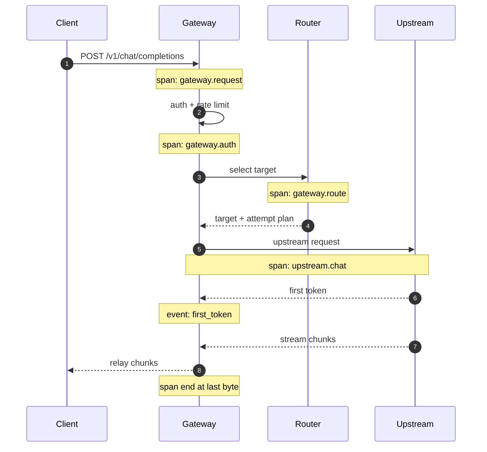

# 结构化日志与链路追踪

线上最难受的场景之一：用户截图说「刚才那次回答特别慢」，而你打开日志，只看到几百条没有上下文的 `INFO request completed`。没有 TraceId，没有模型名，没有阶段耗时——你只能道歉。

## 先说结论

- **一条请求 = 一个 TraceId = 一组结构化字段**，从入口一直带到上游。
- **日志记录「发生了什么」，Span 记录「时间花在哪」**，两者用同一个 ID 串起来。
- **prompt 默认不落日志**。要落就分级、脱敏、限长，并明确谁能看。
- **采样要分层**：成功请求低采样，错误与慢请求全采。
- **别把 metrics 塞进日志**。日志用于个体排查，指标用于整体趋势。

## 三类日志，不要混在一起

| 类型 | 内容 | 保留期 | 用途 |
| --- | --- | --- | --- |
| 访问日志 | 方法、路径、状态码、耗时、字节数 | 7–30 天 | 流量分析、计费核对 |
| 应用日志 | 阶段耗时、路由决策、重试、异常 | 7–30 天 | 排障 |
| 审计日志 | 谁在何时对哪个资源做了什么 | 180 天以上 | 合规、追责 |

审计日志和普通日志的写入路径应该分开：审计日志要求**不可篡改、不可丢失**，通常单独落库或写到专用存储，不能因为日志采样被丢掉。

## 统一字段

同一个字段名在网关的所有模块里必须一致。推荐的最小集合：

| 字段 | 示例 | 说明 |
| --- | --- | --- |
| `timestamp` | `2026-10-30T12:34:56.789Z` | 一律 UTC，ISO 8601 |
| `level` | `info` | `debug/info/warn/error` |
| `event` | `request.completed` | 稳定的事件名，便于聚合 |
| `trace_id` | `4bf92f3577b34da6a3ce929d0e0e4736` | W3C 32 位十六进制 |
| `span_id` | `00f067aa0ba902b7` | 当前 span |
| `request_id` | `req_9f2c1a` | 对外可见的请求 ID |
| `tenant_id` | `t_1001` | 租户 |
| `key_id` | `key_7d` | 凭证 |
| `model_alias` | `chat-default` | 用户请求的模型 |
| `model_target` | `deepseek-chat` | 实际调用的目标 |
| `provider` | `deepseek` | 供应商 |
| `stream` | `true` | 是否流式 |
| `status` | `200` | 返回给客户端的状态 |
| `upstream_status` | `200` | 上游状态 |
| `latency_ms` | `2380` | 总耗时 |
| `ttft_ms` | `410` | 首 token 耗时，非流式为 null |
| `attempt` | `1` | 第几次尝试 |
| `error_code` | `upstream_timeout` | 标准化错误码 |

`event` 用点号分层（`request.started`、`route.selected`、`upstream.retry`、`request.completed`），比自由文本好用得多——你可以在日志系统里直接按事件名做聚合和告警。

## 一条请求的 Span 划分



划分原则：**每个可能独立变慢或失败的阶段，都应该有自己的 span**。典型阶段包括认证、限流、缓存查询、路由选择、上游请求、流式转发、计费落库。

上游请求的 span 要记录：

- `gen_ai.system`（openai / anthropic / deepseek）
- `gen_ai.request.model`
- `gen_ai.response.model`（上游实际返回的模型，可能和请求不同）
- `gen_ai.usage.input_tokens` / `output_tokens`
- `http.response.status_code`
- `retry.count`

这些字段与 OpenTelemetry 的 GenAI 语义约定对齐，后面接 OTel 时不需要重做。

## TraceId 从哪来

三种来源，优先级从高到低：

1. **客户端传入的 W3C `traceparent`**：如果调用方已经在追踪，复用它，链路才能连起来。
2. **客户端传入的 `X-Request-Id`**：作为 `request_id`，但不要直接当 `trace_id`，格式和语义都不同。
3. **网关生成**：用 128 位随机数生成 `trace_id`，用 64 位生成 `span_id`。

```python
import secrets


def new_trace_id() -> str:
    return secrets.token_hex(16)


def new_span_id() -> str:
    return secrets.token_hex(8)


def parse_traceparent(value: str | None) -> tuple[str, str] | None:
    if not value:
        return None
    parts = value.split("-")
    if len(parts) != 4 or parts[0] != "00":
        return None
    trace_id, parent_id = parts[1], parts[2]
    if len(trace_id) != 32 or len(parent_id) != 16:
        return None
    return trace_id, parent_id
```

透传给上游时要谨慎：**不是所有供应商都接受 `traceparent`**，有些会因为有未知头而拒绝请求。安全做法是只透传 `X-Request-Id` 这类自定义头，或者按供应商白名单决定。

## 用 contextvars 贯穿异步调用

FastAPI + httpx 的异步链路里，最可靠的传递方式是 `contextvars`：

```python
import contextvars
import logging
import json
from datetime import datetime, timezone

_request_ctx: contextvars.ContextVar[dict] = contextvars.ContextVar("request_ctx", default={})


class JsonFormatter(logging.Formatter):
    def format(self, record: logging.LogRecord) -> str:
        payload = {
            "timestamp": datetime.now(timezone.utc).isoformat(timespec="milliseconds"),
            "level": record.levelname.lower(),
            "event": record.getMessage(),
            **_request_ctx.get(),
        }
        extra = getattr(record, "fields", None)
        if extra:
            payload.update(extra)
        if record.exc_info:
            payload["exception"] = self.formatException(record.exc_info)
        return json.dumps(payload, ensure_ascii=False)


logger = logging.getLogger("gateway")
logger.setLevel(logging.INFO)
handler = logging.StreamHandler()
handler.setFormatter(JsonFormatter())
logger.addHandler(handler)
logger.propagate = False
```

在中间件里设置上下文，并在请求结束时清空，避免协程复用导致串号：

```python
@app.middleware("http")
async def bind_context(request: Request, call_next):
    trace_id, parent_id = parse_traceparent(request.headers.get("traceparent")) or (
        new_trace_id(), None
    )
    request_id = request.headers.get("x-request-id") or f"req_{secrets.token_hex(6)}"
    token = _request_ctx.set(
        {
            "trace_id": trace_id,
            "parent_span_id": parent_id,
            "span_id": new_span_id(),
            "request_id": request_id,
            "path": request.url.path,
        }
    )
    try:
        response = await call_next(request)
        response.headers["x-request-id"] = request_id
        response.headers["traceparent"] = f"00-{trace_id}-{new_span_id()}-01"
        return response
    finally:
        _request_ctx.reset(token)
```

::: warning 子任务里的上下文
`asyncio.create_task` 会复制当前上下文，但如果你在线程池里跑同步代码，需要显式 `contextvars.copy_context().run(...)`。否则子任务日志里没有 `trace_id`，排查时会断链。
:::

## 阶段耗时怎么记

不要只在请求结束时打一条总耗时。用「阶段计时器」记录每段：

```python
import time


class PhaseTimer:
    def __init__(self) -> None:
        self._marks: dict[str, float] = {}
        self._start = time.perf_counter()

    def mark(self, name: str) -> None:
        self._marks[name] = time.perf_counter()

    @property
    def ttft_ms(self) -> int | None:
        if "first_token" not in self._marks:
            return None
        return int((self._marks["first_token"] - self._start) * 1000)

    def elapsed_ms(self, name: str | None = None) -> int:
        end = self._marks.get(name) if name else time.perf_counter()
        return int(((end or time.perf_counter()) - self._start) * 1000)
```

请求结束时一次性输出：

```python
logger.info(
    "request.completed",
    extra={
        "fields": {
            "model_target": target.name,
            "provider": target.provider,
            "stream": body.get("stream", False),
            "status": status,
            "upstream_status": upstream_status,
            "latency_ms": timer.elapsed_ms(),
            "ttft_ms": timer.ttft_ms,
            "attempt": attempt,
            "error_code": error_code,
        }
    },
)
```

这样一条日志就能回答：走的哪个模型、第几次尝试、首 token 多久、总共多久、错在哪。

## prompt 要不要记

这是最容易出事的地方。建议分三档：

| 档位 | 内容 | 适用 |
| --- | --- | --- |
| L0 默认 | 只记 token 数、消息条数、是否含工具 | 所有生产环境 |
| L1 脱敏摘要 | 截断前 N 字符 + 哈希，PII 替换 | 排障需要时临时开启 |
| L2 全文 | 完整 messages | 仅测试环境或用户明确授权 |

即使 L1 也要注意：**正则脱敏会漏**。邮箱、手机号能匹配，但姓名、地址、内部代号不能。更稳妥的是白名单字段 + 人工抽样，而不是全量落盘再指望脱敏规则。

另外，prompt 里可能包含用户粘贴的密钥、数据库连接串。日志系统往往是权限最松的地方，一份全文 prompt 落进去，等于把密钥复制到了一个更多人能访问的位置。

## 采样

全量采集在高流量下成本很高，但错误请求必须全采：

```python
import random


def should_sample(status: int, latency_ms: int, base_rate: float = 0.05) -> bool:
    if status >= 500 or status == 429:
        return True
    if latency_ms >= 10_000:
        return True
    return random.random() < base_rate
```

这是「尾部采样」的简化版：先全量产生 span，再在导出前决定是否保留。真正的 tail sampling 在 OTel Collector 里做，可以按 trace 聚合后判断（比如「这个 trace 里有错误 span 就整条保留」），比逐 span 判断更完整。

::: tip 采样率要能按租户调
大客户排障时，你希望临时把他的采样率调到 100%。把采样率做成配置（甚至按 `tenant_id` 覆盖），比改代码发版快得多。
:::

## 日志查询示例

用 ClickHouse 存日志时，几个高频查询：

```sql
-- 某租户最近 1 小时的慢请求
SELECT trace_id, model_target, status, latency_ms, ttft_ms, error_code
FROM gateway_logs
WHERE tenant_id = 't_1001'
  AND timestamp >= now() - INTERVAL 1 HOUR
  AND event = 'request.completed'
  AND latency_ms > 5000
ORDER BY latency_ms DESC
LIMIT 50;

-- 按错误码聚合，找Top问题
SELECT error_code, count() AS n
FROM gateway_logs
WHERE timestamp >= now() - INTERVAL 1 DAY
  AND level = 'error'
GROUP BY error_code
ORDER BY n DESC;
```

如果日志在 Loki，用 LogQL 类似：

```logql
{app="llm-gateway"} | json | event="request.completed" | latency_ms > 5000
```

## 与成本、指标的连接

日志里带上 `request_id` 和 `run_id`，就能把三类数据串起来：

- 从一条慢请求日志 → 找到对应 trace → 看到上游耗时。
- 从一次 Agent run → 找到它触发的所有请求 → 算出这次任务的总成本。
- 从成本异常 → 找到 Top 消耗的 `key_id` → 查看它的请求日志。

这也是为什么 `run_id` 值得从 Agent 层一路透传到网关：**它是跨服务归因的最小单位**。

## 反模式

| 反模式 | 问题 |
| --- | --- |
| 只在入口和出口打日志 | 不知道慢在认证、路由还是上游 |
| 用 `print` 或非结构化字符串 | 无法按字段过滤和聚合 |
| 每条日志都打完整 messages | 存储爆炸 + 泄露风险 |
| `trace_id` 用自增 ID | 可被枚举，跨系统不兼容 |
| 日志里放 API Key | 泄露面扩大到日志系统 |
| 采样把错误也采掉 | 出问题时恰好没有日志 |
| 异步任务不传上下文 | 子任务日志孤立，无法关联 |

## Checklist

- [ ] 所有日志为 JSON，字段名统一
- [ ] `trace_id` 支持 W3C `traceparent` 透传，缺失时生成
- [ ] 响应头返回 `x-request-id`，方便用户报障
- [ ] 阶段耗时（认证/路由/上游/首 token/总耗时）都有记录
- [ ] prompt 默认不落盘，L1/L2 有明确开关与权限
- [ ] 错误和慢请求 100% 采样，成功请求可降采样
- [ ] 审计日志独立存储，不受采样影响
- [ ] 日志保留期与合规要求一致
- [ ] 能从 `run_id` 反查一次任务的全部请求

## 下一篇

有了个体链路的日志，还需要整体视角的趋势。下一篇讲指标：[指标与监控](./metrics.md)。
