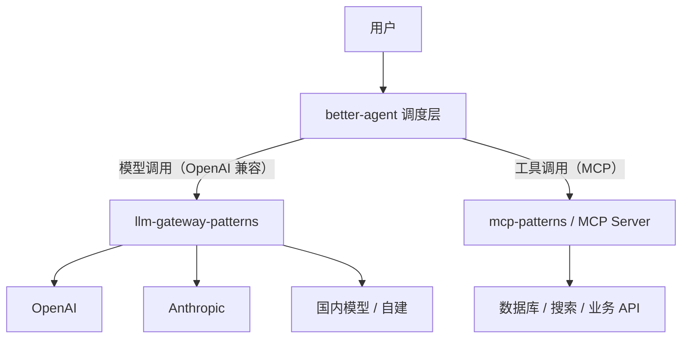

# 与 better-agent 集成

一次 Agent 任务可能触发几十次模型调用：规划、选工具、总结工具结果、反思、再规划。如果每次都直连供应商，你会得到三个后果：**成本无法归因到任务**、**不同步骤用同一个贵模型**、**一次循环就能把预算烧穿**。

网关在这里的角色不是「多一层代理」，而是**把 Agent 的调用变成有边界、有账本、有退路的资源单元**。

::: tip 配套阅读
Agent 调度本身的模式（规划、记忆、工具选择、反思循环）在配套项目 [better-agent](https://yuxinrun.github.io/better-agent/) 中展开。本页只讲它与网关的接缝。
:::

## 先说结论

- **Agent 只认一个 OpenAI 兼容入口**，不关心底层是哪家模型。
- **按步骤分级用模型**：规划用强模型，执行用快模型，摘要用便宜模型。
- **每次任务带 `run_id`**，网关按 run 归因成本、执行预算。
- **重试只能有一层负责**。网关负责上游重试，Agent 负责任务级重试，两者叠加会指数放大。
- **工具结果要外置或截断**，否则上下文和账单一起爆炸。
- **并行工具调用会造成并发尖峰**，网关必须能限住。

## 分层关系



边界要清晰：

- **网关不执行工具**，也不理解 MCP 协议。它只负责模型调用。
- **Agent 不做模型适配**，不关心 Anthropic 的 `system` 在哪一层。
- **MCP 层不关心模型**，只负责工具的描述与执行。

三者通过标准协议解耦，任何一层换实现都不影响另外两层。

## 网关为 Agent 多做的事

普通聊天应用的请求是「一问一答」，Agent 的请求有几个额外特征：

| 特征 | 网关需要的能力 |
| --- | --- |
| 一次任务多次调用 | 按 `run_id` 归因与预算 |
| 步骤角色不同 | 按 `step_type` 路由到不同模型 |
| 上下文快速膨胀 | token 预算、超长降级 |
| 工具结果不可控 | 输入长度限制、截断策略 |
| 并行工具调用 | 并发限制与排队 |
| 长任务易中断 | 幂等、可恢复、缓存 |

### 请求头契约

建议在 Agent 与网关之间约定一组头，网关据此做归因与策略：

| Header | 示例 | 用途 |
| --- | --- | --- |
| `X-Run-Id` | `run_01J8Z3K4` | 任务级归因 |
| `X-Agent-Id` | `agent_research` | Agent 类型 |
| `X-Step-Type` | `plan` / `act` / `observe` / `summarize` | 步骤分级路由 |
| `X-Step-Index` | `7` | 第几步，用于循环检测 |
| `X-Feature` | `deep_research` | 产品功能 |
| `X-Budget-Usd` | `0.50` | 本任务剩余预算 |
| `X-Trace-Id` | `4bf92f...` | 链路追踪 |

`X-Budget-Usd` 由 Agent 维护，网关只做校验与扣减。这样预算的「总额」由业务决定，「执行」由平台保证。

### 步骤分级路由

```yaml
groups:
  agent-plan:
    strategy: priority
    targets: [claude-sonnet, gpt-4o, qwen-max]

  agent-act:
    strategy: weighted
    targets:
      - { name: gpt-4o-mini, weight: 80 }
      - { name: qwen-turbo, weight: 20 }

  agent-summarize:
    strategy: cheapest
    targets: [gpt-4o-mini, qwen-turbo, deepseek-chat]
```

网关按 `X-Step-Type` 选组：

```python
STEP_GROUP = {
    "plan": "agent-plan",
    "act": "agent-act",
    "observe": "agent-act",
    "summarize": "agent-summarize",
}


def resolve_group(headers, body) -> str:
    step = headers.get("x-step-type", "").lower()
    return STEP_GROUP.get(step, "chat-default")
```

这样「规划用最强、执行用最快、总结用最便宜」的策略集中在一处，调整时不用改 Agent 代码。

::: warning 不要让模型自己选模型
「让 Agent 决定用哪个模型」听起来很智能，实际很难稳定：模型对价格没有准确认知，也看不到实时配额。把决策放在网关的路由层，规则可测试、可回滚。
:::

## Agent 侧怎么接

用官方 OpenAI SDK 指向网关即可，不需要自定义客户端：

```python
from openai import OpenAI

client = OpenAI(
    base_url="https://gateway.example.com/v1",
    api_key=os.environ["LGW_API_KEY"],
    default_headers={
        "X-Agent-Id": "agent_research",
        "X-Feature": "deep_research",
    },
)


def step(run_id: str, step_type: str, index: int, messages: list[dict], tools: list[dict]):
    return client.chat.completions.create(
        model="agent-default",
        messages=messages,
        tools=tools,
        stream=True,
        extra_headers={
            "X-Run-Id": run_id,
            "X-Step-Type": step_type,
            "X-Step-Index": str(index),
        },
        extra_body={"stream_options": {"include_usage": True}},
    )
```

注意 `stream_options.include_usage`：Agent 场景调用次数多，没有 usage 就没法做任务级成本控制。

## 按任务归因成本

`run_id` 让账单从「按租户」细化到「按任务」：

```sql
SELECT
  run_id,
  count(*) AS calls,
  sum(input_tokens + output_tokens) AS tokens,
  sum(cost_usd) AS cost,
  max(step_index) AS steps
FROM usage_events
WHERE tenant_id = 't_1001'
  AND occurred_at >= now() - INTERVAL '7 days'
GROUP BY run_id
ORDER BY cost DESC
LIMIT 20;
```

有了这张表，你可以回答：

- 哪类任务最贵？研究型还是客服型？
- 同一个任务重试了几次？
- 成本是花在规划还是执行？
- 哪些任务触发了「步数上限」？

### 单任务预算

Agent 循环最危险的地方是「停不下来」。两级保护：

1. **步数上限**：Agent 自己控制，比如最多 30 步。
2. **预算上限**：网关在每次调用前检查该 `run_id` 的累计花费。

```python
async def check_run_budget(redis, run_id: str, estimated_cost: float) -> bool:
    key = f"runbudget:{run_id}"
    spent = float(await redis.get(key) or 0)
    limit = float(await redis.get(f"{key}:limit") or 0.5)
    if spent + estimated_cost > limit:
        return False
    await redis.incrbyfloat(key, estimated_cost)
    await redis.expire(key, 6 * 3600)
    return True
```

预算耗尽时返回一个明确的错误码（如 `run_budget_exceeded`），Agent 据此优雅结束并给出部分结果，而不是把 500 抛给用户。

## 重试只能有一层

这是集成中最容易踩的坑：

```text
Agent 重试 3 次 × 网关重试 3 次 = 最多 9 次上游调用
```

如果每次调用还涉及多个工具，放大倍数更夸张。建议：

| 层 | 负责什么 | 策略 |
| --- | --- | --- |
| 网关 | 上游瞬时故障 | 对 429/5xx 做 1–2 次快速重试，带抖动 |
| Agent | 任务语义失败 | 不自动重试模型调用；仅在「输出无法解析」时重试一次 |
| 业务 | 用户主动重试 | 作为新任务，新的 `run_id` |

网关的重试要打标（`attempt > 1`），Agent 侧看到 `x-gateway-attempts` 头就不要再重试，避免叠加。

## 超长上下文怎么处理

Agent 的上下文增长来自三处：对话历史、工具结果、检索片段。网关能做的是「兜底」，不是「治理」：

| 手段 | 在哪做 | 说明 |
| --- | --- | --- |
| 工具结果截断 | Agent / MCP | 只回传摘要或引用 ID |
| 历史摘要 | Agent | 超过 N 轮后压缩 |
| 检索条数限制 | Agent | Top-K 控制 |
| 输入 token 上限 | 网关 | 超限直接 413，避免付费后被拒 |
| 超长自动降级 | 网关 | 路由到更大窗口的模型 |
| 分段摘要 | Agent | 长文档先总结再入上下文 |

网关的 413 要早于计费：**在转发前用 tokenizer 估算输入长度**，超限直接拒绝，不要让上游返回 400 后才告诉用户。

```python
def enforce_context_limit(body: dict, target) -> None:
    estimated = estimate_tokens(body.get("messages", [])) + estimate_tokens(body.get("tools", []))
    if estimated > target.context_window - body.get("max_tokens", 1024):
        raise GatewayError(
            413,
            "context_too_large",
            f"estimated {estimated} tokens exceeds {target.name} window",
        )
```

估算可以粗一点（比如按 tokenizer 或字符比例），但要**偏保守**，宁可早拒也不要付费后被拒。

## 流式 + 工具调用

Agent 通常需要边流式输出边解析 `tool_calls`。网关要保证：

- 不缓冲整个响应再转发（会破坏流式体验）。
- 不修改 `tool_calls` 的增量结构。
- 在最后一个 chunk 保留 `finish_reason` 与 `usage`。
- 客户端断开时及时关闭上游连接，避免继续计费。

如果网关做了协议转换（比如把 Anthropic 的 `tool_use` 转成 OpenAI 的 `tool_calls`），流式转换要按事件增量拼接，不能等完整参数再发——否则工具调用会延迟到流结束才可见。

## 并行工具与并发尖峰

Agent 一次返回 5 个 `tool_calls`，执行完后可能并发发起 5 个模型调用做总结。这类尖峰很容易触发上游 429：

- 网关按 `run_id` 做**并发上限**，而不是只看租户总量。
- 同一 run 的请求可以排队串行化，牺牲一点延迟换稳定性。
- 返回 429 时带 `Retry-After`，Agent 侧的并行调度器要尊重它。

```python
async def acquire_run_slot(run_id: str, limit: int = 4):
    key = f"runsem:{run_id}"
    current = await redis.incr(key)
    if current == 1:
        await redis.expire(key, 300)
    if current > limit:
        await redis.decr(key)
        raise GatewayError(429, "run_concurrency_exceeded", "too many parallel calls in one run")
    return key


async def release_run_slot(key: str) -> None:
    await redis.decr(key)
```

## 结果一致性与模型切换

当 planner 和 executor 使用不同模型时，会出现「规划输出的格式执行器看不懂」的问题。三个缓解手段：

1. **结构化输出**：规划结果用 JSON Schema 约束，不依赖自然语言格式。
2. **适配提示**：给执行器的 system prompt 里说明上游输出的格式约定。
3. **固定关键步骤的模型**：规划与执行如果强耦合，就不要在两者间做随机分流。

网关的路由要支持「按步骤固定目标」，而不是全局权重随机。否则同一个任务里 planner 每次换模型，行为会飘。

## 可观测性

Agent 场景下，单看网关指标不够，要能把一次任务串起来：

- `run_id` 作为 trace 的关联键，所有步骤的 span 挂在同一个 trace 下（或通过 link 关联）。
- 看板展示「每任务调用次数分布」「每任务成本分布」「步数超限率」。
- 告警关注「单任务调用次数 > 50」「单任务成本 > P99 的 5 倍」。

这些指标能提前发现 Agent 陷入循环，而不是等到账单出来。

## 反模式

| 反模式 | 后果 |
| --- | --- |
| Agent 直连多家供应商 | 适配逻辑散落，成本无法归因 |
| 所有步骤用同一个旗舰模型 | 成本高 5–10 倍，延迟也更高 |
| Agent 与网关都重试 | 上游流量指数放大 |
| 不带 `run_id` | 出问题无法定位是哪次任务 |
| 工具结果全量回填 | 上下文爆炸，单次成本失控 |
| 超长请求先转发再报错 | 付了钱还失败 |
| 并行工具无并发限制 | 瞬时 429，任务整体失败 |
| 让模型自己选模型 | 策略不可测、不可回滚 |

## Checklist

- [ ] Agent 只通过一个 OpenAI 兼容入口调用模型
- [ ] 请求头携带 `run_id`、`step_type`、`step_index`
- [ ] 按步骤分级路由（plan / act / summarize）
- [ ] 单任务有步数上限与预算上限
- [ ] 重试职责单一，网关与 Agent 不叠加
- [ ] 输入长度在转发前校验，超限返回 413
- [ ] 流式工具调用增量透传，不破坏结构
- [ ] 同一 run 的并发有上限
- [ ] 成本可按 `run_id` 聚合查询
- [ ] 关键步骤固定模型，避免行为漂移

## 下一篇

Agent 的工具调用走的是 MCP 层，但它和网关仍有几个关键接缝：[与 mcp-patterns 集成](./mcp-patterns.md)。
