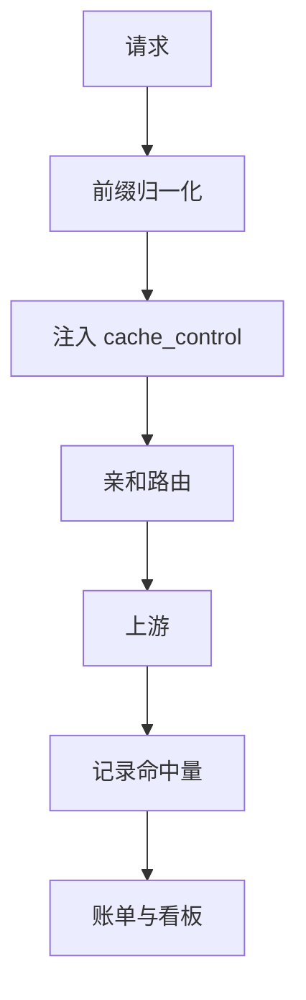
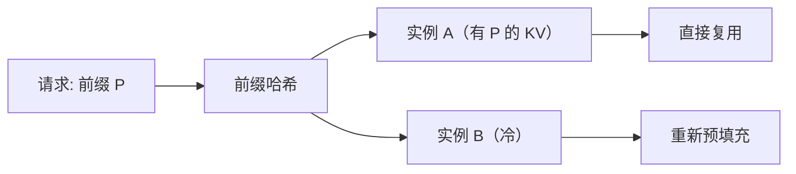

# KV Cache 代理与成本优化

一个典型的客服 Agent，system prompt 加上工具定义有 6000 token，每轮对话都原样发送。按普通输入价计费，80% 的钱花在了**重复的、完全相同的**前缀上。

供应商其实早就提供了缓存能力，但默认不会帮你用好：前缀顺序不对、时间戳混在里面、多副本路由到不同实例，都会让命中率归零。网关正好站在能统一处理这些问题的位置。

## 先说结论

- **先分清三种缓存**：供应商 prompt cache、自建前缀/KV cache、语义缓存。它们解决不同问题，价格和一致性完全不同。
- **缓存命中靠「前缀完全一致」**，任何一个字节变化都会导致从头失效。
- **网关的职责是：稳定前缀、注入缓存标记、把请求路由到有缓存的实例、把命中量算进账单。**
- **缓存写入可能比普通输入更贵**，短前缀或一次性请求不要开缓存。
- **多租户必须做前缀隔离**，否则既省不了钱，还可能泄露数据。

## 三种缓存，别混为一谈

| 类型 | 命中条件 | 省什么 | 一致性 | 典型实现 |
| --- | --- | --- | --- | --- |
| 供应商 prompt cache | 相同前缀 + 相同模型 + 同组织 | 输入 token 费用 + 首字延迟 | 强（同一模型） | Anthropic `cache_control`、OpenAI 自动缓存、DeepSeek 上下文缓存 |
| 自建前缀/KV cache | 相同前缀落在同一推理实例 | 预填充算力 | 强（同一模型权重） | vLLM Automatic Prefix Caching、SGLang RadixAttention |
| 语义缓存 | 语义相似 | 整次调用 | 弱（可能答非所问） | 向量检索 + 阈值 |

三者可以叠加，但**不要用语义缓存替代前缀缓存**。前缀缓存是确定性的，语义缓存是概率性的；前者省钱不改变答案，后者省钱但可能改变答案。

## 供应商 prompt cache 怎么用

各家机制不同，但共同点是「显式或隐式地标记一段可复用的前缀」。

### Anthropic

Anthropic 通过 `cache_control` 标记缓存断点，通常放在 system、tools 或较长的上下文块上：

```json
{
  "model": "claude-sonnet-4",
  "system": [
    {
      "type": "text",
      "text": "你是一个企业知识库助手……（很长的规则与示例）",
      "cache_control": { "type": "ephemeral" }
    }
  ],
  "messages": [
    { "role": "user", "content": "上季度的续费率是多少？" }
  ]
}
```

几个关键约束（以官方文档为准）：

- 缓存有**最小 token 门槛**，太短的前缀不会生效。
- 默认 TTL 较短，过期后需要重新写入；写入通常按更高的单价计费。
- 缓存是**组织级**的，同一组织内相同前缀可复用。
- 最多支持有限个断点，断点位置影响命中范围。

### OpenAI

OpenAI 对较长前缀自动启用缓存，无需显式标记，响应里的 `usage.prompt_tokens_details.cached_tokens` 会告诉你命中了多少。网关能做的是**保证前缀稳定**，并把 `cached_tokens` 记进账单。

### DeepSeek / 国内模型

多数提供自动上下文缓存，响应里区分 `prompt_cache_hit_tokens` 与 `prompt_cache_miss_tokens`。这类缓存的命中同样依赖前缀逐字节一致。

### Gemini

Gemini 的上下文缓存分为隐式和显式两种，显式缓存需要单独创建缓存对象并引用。网关要处理「缓存对象生命周期」这层额外逻辑，通常只在超长固定上下文（如整本手册）场景才值得。

## 网关需要做的四件事



### 1. 前缀归一化

把「逻辑上相同」的请求变成「字节上相同」的请求：

- 去掉时间戳、随机 ID、当前日期。
- 固定 JSON 序列化方式（键排序、无多余空格）。
- 工具定义按固定顺序排列，而不是按字典遍历顺序。
- 多段 system 合并时保持稳定顺序。

```python
def canonicalize_messages(messages: list[dict]) -> list[dict]:
    out = []
    for m in messages:
        content = m.get("content")
        if isinstance(content, str):
            content = content.strip()
        elif isinstance(content, list):
            content = [
                {k: v for k, v in part.items() if k in ("type", "text", "image_url")}
                for part in content
            ]
        out.append({"role": m["role"], "content": content})
    return out
```

::: warning 不要过度归一化
去掉空白、改写措辞都可能改变模型行为。归一化只做**明确无副作用**的操作：键排序、去随机值、固定顺序。任何涉及语义的改动都要单独评估。
:::

### 2. 注入缓存标记

以 Anthropic 为例，网关可以在转发前自动给 system 的最后一个块加上 `cache_control`，业务方不需要感知：

```python
def inject_cache_control(body: dict, min_chars: int = 4000) -> dict:
    system = body.get("system")
    if isinstance(system, str):
        if len(system) < min_chars:
            return body
        body["system"] = [
            {"type": "text", "text": system, "cache_control": {"type": "ephemeral"}}
        ]
        return body

    if isinstance(system, list) and system:
        total = sum(len(b.get("text", "")) for b in system)
        if total < min_chars:
            return body
        last = dict(system[-1])
        last["cache_control"] = {"type": "ephemeral"}
        body["system"] = [*system[:-1], last]
    return body
```

字符数门槛只是粗略替代，真实门槛是 token 数。更准确的做法是用 tokenizer 估算，或者按模型配置一个 `min_prefix_tokens`。

注入要**幂等**：业务方自己已经标了 `cache_control` 就不要重复加，否则可能触发断点数量超限。

### 3. 亲和路由

对自建推理（vLLM/SGLang），缓存存在**具体实例的内存**里。请求如果被轮询到另一台机器，缓存就是冷的：



做法是按前缀哈希做一致性哈希，把相同前缀的请求固定到同一实例：

```python
import hashlib
import bisect


class PrefixRouter:
    def __init__(self, instances: list[str], replicas: int = 128):
        self.ring: list[tuple[int, str]] = []
        for inst in instances:
            for i in range(replicas):
                h = int(hashlib.md5(f"{inst}#{i}".encode()).hexdigest(), 16)
                self.ring.append((h, inst))
        self.ring.sort()
        self.hashes = [h for h, _ in self.ring]

    def pick(self, prefix: str) -> str:
        h = int(hashlib.md5(prefix.encode()).hexdigest(), 16)
        idx = bisect.bisect_left(self.hashes, h) % len(self.ring)
        return self.ring[idx][1]
```

要注意的边界：

- **实例扩缩容时**一致性哈希会重排一部分前缀，命中率短期下降是正常的。
- **热点前缀**可能把某台实例打满，需要加「负载上限」：超过阈值时溢出到次优实例，接受冷启动。
- 前缀取前 N 个 token 做哈希即可，不必对全量文本哈希，长度要固定，避免同前缀不同长度算出不同结果。

### 4. 记录命中量

从响应里提取缓存字段，写入 usage 事件：

```python
def cache_fields(provider: str, usage: dict) -> dict:
    if provider == "anthropic":
        return {
            "cache_read_tokens": usage.get("cache_read_input_tokens", 0),
            "cache_write_tokens": usage.get("cache_creation_input_tokens", 0),
        }
    if provider == "deepseek":
        return {
            "cache_read_tokens": usage.get("prompt_cache_hit_tokens", 0),
            "cache_write_tokens": 0,
        }
    details = usage.get("prompt_tokens_details") or {}
    return {"cache_read_tokens": details.get("cached_tokens", 0), "cache_write_tokens": 0}
```

命中率是这套优化的核心指标：`cache_read_tokens / input_tokens`。它掉了，说明前缀被污染或路由乱了。

## 前缀稳定化：最常见的五个破坏者

| 破坏者 | 例子 | 修复 |
| --- | --- | --- |
| 时间戳 | `当前时间：2026-10-30 12:34:56` 放在 system 开头 | 移到 user 消息，或只精确到天 |
| 随机 ID | 每次生成新的 `session_uuid` 拼进 prompt | 不拼，或放在末尾 |
| 动态排序 | 工具列表来自 `dict`，顺序不稳定 | 固定排序 |
| 多租户拼接 | 把租户名放在前缀里 | 接受隔离（必要），或放到后缀 |
| 版本号频繁变 | 每次发布改 system 文案 | 发布节奏与缓存 TTL 对齐 |

一个实用技巧：**把稳定内容放最前，变化内容放最后**。缓存按前缀匹配，越靠前越值钱。

```text
[稳定] 角色设定 + 规则 + few-shot 示例 + 工具定义
[较稳定] 租户配置、知识库摘要
[变化] 对话历史
[最易变] 本轮用户输入、时间、随机种子
```

## 成本测算

假设 system + tools 共 6000 token，每轮对话平均新增 400 token，输出 300 token，某模型输入价 $3/M、缓存读 $0.3/M、缓存写 $3.75/M：

| 方案 | 每轮输入成本 | 100 万轮成本 |
| --- | ---: | ---: |
| 无缓存 | 6400 × $3/M = $0.0192 | $19,200 |
| 前缀缓存命中 | 6000 × $0.3/M + 400 × $3/M = $0.0030 | $3,000 |
| 含首次写入摊销 | 约 $0.0031 | 约 $3,100 |

节省约 84%。但这是理想值，实际还要考虑：

- 缓存 TTL 过期后的重写成本。
- 命中率达不到 100%（前缀变化、路由漂移）。
- 缓存写入单价更高，短生命周期请求可能反而更贵。

所以上线前先算**盈亏平衡点**：一个前缀至少要被复用多少次，缓存才划算。

## 多租户与前缀隔离

两种策略，各有代价：

| 策略 | 命中率 | 隔离性 | 适用 |
| --- | --- | --- | --- |
| 共享前缀 | 高（跨租户复用） | 低 | 公开的通用规则，无租户数据 |
| 每租户前缀 | 低（各自独立） | 高 | 含租户配置、知识库内容 |

实践：**通用规则共享，租户数据单独成段**。这样通用部分仍能跨租户命中，敏感部分互不可见。

```text
[共享] 你是一个企业助手，遵循以下通用规则……
[租户 A] 你的公司是 A，产品线包括……
[会话] 用户：……
```

注意供应商缓存是组织级的，跨租户共享前缀在计费上没问题，但如果前缀里混入了租户数据，就变成数据泄露。**共享段必须经过审核，确认不含任何租户信息。**

## 自建推理的前缀缓存

vLLM 的 Automatic Prefix Caching（APC）默认按块哈希复用 KV。要让它真正生效：

- 开启 `enable_prefix_caching`。
- 保证请求的前缀逐 token 一致（chat template 也要一致）。
- 配合上面的亲和路由，否则跨实例复用不了。
- 监控 `gpu_prefix_cache_hit_rate` 一类的指标。

SGLang 的 RadixAttention 思路类似，对多轮对话和共享 system prompt 的场景收益明显。自建场景下「省的是算力」，体现为吞吐提升和 TTFT 下降，而不是账单上的数字。

## 监控

| 指标 | 说明 |
| --- | --- |
| `cache_read_tokens / input_tokens` | 命中率，按模型/租户拆分 |
| `cache_write_tokens` | 写入量，突然升高说明前缀在频繁变化 |
| TTFT P95 | 命中时通常显著下降 |
| 每请求平均输入成本 | 最直观的降本指标 |
| 前缀哈希分布 | 是否过度分散，影响亲和路由效果 |

命中率骤降的三个常见原因：发布了新的 system prompt、路由规则变了、某个上游开始忽略缓存标记。把这三点做成告警的排查清单。

## 反模式

| 反模式 | 后果 |
| --- | --- |
| 在 system 开头拼当前时间 | 命中率直接归零 |
| 对短前缀开缓存 | 写入费高于节省 |
| 语义缓存不做租户隔离 | 跨租户数据泄露 |
| 自建推理用轮询路由 | 缓存永远冷启动 |
| 缓存标记重复注入 | 超过断点上限，请求报错 |
| 只优化前缀不看 TTL | 写入成本吃掉节省 |
| 把缓存命中当成正确性保证 | 语义缓存可能返回过期答案 |

## Checklist

- [ ] 明确使用的是供应商缓存、自建前缀缓存还是语义缓存
- [ ] 前缀中无时间戳、随机 ID、不稳定排序
- [ ] 稳定内容在前，变化内容在后
- [ ] `cache_control` 注入幂等，且有最小长度门槛
- [ ] 自建推理开启前缀缓存并配置亲和路由
- [ ] 缓存读/写 token 进入 usage 事件与账单
- [ ] 命中率按模型与租户可观测，有骤降告警
- [ ] 多租户共享段经过审核，不含租户数据
- [ ] 算过盈亏平衡点，短前缀不盲目开缓存
- [ ] 缓存 TTL 与发布节奏匹配

## 下一篇

缓存解决了成本，接下来看网关如何支撑上层 Agent：[与 better-agent 集成](./better-agent.md)。
