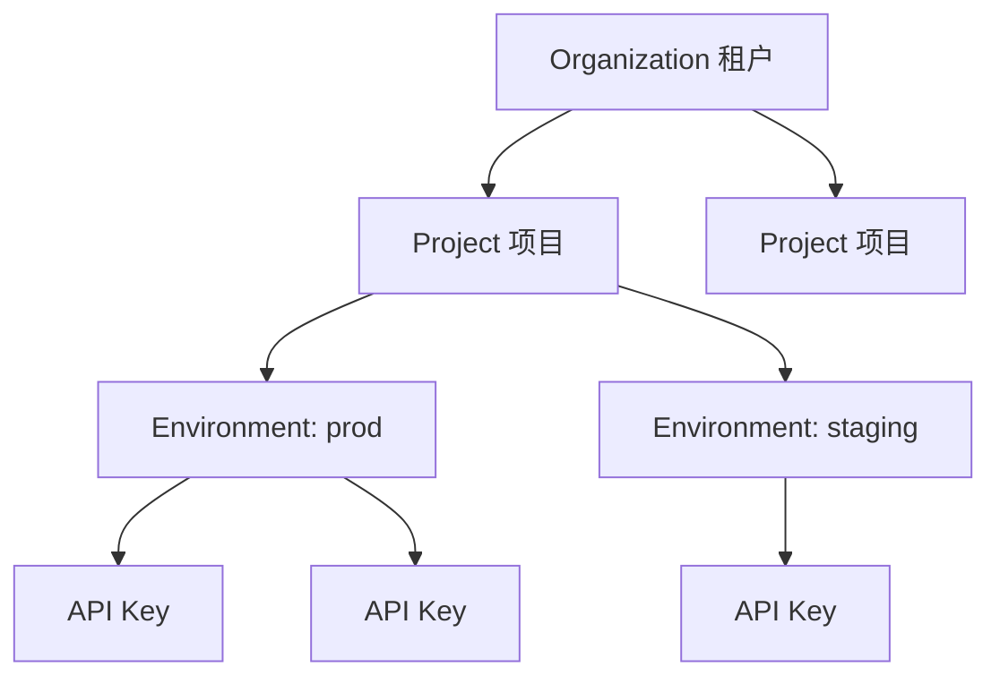
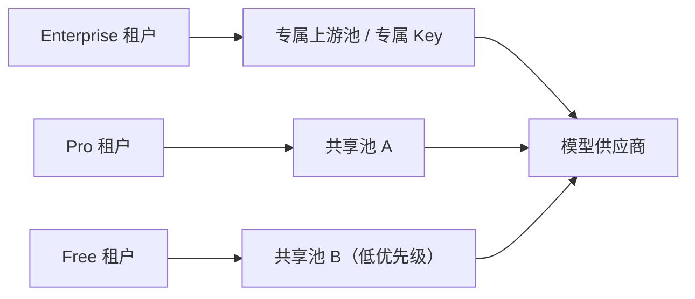

# 企业多租户与配额体系

多租户网关的核心矛盾：**所有人都想用同一个池子，但没有人愿意为别人的峰值买单**。如果所有租户共享一套配额，一个大客户的批量任务就能把小客户全部打成 429；如果每个租户都独立预留容量，利用率又会低得可怕。

这一页讲怎么在「隔离」和「共享」之间找到可运营的平衡点。

## 先说结论

- **租户不是用户**。租户是计费与隔离的单位，下面还有项目、环境、Key 三层。
- **配额是多维的**：RPM、TPM、并发、预算、模型白名单、上下文上限，缺一不可。
- **配额要能继承和覆盖**：套餐给默认值，项目可收紧，Key 可再收紧，但不能突破上层上限。
- **隔离有六个面**：认证、配额、缓存、日志、路由、数据。只做认证不叫多租户。
- **噪声邻居要靠分层资源池**，不能只靠限流。
- **配额变更必须可审计**，否则客户会问「谁把我的额度调低了」。

## 租户模型



| 层级 | 作用 | 典型属性 |
| --- | --- | --- |
| Organization | 计费主体、合同主体 | 套餐、总预算、地域策略 |
| Project | 成本归属、权限边界 | 项目预算、模型白名单 |
| Environment | 隔离生产与测试 | 更严格的测试配额 |
| API Key | 凭证、调用来源 | 速率、过期时间、IP 限制 |

为什么要分这么细？因为真实需求是：

- 财务要按**租户**开票。
- 技术负责人要按**项目**看成本。
- 测试环境不能吃掉生产配额。
- 一个 Key 泄露时能单独吊销，不影响其他服务。

## 配额维度

| 维度 | 单位 | 作用 |
| --- | --- | --- |
| RPM | 请求/分钟 | 防高频小请求 |
| TPM | token/分钟 | 防长上下文吃满配额 |
| 并发 | 进行中请求数 | 防连接与显存占满 |
| 日/月预算 | 金额 | 防跑飞 |
| 模型白名单 | 模型列表 | 防越权使用贵模型 |
| 上下文上限 | token | 防单请求过大 |
| 单次输出上限 | token | 防失控生成 |
| 工具调用次数 | 次/请求 | 防 Agent 循环 |

::: warning RPM 和 TPM 不能互相替代
一个请求 50 万 token、每分钟 1 次，RPM 看起来非常健康，但 TPM 已经爆了。反过来，大量 10 token 的探测请求会把 RPM 打满，TPM 却很低。两个都要限。
:::

## 套餐设计

套餐不是拍脑袋定的，通常按「目标客户的使用强度」分三档：

| 维度 | Free | Pro | Enterprise |
| --- | --- | --- | --- |
| RPM | 20 | 300 | 可谈 |
| TPM | 40k | 600k | 可谈 |
| 并发 | 2 | 30 | 可谈 |
| 月预算 | $5 | $500 | 合同额度 |
| 模型 | 基础模型 | 全部 | 全部 + 专属部署 |
| 缓存 | 共享 | 共享 | 独立命名空间 |
| 日志保留 | 3 天 | 30 天 | 180 天 |
| 支持 | 社区 | 工单 | 专属群 + SLA |

套餐的作用是**给默认值**，而不是限制死。企业客户几乎一定会要求调整某一项，所以配额系统必须支持按租户覆盖。

## 层级继承与覆盖

规则：**下层只能收紧，不能放宽**。

```python
from dataclasses import dataclass, replace


@dataclass(frozen=True)
class Quota:
    rpm: int
    tpm: int
    concurrency: int
    monthly_budget_usd: float
    models: frozenset[str] | None   # None 表示不限制
    max_context_tokens: int


def merge_quota(base: Quota, override: Quota | None) -> Quota:
    if override is None:
        return base
    return Quota(
        rpm=min(base.rpm, override.rpm),
        tpm=min(base.tpm, override.tpm),
        concurrency=min(base.concurrency, override.concurrency),
        monthly_budget_usd=min(base.monthly_budget_usd, override.monthly_budget_usd),
        models=(
            base.models
            if override.models is None
            else (base.models & override.models if base.models else override.models)
        ),
        max_context_tokens=min(base.max_context_tokens, override.max_context_tokens),
    )
```

`min` 的语义很重要：如果项目配置写错了（比如写了 100 万 RPM），不会突破租户套餐的上限。配置错误应该导致「更严格」，而不是「更宽松」。

预算通常是个例外——企业客户可能给某个项目追加预算，总额超过套餐默认值。这种情况下应该由**租户级总额**兜底，而不是简单 `min`：

```python
def effective_budget(tenant_budget: float, project_budgets: list[float]) -> float:
    return min(tenant_budget, sum(project_budgets))
```

## 隔离的六个面

| 面 | 不做会怎样 | 做法 |
| --- | --- | --- |
| 认证 | 任何人拿一个 Key 用所有模型 | Key 绑定租户与作用域 |
| 配额 | 一家打满，全部 429 | 分层限流 + 资源池 |
| 缓存 | A 租户读到 B 租户的缓存结果 | 缓存 Key 带租户命名空间 |
| 日志 | 排障时看到别家 prompt | 日志按租户打标 + 访问控制 |
| 路由 | 小客户被路由到贵的模型 | 按套餐限制目标集合 |
| 数据 | 微调、文件、批处理串租户 | 存储层强制 tenant_id 过滤 |

缓存是最容易被忽略的一条。语义缓存如果只按 prompt 相似度匹配，A 租户问「我们公司上季度营收」可能命中 B 租户的答案——这是数据泄露，不是性能问题。

```python
def cache_key(tenant_id: str, model: str, messages: list[dict]) -> str:
    canonical = json.dumps(messages, sort_keys=True, ensure_ascii=False)
    digest = hashlib.sha256(canonical.encode()).hexdigest()
    return f"cache:{tenant_id}:{model}:{digest}"
```

企业版还可以给每个租户独立的 Redis 逻辑库或前缀，配合 TTL 与容量上限，避免一个大租户把缓存挤爆。

## 噪声邻居防护

限流只能保证「不超过配额」，不能保证「不互相影响」。真正的隔离要靠资源分层：



具体手段：

- **独立上游凭证**：大客户用单独的供应商 Key，配额互不占用。
- **独立连接池**：每类租户一个 `httpx.AsyncClient`，限制 `max_connections`，防止连接被吃光。
- **独立队列/并发信号量**：Free 层并发上限低，且排队时间不计入其超时。
- **优先级调度**：过载时先拒绝 Free，再拒绝 Pro，最后才动 Enterprise。
- **专属部署**：Enterprise 可指向自建 vLLM 或专属实例。

```python
POOL_LIMITS = {
    "free": {"max_connections": 50, "max_keepalive": 10},
    "pro": {"max_connections": 300, "max_keepalive": 60},
    "enterprise": {"max_connections": 800, "max_keepalive": 200},
}
```

## 配额检查的顺序

顺序影响性能与体验：

1. **认证**：解析 Key，得到租户与套餐（本地缓存，避免每次查库）。
2. **模型白名单**：最便宜的检查，先拒绝越权。
3. **RPM / 并发**：Redis 原子操作。
4. **上下文长度**：解析请求体后检查。
5. **TPM**：需要估算输入 token + 预留输出 token。
6. **预算**：预留 + 结算。
7. **转发**。

把便宜且确定的检查放前面，可以避免为注定失败的请求做昂贵的 token 估算。

## 配额存储设计

Redis Key 建议按「维度 + 层级 + 时间窗」组织：

```text
q:{tenant}:{dim}:{window}          # 租户级
q:{tenant}:{project}:{dim}:{window}
q:{tenant}:{key}:{dim}:{window}
```

时间窗用滑动窗口或令牌桶，粒度为分钟（RPM/TPM）和月（预算）。月度 Key 的 TTL 设到自然月结束再加一天，避免跨月残留。

配置本身放数据库，Redis 只做计数缓存：

```sql
CREATE TABLE tenant_quotas (
  tenant_id   TEXT PRIMARY KEY,
  plan        TEXT NOT NULL,
  rpm         INT NOT NULL,
  tpm         INT NOT NULL,
  concurrency INT NOT NULL,
  monthly_budget_usd NUMERIC(12, 2) NOT NULL,
  max_context_tokens INT NOT NULL,
  models      TEXT[],
  updated_at  TIMESTAMPTZ NOT NULL DEFAULT now(),
  updated_by  TEXT NOT NULL
);
```

`updated_by` 与变更历史表不是可选项。客户提出「我的额度怎么变少了」时，你需要拿得出证据。

## 配额不足时的返回

不要只返回一个冷冰冰的 429。标准做法：

```http
HTTP/1.1 429 Too Many Requests
Content-Type: application/json
Retry-After: 17
X-RateLimit-Limit-Requests: 300
X-RateLimit-Remaining-Requests: 0
X-RateLimit-Reset-Requests: 2026-10-30T12:35:00Z
X-RateLimit-Limit-Tokens: 600000
X-RateLimit-Remaining-Tokens: 42130
X-RateLimit-Reset-Tokens: 2026-10-30T12:35:00Z
```

```json
{
  "error": {
    "type": "rate_limit_error",
    "code": "tpm_exceeded",
    "message": "TPM quota exceeded for tenant t_1001. Retry after 17s.",
    "limit": 600000,
    "used": 557870,
    "retry_after_seconds": 17
  }
}
```

各个 SDK 对 `Retry-After` 的处理不一致，所以头里同时给出结构化字段。错误信息里**不要暴露其他租户的信息**，只说自己。

## 配额调整的运营流程

| 场景 | 流程 |
| --- | --- |
| 新租户开通 | 按套餐初始化，写入审计 |
| 临时提额 | 带过期时间的覆盖，到期自动恢复 |
| 套餐升级 | 立即生效，按比例结算 |
| 套餐降级 | 下个账期生效，避免中途限额导致事故 |
| 封禁 | 吊销全部 Key，保留只读审计权限 |

临时提额一定要有 TTL。没有 TTL 的「临时」最终都会变成永久，而且没人记得当初为什么加。

## 计量与账单

多租户的账单要能拆到项目，甚至拆到环境：

```sql
SELECT
  tenant_id,
  project_id,
  sum(cost_usd) AS cost,
  sum(input_tokens) AS input_tokens,
  sum(output_tokens) AS output_tokens,
  count(*) AS requests
FROM usage_events
WHERE occurred_at >= date_trunc('month', now())
GROUP BY tenant_id, project_id
ORDER BY cost DESC;
```

测试环境的成本要不要计入账单？建议**计入但单独标记**，让客户自己决定是否内部结算。直接排除会导致测试环境无人约束。

## 反模式

| 反模式 | 后果 |
| --- | --- |
| 只有租户级配额 | 一个项目的批任务拖垮同租户其他项目 |
| 缓存 Key 不含租户 | 跨租户数据泄露 |
| 配额只存在进程内存 | 多副本下实际额度是 N 倍 |
| 所有租户共享上游 Key | 一家超额，全体 429 |
| 临时提额无过期 | 额度只增不减 |
| 429 不返回 `Retry-After` | 客户端疯狂重试，雪上加霜 |
| 配额变更无审计 | 纠纷时无法自证 |
| Free 层与付费层同池同优先级 | 付费用户体验被免费流量拖累 |

## Checklist

- [ ] 租户/项目/环境/Key 四层模型清晰
- [ ] RPM、TPM、并发、预算、模型白名单、上下文上限均已覆盖
- [ ] 配额继承只收紧不放宽，租户总额兜底
- [ ] 配额计数在 Redis，多副本一致
- [ ] 认证、配额、缓存、日志、路由、数据六个面都做了隔离
- [ ] 缓存 Key 包含租户命名空间
- [ ] 分层资源池与优先级调度，防止噪声邻居
- [ ] 429 返回完整限流头与结构化错误
- [ ] 配额变更写入审计表，临时提额带 TTL
- [ ] 账单可按租户与项目拆分

## 下一篇

租户隔离做好后，下一个降本重点是缓存：[KV Cache 代理与成本优化](./kv-cache.md)。
