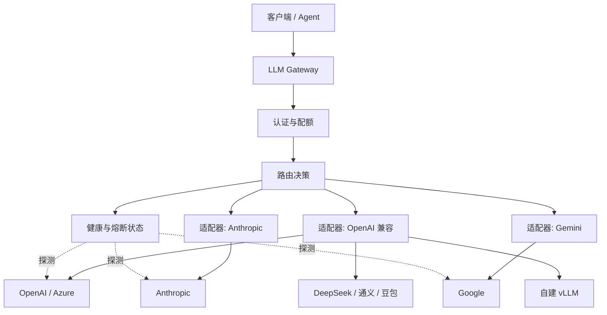
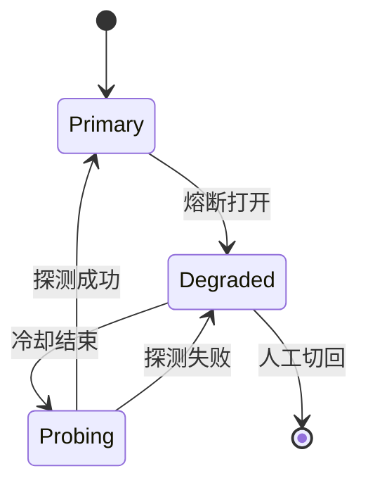

# 多厂商混合接入与自动故障转移

单一供应商的 99.9% 可用性，意味着每月约 43 分钟不可用——而且往往集中在你最不希望它发生的时候。混合接入不是为了「多接几家显得厉害」，而是为了在**容量、地域、成本和能力**四个维度上都有退路。

但「加个 fallback」远没有看起来那么简单：协议差异、能力不对等、会话一致性、重试放大，任何一个处理不好，故障转移本身就会变成新的故障源。

## 先说结论

- **混合接入的前提是统一协议**。对外只暴露 OpenAI 兼容接口，差异在适配层消化。
- **故障转移要按「能力」匹配**，不能只看「有没有模型」。备份模型不支持工具调用，切过去等于全部失败。
- **被动检测 + 主动探测**结合：被动看真实请求，主动在低峰期验证备份可用。
- **切换要有粘性**：同一会话不要在主备之间反复横跳。
- **重试预算要全局**，否则网关重试 × Agent 重试 = 请求量指数放大。
- **故障转移必须演练**，没演练过的预案等于没有。

## 四类混合动机

| 动机 | 表现 | 主要手段 |
| --- | --- | --- |
| 容量 | 高峰期主模型 429 | 按权重分流、溢出到备用池 |
| 可用性 | 供应商故障、区域中断 | 健康检查 + 自动切换 |
| 成本 | 简单请求用贵模型浪费 | 按任务难度/租户套餐路由 |
| 能力 | 长上下文、视觉、工具调用 | 按能力标签路由 |
| 合规 | 数据出境、行业监管 | 按租户地域策略路由 |

大多数团队从「可用性」开始，最后都会走到「成本 + 能力」的组合路由。

## 整体架构



注意适配器的位置：**协议适配在路由之后**。路由层面对的是抽象的「目标」，不应该关心它是哪家协议。

## 能力矩阵

选备份模型时，先列一张能力表。下面只是示意，实际以各厂商文档为准：

| 能力 | 主力模型 | 备份要求 |
| --- | --- | --- |
| 流式输出 | 全部 | 必须支持 |
| 工具调用 | GPT / Claude / Qwen / DeepSeek | 备份必须支持，否则工具类请求不能切 |
| JSON 模式 | 多数支持，严格程度不同 | 需要结构化输出时校验 schema |
| 视觉输入 | GPT-4o / Claude / Gemini / Qwen-VL | 按模态打标签 |
| 长上下文 | Gemini / Claude / Qwen | 按 `context_window` 过滤 |
| 推理/思考 | o 系列 / Claude thinking / DeepSeek-R1 | 输出格式差异大，谨慎混用 |
| 中文能力 | 国内模型通常更强 | 按评测集验证，不靠感觉 |

路由时用「标签匹配」而不是硬编码模型名：

```yaml
targets:
  - name: gpt-4o
    provider: openai
    model: gpt-4o
    capabilities: [stream, tools, json, vision]
    context_window: 128000
    weight: 70

  - name: claude-sonnet
    provider: anthropic
    model: claude-sonnet-4
    capabilities: [stream, tools, json, vision, long_context]
    context_window: 200000
    weight: 30

  - name: qwen-max
    provider: dashscope
    model: qwen-max
    capabilities: [stream, tools, json]
    context_window: 32000
    weight: 0        # 仅作为备份，不参与常规分流

  - name: deepseek-chat
    provider: deepseek
    model: deepseek-chat
    capabilities: [stream, tools, json]
    context_window: 64000
    weight: 0
```

请求进来后先算「必需能力集」：

```python
def required_capabilities(body: dict) -> set[str]:
    caps = {"stream"} if body.get("stream") else set()
    if body.get("tools"):
        caps.add("tools")
    if body.get("response_format", {}).get("type") == "json_object":
        caps.add("json")
    if any(is_vision_part(m) for m in body.get("messages", [])):
        caps.add("vision")
    return caps
```

然后用 `context_window` 过滤掉装不下的目标，再按策略选择。**这一步必须在转发前做**，否则切到一个上下文更小的模型，请求会直接 400。

## 故障检测

### 被动检测

从真实请求里学习，不需要额外成本：

| 信号 | 判定 |
| --- | --- |
| 连续 5xx | 上游故障 |
| 连续超时 | 网络或上游过载 |
| 429 比例突增 | 配额耗尽或被限流 |
| P95 延迟翻倍 | 上游劣化，尚未失败 |
| 连接错误（DNS/TLS） | 区域性网络问题 |

被动检测的缺点是「要等真实请求失败」。所以还需要主动探测。

### 主动探测

低峰期定时发一个极小的请求（比如 `max_tokens=1` 的 "ping"），验证：

- 网络可达、鉴权有效。
- 模型名有效（供应商经常下线旧模型）。
- 返回格式符合预期。

```python
async def probe(target) -> ProbeResult:
    start = time.perf_counter()
    try:
        r = await client.post(
            target.url,
            json={
                "model": target.model,
                "messages": [{"role": "user", "content": "ping"}],
                "max_tokens": 1,
                "stream": False,
            },
            timeout=5.0,
        )
    except httpx.HTTPError as exc:
        return ProbeResult(ok=False, reason=type(exc).__name__)
    latency = (time.perf_counter() - start) * 1000
    if r.status_code == 401:
        return ProbeResult(ok=False, reason="auth_invalid")
    if r.status_code == 404:
        return ProbeResult(ok=False, reason="model_not_found")
    if r.status_code >= 500:
        return ProbeResult(ok=False, reason="upstream_5xx")
    return ProbeResult(ok=True, latency_ms=latency)
```

探测频率不要太高：每 30–60 秒一次足够，且要分散到不同目标，避免探测本身变成流量。

::: tip 探测也会花钱
`max_tokens=1` 仍然计费。100 个目标 × 每分钟一次 × 一天 = 14 万次请求。按最便宜的价格算也是真金白银，记得把探测流量单独打标签，便于从账单中剔除。
:::

## 错误分类决定要不要切

不是所有错误都该触发故障转移：

| 上游返回 | 含义 | 是否切换 |
| --- | --- | --- |
| 401 / 403 | 我们的密钥或权限问题 | ❌ 切了也一样，直接告警 |
| 404 | 模型不存在 | ✅ 切，并标记该目标不可用 |
| 400 | 请求本身有问题 | ❌ 切了还是 400 |
| 413 | 请求体过大 | ⚠️ 可切到上下文更大的目标 |
| 429 | 限流 | ✅ 切，或等待后重试 |
| 500 / 502 / 503 | 上游故障 | ✅ 切 |
| 504 / 超时 | 上游过慢 | ✅ 切（注意重复计费） |
| 流中断 | 连接异常 | ⚠️ 仅在未输出内容时切换 |

这张表要写进代码，而不是散落在各处 `if` 里。统一的分类函数：

```python
RETRYABLE = {404, 408, 409, 425, 429, 500, 502, 503, 504}


def classify(status: int | None, exc: Exception | None) -> str:
    if exc is not None:
        if isinstance(exc, httpx.TimeoutException):
            return "timeout"
        return "transport"
    if status in (401, 403):
        return "auth"
    if status == 400:
        return "bad_request"
    if status == 413:
        return "too_large"
    if status in RETRYABLE:
        return "retryable"
    return "fatal"
```

## 切换策略

### 立即切换 vs 渐进切换

| 策略 | 适用 | 风险 |
| --- | --- | --- |
| 立即全切 | 明确的上游故障 | 备份容量可能扛不住 |
| 按比例渐进 | 上游劣化但未完全失败 | 切换慢 |
| 仅新请求切换 | 保护进行中的流 | 老连接仍可能失败 |

推荐：**熔断打开时全切新请求，进行中的流不打断**。已经输出的内容切了也没意义，反而会让用户看到拼接错乱的两段回答。

### 粘性

同一会话（`session_id` 或 `run_id`）应尽量落在同一目标：

- 保持风格一致，避免用户感觉「换了个人」。
- 利用供应商的 prompt cache，提升命中率。
- 避免多轮对话中模型能力差异导致的上下文理解跳变。

实现上用一致性哈希或 Redis 记录映射，并设置 TTL（比如 30 分钟）：

```python
async def sticky_target(session_id: str, candidates: list[str]) -> str | None:
    key = f"sticky:{session_id}"
    cached = await redis.get(key)
    if cached and cached in candidates:
        return cached
    return None
```

但粘性不能凌驾于健康状态：目标熔断时必须切换，同时更新映射。

### 半开探测

熔断打开后不能一直不试。半开状态放少量请求过去：

- 成功率达到阈值 → 关闭熔断，逐步恢复权重。
- 仍失败 → 重新打开，并延长下次探测时间（指数退避）。

```python
class CircuitBreaker:
    def __init__(self, failure_threshold=5, recovery_timeout=30.0, half_open_max=3):
        self.failure_threshold = failure_threshold
        self.recovery_timeout = recovery_timeout
        self.half_open_max = half_open_max
        self.failures = 0
        self.opened_at = 0.0
        self.state = "closed"
        self.half_open_inflight = 0

    def allow(self) -> bool:
        now = time.monotonic()
        if self.state == "closed":
            return True
        if self.state == "open":
            if now - self.opened_at >= self.recovery_timeout:
                self.state = "half_open"
                self.half_open_inflight = 0
            else:
                return False
        if self.half_open_inflight < self.half_open_max:
            self.half_open_inflight += 1
            return True
        return False

    def record(self, ok: bool) -> None:
        if ok:
            if self.state == "half_open":
                self.state = "closed"
                self.failures = 0
            else:
                self.failures = max(0, self.failures - 1)
        else:
            self.failures += 1
            if self.state == "half_open" or self.failures >= self.failure_threshold:
                self.state = "open"
                self.opened_at = time.monotonic()
```

多副本部署时，熔断状态要么放 Redis 共享，要么接受「每个副本独立判断」的短暂不一致。前者更准，后者更简单——**关键是别让每个副本在同一秒一起把流量打到已经挂掉的上游**，可以给探测时间加随机抖动。

## 协议差异的坑

统一成 OpenAI 格式后，仍然有些差异无法完全抹平：

| 差异 | 表现 | 处理 |
| --- | --- | --- |
| `temperature` 范围 | 有的 0–1，有的 0–2 | 按目标裁剪 |
| `max_tokens` 语义 | 是否包含推理 token | 保守设置，或按模型调整 |
| system 消息位置 | OpenAI 在 messages 里，Anthropic 顶层 | 适配层转换 |
| 工具 schema | JSON Schema 子集支持不同 | 简化 schema，去掉不支持的字段 |
| 停止词 | 数量限制不同 | 截断到上限 |
| 并行工具调用 | 支持程度不同 | 不支持时串行化 |
| 空 content | 有的拒绝，有的接受 | 归一化为 `null` 或占位符 |
| 流式结束标记 | `[DONE]` vs 命名事件 | 适配层统一 |

最隐蔽的是**输出风格差异**。同一个 prompt，主力模型输出 Markdown 表格，备份模型输出纯文本；主力会主动追问，备份直接给答案。如果产品强依赖格式，切换后要加一层后处理或提示词补偿。

## 切换后的体验一致性



几个产品层面的决定：

- **要不要告诉用户模型变了？** 大多数场景不必，但如果输出风格差异明显，可以在响应里加 `x-gateway-model` 头，供前端提示。
- **计费按哪个模型？** 按实际调用的目标计费，同时在账单里保留「因降级产生的额外/节省成本」。
- **SLA 怎么算？** 降级期间的请求算成功还是失败？建议单独统计「降级成功率」，不要混进主模型 SLI。

## 演练

没演练过的故障转移，第一次运行大概率是在真实故障中。

| 演练项 | 方法 | 期望 |
| --- | --- | --- |
| 主模型 429 | 用测试 Key 打满配额 | 自动溢出到备份，错误率可控 |
| 主模型 5xx | 指向一个返回 500 的 mock | 熔断在 N 次失败后打开 |
| 网络超时 | 用 toxiproxy 注入延迟 | 首 token 超时触发切换 |
| 备份不可用 | 同时禁用主备 | 返回明确错误，不无限重试 |
| 配置错误 | 故意写错模型名 | 启动时校验失败，而非运行时 |
| 容量不足 | 只保留备份单目标 | 限流生效，不雪崩 |

演练要在**生产之外的环境**做，但配置要和生产同源。用 mock 上游比真打供应商便宜得多，也更可控。

## 成本影响

故障转移会改变成本结构：

- 备份模型通常更贵（贵的那家往往更稳）。
- 重试会产生重复计费，尤其是超时但上游实际已生成的情况。
- 跨区域调用增加网络成本。

所以路由配置要能回答：**降级 1 小时，多花多少钱？** 把这个数字算出来，写进预案里，事故时才知道该切还是该限流。

## 反模式

| 反模式 | 后果 |
| --- | --- |
| 备份模型不支持 tools | 工具类请求切换后全部失败 |
| 所有错误都触发切换 | 400 被切成 400，放大延迟 |
| 无重试预算 | 网关 × Agent 双重试，流量翻十倍 |
| 会话不粘 | 同一轮对话前后风格突变，缓存全失效 |
| 熔断无半开 | 上游恢复后仍拒绝流量 |
| 不校验上下文长度 | 切到小窗口模型直接 400 |
| 没有演练 | 真故障时才发现配置写错 |
| 探测流量不标记 | 账单里多出一笔「神秘请求」 |

## Checklist

- [ ] 对外统一 OpenAI 兼容协议，差异在适配层
- [ ] 目标带 `capabilities` 与 `context_window` 元数据
- [ ] 请求先过滤能力与上下文，再选目标
- [ ] 错误分类表落地为代码，非重试错误不切换
- [ ] 被动检测 + 主动探测，探测流量可识别
- [ ] 熔断有半开与退避，状态多副本一致或可接受
- [ ] 会话粘性有 TTL，且服从健康状态
- [ ] 降级链路有独立 SLI 与成本统计
- [ ] 重试预算全局生效，防止双重放大
- [ ] 至少每季度做一次故障演练

## 下一篇

多厂商解决了「去哪调用」，接下来解决「谁能用多少」：[企业多租户与配额体系](./multi-tenant.md)。
