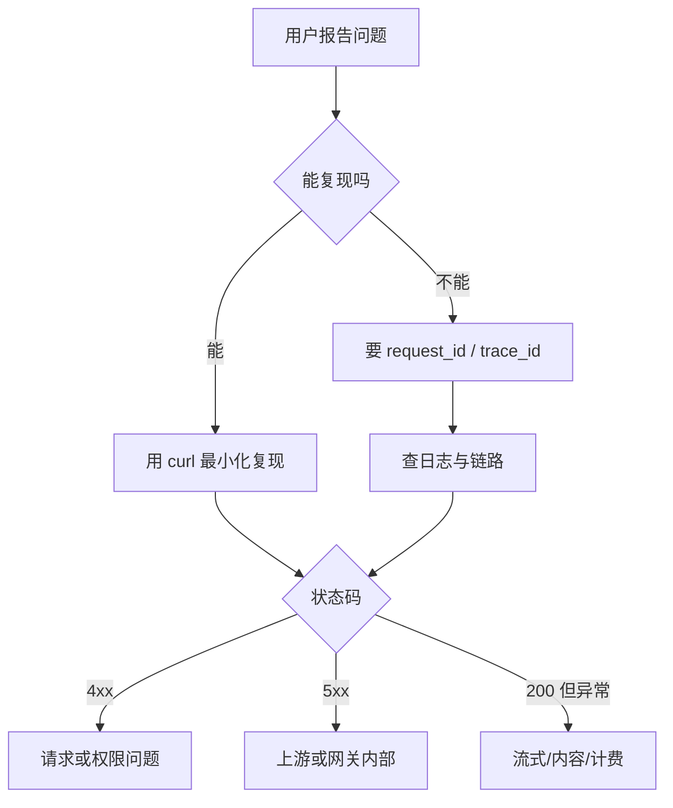

# 常见问题排查手册

这一页是前面各章的「索引式」补充：当你只有一个症状（报错、变慢、账单不对），从这里快速定位到可能的原因和验证方法。

## 排查总顺序



三条原则：

1. **先要 `request_id`**。没有它，你只能猜。
2. **先用 curl 绕开客户端**，排除 SDK 和业务代码。
3. **一次只改一个变量**，否则不知道哪个改动生效了。

## 快速对照表

| 症状 | 最可能的原因 | 先查什么 |
| --- | --- | --- |
| 401 | Key 错误、过期、环境混用 | `key_id`、租户状态 |
| 403 | 模型不在白名单、IP 限制 | Key 的 scopes |
| 404 | 模型名不存在、路由组为空 | `model_alias`、目标配置 |
| 400 context length | 输入 + 输出超过窗口 | token 估算 |
| 400 tools | schema 不合法、模型不支持 | 工具定义、能力标签 |
| 413 | 请求体过大、工具结果过大 | body 大小、单请求上限 |
| 429（本地） | RPM/TPM/并发/预算 | 限流头 `X-RateLimit-*` |
| 429（上游） | 供应商配额 | `upstream_status`、供应商后台 |
| 502 | 上游返回无效、鉴权失败 | 上游响应体 |
| 503 | 无可用目标、熔断全开 | 熔断状态、健康检查 |
| 504 | 上游超时 | 阶段耗时、首 token 时间 |
| 200 但很慢 | 上游慢、连接池排队 | TTFT、池等待 |
| 流中断 | 代理缓冲、块间超时 | 逐段 curl |
| 重复计费 | 重试、客户端重连 | `attempt`、`request_id` |
| 缓存不命中 | 前缀变化、路由漂移 | `cache_read_tokens` |
| 内存上涨 | 缓冲、连接泄漏 | RSS、FD、inflight |

## 认证类

### 401 Unauthorized

| 检查 | 方法 |
| --- | --- |
| Key 是否存在 | 按 `key_id` 查库 |
| 是否过期 | `expires_at` |
| 是否被吊销 | `revoked_at` |
| 环境是否混用 | 测试 Key 打了生产地址 |
| Header 格式 | `Authorization: Bearer lgw_live_...` |
| 代理是否改写 | 抓包看实际发出的头 |

```bash
curl -sS -D - https://gateway.example.com/v1/models \
  -H "Authorization: Bearer $KEY" | head -20
```

如果网关返回 401 但上游也返回 401，要区分：网关的 401 是「你不该进来」，上游的 401 应该被包装成 502（`upstream_auth_error`），否则用户会以为是自己的 Key 错了。

### 403 Forbidden

常见于：

- 模型不在 Key 的 allowlist。
- 租户被限制只能访问某些地域。
- IP 不在白名单。
- 请求了需要更高套餐的模型。

错误信息要明确，比如 `model_not_allowed: gpt-4o is not enabled for plan free`，而不是笼统的 forbidden。

## 模型与路由类

### 404 Model Not Found

排查顺序：

1. `model_alias` 是否存在于路由配置。
2. 路由组是否为空（所有目标都被过滤）。
3. 上游模型名是否已下线。
4. 供应商是否需要区域 endpoint（如 Azure 的 deployment name）。

```bash
curl -sS https://gateway.example.com/v1/models -H "Authorization: Bearer $KEY"
```

网关应该提供 `/v1/models`，返回的是**对当前租户可见的别名**，而不是上游全量模型。

### 503 No Healthy Target

所有目标都熔断或探测失败时会返回这个。检查：

- 熔断状态（`gateway_circuit_state`）。
- 健康探测结果。
- 是否配置了备份目标。
- 是否被限流到没有可用目标。

返回体里带上各目标的状态，能省很多沟通：

```json
{
  "error": {
    "type": "service_unavailable",
    "code": "no_healthy_target",
    "targets": [
      { "name": "gpt-4o", "state": "open", "reason": "5xx_rate_high" },
      { "name": "qwen-max", "state": "open", "reason": "auth_invalid" }
    ]
  }
}
```

## 请求类

### 400 Context Length Exceeded

```bash
# 计算输入 token 的粗略值
python -c "import sys; print(len(open(sys.argv[1]).read())//3)" prompt.txt
```

检查：

- 是否包含工具 schema（容易被忽略）。
- 是否把整份文档塞进了 system。
- `max_tokens` 是否设置过大，导致输入 + 输出超限。
- 多模态内容的 token 折算。

网关应该在转发前拦截并返回可操作的建议，而不是把上游的原始 400 透传。

### 400 Tool Schema Invalid

常见原因：

- `parameters` 不是合法 JSON Schema。
- 使用了模型不支持的字段（如 `$ref`、复杂 `oneOf`）。
- `required` 里的字段在 `properties` 中不存在。
- 工具名为空或含非法字符。

```python
def validate_tool(tool: dict) -> list[str]:
    fn = tool.get("function", {})
    errors = []
    if not fn.get("name"):
        errors.append("function.name is required")
    params = fn.get("parameters", {})
    if params.get("type") != "object":
        errors.append("parameters.type must be object")
    props = params.get("properties", {})
    for key in params.get("required", []):
        if key not in props:
            errors.append(f"required field {key} not in properties")
    return errors
```

### 413 Payload Too Large

| 来源 | 阈值 | 处理 |
| --- | --- | --- |
| 请求体大小 | 网关配置，如 10MB | 客户端压缩/分批 |
| 单请求输入 token | 套餐配置 | 压缩上下文 |
| 单条工具结果 | 网关兜底，如 16k | 分页/摘要 |
| 图片大小 | 供应商限制 | 缩放 |

注意反向代理也有 body 限制（Nginx `client_max_body_size`），报错可能是代理返回的，不是网关。

## 限流类

### 429 怎么区分本地和上游

```http
HTTP/1.1 429 Too Many Requests
X-Gateway-Limit-Source: local
X-RateLimit-Limit-Tokens: 600000
X-RateLimit-Remaining-Tokens: 0
```

| 来源 | 特征 | 处理 |
| --- | --- | --- |
| 本地限流 | 有 `X-RateLimit-*`，`upstream_status` 为空 | 等窗口重置或提额 |
| 上游限流 | `upstream_status=429`，可能带上游的 `Retry-After` | 切换目标、降速、联系供应商 |

最糟的情况是上游 429 被当成 500 返回，客户端疯狂重试，把问题放大。

### 并发被打满

现象：延迟高、`inflight` 接近上限、上游没报错。

```promql
sum(gateway_inflight_requests) by (model_alias)
```

处理：

- 降低单租户并发上限。
- 扩大上游连接池与实例数。
- 长请求单独排队，避免占满短请求的名额。

## 超时类

### 四种超时的区分

| 超时 | 报错特征 | 根因 |
| --- | --- | --- |
| connect | 建连阶段失败 | DNS、网络、TLS |
| write | 发送请求体失败 | 请求太大、上游不读 |
| read（首字节） | 等响应头超时 | 上游排队、模型未开始 |
| read（块间） | 流中途停止 | 上游卡住、连接被中断 |

日志里记录 `phase` 字段（`connect`/`write`/`first_byte`/`stream`），比只记 `timeout` 有用得多。

### 首 token 很慢但总时长正常

可能原因：

- 输入太长，预填充慢。
- 上游排队（尤其高峰期）。
- 路由到了慢模型。
- 网关在等配额或缓存锁。

看 TTFT 与 `input_tokens` 的相关性，以及不同 `model_target` 的 TTFT 分布。

## 流式类

详见 [SSE 断流、粘包与半包](./sse-issues.md)。这里只列最快的三个检查：

```bash
# 1. 直连上游
curl -N -sS https://api.upstream.com/v1/chat/completions ...

# 2. 直连网关
curl -N -sS http://localhost:8000/v1/chat/completions ...

# 3. 经过代理
curl -N -sS https://gateway.example.com/v1/chat/completions ...
```

哪一步开始「一次性返回」，问题就在那一段。

## 计费类

### 重复计费

| 原因 | 特征 | 处理 |
| --- | --- | --- |
| 网关重试 | 同一 `request_id` 多条 `attempt` | 只对最后一次计费，或按上游实际计费 |
| 客户端重连 | 多个 `request_id`，内容相似 | 客户端禁止自动重连 |
| 队列重投 | 同一 `event_id` 重复 | 幂等键 |
| 流中断后重发 | 两次调用，第二次完整 | 产品层去重 |

对账时如果发现内部金额是供应商的两倍，先查 `attempt > 1` 的比例。

### 缓存不命中

按顺序查：

1. 前缀是否变化（时间戳、随机 ID、工具顺序）。
2. TTL 是否过短。
3. 是否路由到了不同实例（自建缓存）。
4. 租户前缀是否被隔离（每租户独立前缀会降低跨租户命中）。
5. 模型是否换了版本。

`cache_read_tokens` 突降的时间点，通常能对应到一次发布。

## 性能类

### CPU 不高但延迟高

典型是 IO 等待或排队：

- 连接池耗尽：看 `pool` 等待时间。
- Redis 往返：每个请求 5 次 RTT，累计就是几十毫秒。
- 上游慢：看 upstream span。
- 锁竞争：缓存 singleflight 锁、配额锁。

### 内存持续上涨

| 原因 | 检查 |
| --- | --- |
| 缓冲未释放 | 流式响应是否累积了完整文本 |
| 连接泄漏 | `inflight` 与 FD 数量 |
| 日志缓冲 | 异步日志队列是否无界 |
| 缓存无上限 | 本地缓存是否设置了 maxsize |
| 请求体未限制 | 大 body 被读进内存 |

```bash
# 观察 FD 数量
ls /proc/$(pgrep -f uvicorn | head -1)/fd | wc -l
```

FD 持续上涨基本可以确定是连接或文件未关闭。

## 常用命令

```bash
# 带状态码和耗时
curl -sS -o /dev/null -w "%{http_code} %{time_total}s\n" \
  https://gateway.example.com/healthz

# 分阶段耗时
curl -sS -o /dev/null -w \
  "dns=%{time_namelookup} connect=%{time_connect} tls=%{time_appconnect} ttfb=%{time_starttransfer} total=%{time_total}\n" \
  https://gateway.example.com/v1/models

# 解析与连通性
dig +short api.openai.com
openssl s_client -connect api.openai.com:443 -servername api.openai.com </dev/null 2>/dev/null | head -5

# 连接状态
ss -s
ss -tan state established | wc -l
```

## 事故处理流程

1. **止损**：切流、降级、限流、回滚。先让用户能用，再查原因。
2. **定界**：是网关、上游、还是客户端？用最小 curl 复现。
3. **定位**：trace 找慢 span，日志找错误码，指标看趋势。
4. **修复**：改配置优先于改代码，改代码优先于改架构。
5. **验证**：同一路径复测，确认指标恢复。
6. **复盘**：时间线、根因、影响面、改进项与负责人。

止损和定位要并行，不要等查清楚再动手——很多事故的损失是「恢复太慢」，不是「问题太难」。

## 反模式

| 反模式 | 后果 |
| --- | --- |
| 没有 `request_id` | 无法定位具体请求 |
| 直接透传上游错误 | 用户看到无法理解的报错 |
| 401 当成 500 重试 | 放大无效流量 |
| 超时只记一个 `timeout` | 不知道卡在哪一阶段 |
| 只看平均值 | 长尾问题被掩盖 |
| 事故时先改代码 | 引入新变量，扩大影响 |
| 不保留现场 | 复盘时只能回忆 |

## Checklist

- [ ] 所有响应都带 `request_id` 与 `trace_id`
- [ ] 错误体标准化，包含 `type`、`code`、可操作信息
- [ ] 区分本地 429 与上游 429
- [ ] 超时记录具体阶段
- [ ] 上游 401/403 包装为 502，不直接透传
- [ ] 流式问题有分段复现方法
- [ ] 计费事件幂等，重试可识别
- [ ] 缓存命中率可按模型与时间观察
- [ ] 有内存、FD、连接数的监控
- [ ] 团队有一页可执行的故障处理流程

## 下一篇

排障之后是上线与运维：[Docker Compose 部署](../06-deploy/docker-compose.md)。
