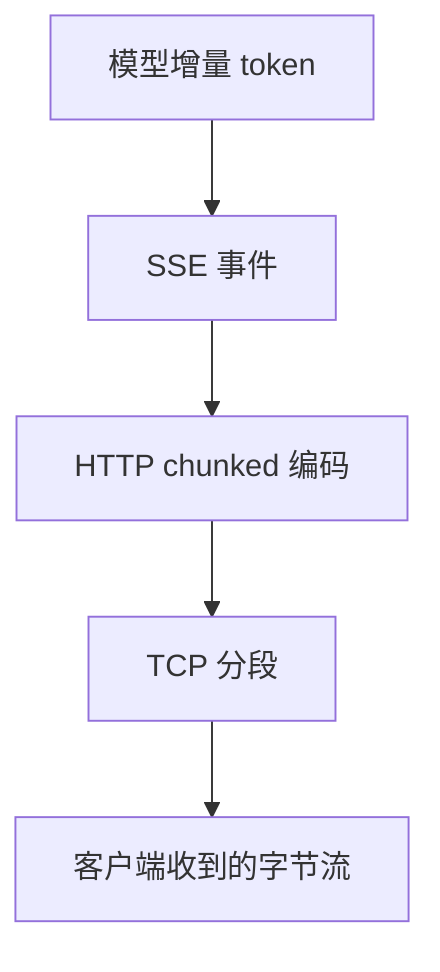

# SSE 断流、粘包与半包

流式输出出问题时，最难的是**它经常看起来是好的**：HTTP 状态 200，前 20 个 token 正常，然后停了。客户端没有报错，网关日志也没有异常，只有用户说「说到一半不动了」。

这一页按数据流经的层次拆解：TCP 分块 → HTTP chunked → SSE 事件 → 模型增量，每一层都可能是问题源头。

## 先说结论

- **`aiter_bytes()` 给你的是网络块，不是 SSE 事件**。必须按 `\n\n` 缓冲后解析。
- **一个 UTF-8 字符可能被拆在两个 chunk 里**。用增量解码器，不要对每个 chunk 单独 `decode()`。
- **网关必须禁用缓冲**：Nginx 的 `proxy_buffering`、CDN 的响应缓冲都会让流式变成「一次性返回」。
- **流式错误不能改状态码**。响应头已经发出去了，只能用 SSE 错误事件告知。
- **客户端断开要立刻取消上游请求**，否则你还在为没人看的内容付费。
- **不要自动重发整个请求**，除非能保证幂等——否则会重复计费并产生两段拼接的回答。

## SSE 协议的最小知识

一个 SSE 响应长这样：

```text
event: message
data: {"id":"chatcmpl-1","choices":[{"delta":{"content":"你"}}]}

data: {"id":"chatcmpl-1","choices":[{"delta":{"content":"好"}}]}

: keep-alive

data: [DONE]

```

规则：

- 每个字段一行，`field: value`。
- **空行表示一个事件结束**。
- `data:` 可以出现多次，按行拼接后才是完整数据。
- 以 `:` 开头的是注释，常用作心跳。
- 行结束可能是 `\n`、`\r\n` 或 `\r`。

OpenAI 兼容接口通常只用 `data:`，并且用 `data: [DONE]` 表示结束。Anthropic 用命名事件（`message_start`、`content_block_delta` 等），结构不同但分隔规则一样。

## 四层结构



| 层 | 边界 | 常见问题 |
| --- | --- | --- |
| 模型增量 | 厂商定义 | 空 delta、role-only 首块 |
| SSE 事件 | 空行 | 粘包、半包、多行 data |
| HTTP chunked | chunk size | 代理重组、缓冲 |
| TCP | MSS | 多字节字符被拆开 |

**关键认知：一个 TCP 包可能包含 3 个 SSE 事件，也可能只包含半个事件。任何假设「一次读取 = 一个事件」的代码都是错的。**

## 错误的写法

```python
# ❌ 典型错误：逐块 decode + 逐块 split
async for chunk in upstream.aiter_bytes():
    text = chunk.decode("utf-8")          # 多字节字符会被截断
    for line in text.split("\n"):          # 事件可能横跨多个 chunk
        if line.startswith("data: "):
            handle(json.loads(line[6:]))   # 空行边界被忽略
```

这段代码在本地测试时经常「能用」，因为本地网络块往往恰好对齐。上线后遇到大响应、代理、压缩，就开始随机失败。

## 正确的解析器

```python
import codecs
import json
from typing import AsyncIterator


class SSEParser:
    def __init__(self) -> None:
        self._decoder = codecs.getincrementaldecoder("utf-8")()
        self._buffer = ""
        self._data_lines: list[str] = []
        self._event = "message"

    def feed(self, chunk: bytes) -> list[dict]:
        events: list[dict] = []
        self._buffer += self._decoder.decode(chunk)

        # 统一换行，再按空行切事件
        self._buffer = self._buffer.replace("\r\n", "\n").replace("\r", "\n")
        while "\n\n" in self._buffer:
            raw, self._buffer = self._buffer.split("\n\n", 1)
            evt = self._parse_block(raw)
            if evt is not None:
                events.append(evt)
        return events

    def _parse_block(self, block: str) -> dict | None:
        data_lines: list[str] = []
        event = "message"
        for line in block.split("\n"):
            if not line or line.startswith(":"):
                continue
            field, _, value = line.partition(":")
            if value.startswith(" "):
                value = value[1:]
            if field == "data":
                data_lines.append(value)
            elif field == "event":
                event = value
            elif field == "id":
                pass
        if not data_lines:
            return None
        return {"event": event, "data": "\n".join(data_lines)}

    def flush(self) -> list[dict]:
        rest = self._buffer.strip()
        self._buffer = ""
        if not rest:
            return []
        evt = self._parse_block(rest)
        return [evt] if evt else []
```

用的时候：

```python
parser = SSEParser()
async for chunk in upstream.aiter_bytes():
    for evt in parser.feed(chunk):
        await forward(evt)
for evt in parser.flush():
    await forward(evt)
```

三个细节值得注意：

1. **`codecs.getincrementaldecoder`** 会缓存不完整的 UTF-8 字节，下一个 chunk 到达时继续解码。
2. **先统一换行再按空行切**，避免 `\r\n\r\n` 与 `\n\n` 混用导致切不开。
3. **`flush()`** 处理最后一个没有空行结尾的事件。很多服务端不发末尾空行，不 flush 就会丢最后一个 chunk。

## 转发时的缓冲

即使解析正确，中间任何一层缓冲都会破坏流式体验：

### Nginx

```nginx
location /v1/ {
    proxy_pass http://gateway;
    proxy_http_version 1.1;

    proxy_set_header Connection "";
    proxy_buffering off;
    proxy_cache off;
    proxy_request_buffering off;

    proxy_read_timeout 300s;
    proxy_send_timeout 300s;

    add_header X-Accel-Buffering no;
    chunked_transfer_encoding on;
}
```

`X-Accel-Buffering: no` 是给 Nginx 的指令，让它在应用侧无法改配置时也能关闭缓冲。网关自己也可以加上这个响应头。

### 应用侧

```python
return StreamingResponse(
    relay(),
    media_type="text/event-stream",
    headers={
        "Cache-Control": "no-cache, no-transform",
        "Connection": "keep-alive",
        "X-Accel-Buffering": "no",
    },
)
```

`no-transform` 很重要：某些 CDN 会对 `text/*` 做压缩或改写，直接破坏 SSE 格式。

### 代理与 CDN 清单

| 组件 | 需要检查 |
| --- | --- |
| Nginx / Envoy | `proxy_buffering`、`buffer` 大小、读超时 |
| Cloudflare / 云 CDN | 是否对 `text/event-stream` 做缓冲、超时是否 100 秒 |
| API Gateway（云厂商） | 集成超时、响应流式开关 |
| Service Mesh | sidecar 是否缓冲、空闲超时 |
| 负载均衡 | 空闲连接回收时间 |

一个快速验证方法：在网关里每秒发一个注释行 `: ping\n\n`，用 `curl -N` 观察是否每秒到达。如果几秒后才一次性出现，说明中间有缓冲。

## 超时

流式请求的超时要分层设置：

| 超时 | 含义 | 建议 |
| --- | --- | --- |
| 连接超时 | TCP/TLS 建连 | 5–10s |
| 首字节超时 | 发出请求到收到响应头 | 30–60s |
| 首 token 超时 | 到第一个可见 delta | 60–120s（推理模型更久） |
| 块间超时 | 两个 chunk 之间 | 60–120s |
| 总时长 | 整个请求 | 300–600s |

最容易漏的是**块间超时**。上游可能已经建立了连接、发了几个 token，然后卡住不动。没有块间超时，这个连接会一直挂着，占并发、占显存。

```python
async def iter_with_idle_timeout(aiter, idle_seconds: float):
    it = aiter.__aiter__()
    while True:
        try:
            chunk = await asyncio.wait_for(it.__anext__(), timeout=idle_seconds)
        except StopAsyncIteration:
            return
        except asyncio.TimeoutError:
            raise GatewayError(504, "upstream_idle_timeout", "no data within idle window")
        yield chunk
```

## 流式中的错误

响应头一旦发出（状态 200），就不能再改成 500 了。错误只能通过流内事件传达：

```text
event: error
data: {"error":{"type":"upstream_error","code":"upstream_timeout","message":"..."}}

```

实现上要注意：

- 错误事件发出后，**不要发 `[DONE]`**，否则客户端会认为正常结束。
- 如果已经转发了部分内容，客户端需要知道「这段回答不完整」。
- 记录一条 `stream_error` 日志，带上已转发的 token 数。

```python
async def relay():
    sent_any = False
    try:
        async for evt in upstream_events():
            sent_any = True
            yield encode(evt)
    except GatewayError as exc:
        yield encode({"event": "error", "data": json.dumps({"error": exc.to_dict()})})
        logger.warning("stream.error", extra={"fields": {"code": exc.code, "sent_any": sent_any}})
```

::: warning 客户端要能识别错误事件
很多 OpenAI SDK 只解析 `data:`，遇到 `event: error` 会静默忽略，表现为「流突然结束」。如果你自己写客户端，必须显式处理错误事件；如果用第三方 SDK，考虑把错误也放进 `data:` 里，并用一个可识别的字段标记。
:::

## 客户端断开

用户关掉页面、网络切换、手机锁屏，都会导致连接断开。网关必须：

1. 感知断开（`request.is_disconnected()` 或框架的 abort 回调）。
2. 取消上游请求。
3. 停止计费（或按已产生部分计费）。

```python
async def relay(request: Request, upstream):
    try:
        async for chunk in upstream.aiter_bytes():
            if await request.is_disconnected():
                break
            yield chunk
    finally:
        await upstream.aclose()
```

只 `break` 不够，必须显式关闭上游响应，否则 httpx 的连接会留在池里，直到超时。

## 断线重连

大多数 LLM API **不支持断点续传**。这意味着：

- 重连 = 重新生成 = 重新计费。
- 已输出的内容无法从断点继续。

所以策略应该是「不自动重连」，而是：

| 场景 | 处理 |
| --- | --- |
| 还没输出任何 token | 可以安全重试 |
| 已输出部分内容 | 不要自动重试；告知用户，让用户决定 |
| 幂等场景（如批量生成） | 用请求 ID 去重，服务端返回缓存结果 |

如果一定要做续传，只能在应用层实现：把已生成的文本作为 assistant 消息，追加「请从这句话继续」，但这不是真正的续传，模型可能重复或改变风格。

## 调试手法

### curl

```bash
curl -N -sS https://gateway.example.com/v1/chat/completions \
  -H "Authorization: Bearer $KEY" \
  -H "Content-Type: application/json" \
  -d '{"model":"chat-default","stream":true,"messages":[{"role":"user","content":"数到 20"}]}'
```

`-N` 关闭 curl 自己的缓冲。如果输出是一段一段出现的，说明链路正常；如果最后一次性出现，问题在缓冲。

### 逐字节观察

```bash
curl -N ... | while IFS= read -r line; do
  printf '%s %s\n' "$(date +%H:%M:%S.%3N)" "$line"
done
```

时间戳能直接暴露「卡了多久」。

### 抓包

```bash
sudo tcpdump -i any -A -s 0 'tcp port 443' | grep -A 2 'data:'
```

注意 HTTPS 下只能看到密文，需要在网关侧抓明文，或者用 `mitmproxy`。

### 分离变量

按「客户端 → 代理 → 网关 → 上游」逐段测：

1. 直连上游，确认上游流式正常。
2. 直连网关，确认网关转发正常。
3. 经过代理/CDN，确认没有缓冲。
4. 用真实客户端 SDK，确认解析正常。

哪一段开始「一次性返回」，问题就在那一段。

## 常见症状对照

| 症状 | 可能原因 | 检查 |
| --- | --- | --- |
| 一次性返回全部 | 代理缓冲 | `X-Accel-Buffering`、CDN 配置 |
| 每 4KB 一跳 | 缓冲区大小 | Nginx `proxy_buffer_size` |
| 中文乱码/问号 | 逐块 decode | 用增量解码器 |
| 偶尔丢最后一个事件 | 没 flush | 补 `flush()` |
| 20 个 token 后停住 | 块间超时/上游卡住 | 加 idle timeout |
| 状态 200 但无内容 | 上游返回空流 | 检查上游响应体 |
| 重复输出 | 客户端重连重发 | 禁止自动重连 |
| 流断在代理 60s | 代理读超时 | 调大 `proxy_read_timeout` |

## 反模式

| 反模式 | 后果 |
| --- | --- |
| 按 chunk 直接 split | 粘包/半包随机失败 |
| 每块单独 `decode("utf-8")` | 多字节字符损坏 |
| 忽略最后一个事件 | 丢失 `[DONE]` 或 usage |
| 网关默认缓冲 | 流式退化为一次性 |
| 流中出错改状态码 | 头已发出，客户端收不到 |
| 客户端断开不关上游 | 资源泄漏 + 继续计费 |
| 断线自动重发 | 重复计费、回答拼接错乱 |
| 只测本地直连 | 上线遇到代理才暴露 |

## Checklist

- [ ] 使用增量 UTF-8 解码器
- [ ] 按空行切事件，支持 `\n`、`\r\n`、`\r`
- [ ] 支持多行 `data:` 拼接
- [ ] 结束时 `flush()` 残留缓冲
- [ ] 响应头包含 `no-cache, no-transform` 与 `X-Accel-Buffering: no`
- [ ] 代理/CDN 已关闭缓冲，超时已调大
- [ ] 首 token 与块间超时分别配置
- [ ] 流内错误用 error 事件，不发 `[DONE]`
- [ ] 客户端断开时取消上游并释放连接
- [ ] 已输出内容后不自动重连
- [ ] 用 `curl -N` 验证过真实链路

## 下一篇

流式之外，另一个高频问题是上下文：[长上下文与性能边界](./long-context.md)。
