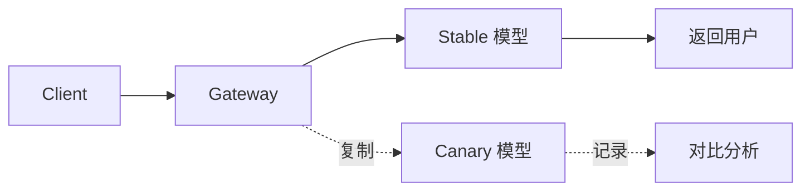

# 模型版本灰度与金丝雀

模型变更有两个来源：**你主动切换**（换更便宜/更强的模型），和**供应商悄悄升级**（同一个模型名，行为变了）。前者可以灰度，后者只能靠固定版本 + 监控兜底。

无论哪种，风险都比普通代码发布更高：代码错误通常是确定性的，模型行为变化是**统计性的**——错误率没涨，但回答质量悄悄下降。

## 先说结论

- **模型名要固定到版本**，能 pin 就 pin，不能 pin 就监控漂移。
- **灰度按稳定分桶**，同一租户/会话始终落在同一侧。
- **质量要单独评估**，延迟和错误率正常不代表答案变好了。
- **金丝雀阶段要有自动回滚条件**，而不是靠人盯。
- **影子流量很贵**，只在关键变更时用。
- **回滚是配置操作**，不是发版。

## 两类变更

| 变更 | 例子 | 可控性 | 策略 |
| --- | --- | --- | --- |
| 主动切换 | gpt-4o → gpt-4o-mini，Claude 3.5 → 4 | 高 | 灰度 + 评估 |
| 供应商升级 | 同名模型底层更新、默认参数变化 | 低 | 固定版本 + 漂移监控 |
| 参数变更 | temperature 默认值、最大输出 | 中 | 配置灰度 |
| 提示词变更 | system prompt 改版 | 高 | 与模型灰度分开 |

::: warning 同名不等于同模型
供应商可能在不变更模型名的情况下更新权重或推理配置。你的评测基线会在某天突然失效，而没有任何发布记录。这就是为什么要记录 `gen_ai.response.model`——它有时会返回带日期的实际版本。
:::

## 固定版本

优先使用带日期的模型标识：

```yaml
targets:
  - name: gpt-4o-2024-08-06
    provider: openai
    model: gpt-4o-2024-08-06
    aliases: [gpt-4o-stable]
```

如果供应商只提供浮动别名：

- 在响应里记录 `response.model`，观察它是否变化。
- 每周跑一次固定评测集，和基线对比。
- 发现漂移时，切到另一个区域/版本，或临时降低该模型的权重。

## 灰度维度

| 维度 | 适用 | 注意 |
| --- | --- | --- |
| 按租户 | B 端，可与客户约定 | 大客户单独沟通 |
| 按流量比例 | C 端，样本大 | 必须稳定分桶 |
| 按请求特征 | 低风险场景先试 | 特征要可解释 |
| 内部员工 | 第一道验证 | 反馈质量高 |
| 按地域 | 合规或延迟优化 | 注意数据边界 |

最常用的是「内部 → 1% → 5% → 20% → 50% → 100%」，每一阶段至少观察一个业务周期（比如一整天），而不是几小时。

## 稳定分桶

不能用 `random.random()`——同一个用户每次请求可能落到不同侧，体验会跳变，指标也被污染。

```python
import hashlib


def bucket(key: str, salt: str = "model-canary-v1") -> int:
    digest = hashlib.sha256(f"{salt}:{key}".encode()).hexdigest()
    return int(digest[:8], 16) % 10_000   # 0..9999


def pick_variant(tenant_id: str, rollout_pct: float) -> str:
    threshold = int(rollout_pct * 100)
    return "canary" if bucket(tenant_id) < threshold else "stable"
```

要点：

- **分桶键要稳定**：租户 ID、Key ID 或会话 ID，不要用请求 ID。
- **salt 带版本**：换 salt 会重新洗牌，只在必要时做。
- **比例单调递增**：1% → 5% 时，原来在 1% 里的租户仍在灰度中，避免反复横跳。
- **同一会话保持一致**：用 `session_id` 优先于 `tenant_id`，避免多轮对话中途换模型。

## 配置结构

```json
{
  "version": "2026-10-30.1",
  "routes": {
    "chat-default": {
      "stable": { "target": "gpt-4o-2024-08-06", "weight": 1.0 },
      "canary": { "target": "gpt-4o-mini-2024-07-18", "weight": 1.0 },
      "rollout_pct": 5.0,
      "salt": "canary-2026-10-30"
    }
  }
}
```

`version` 要出现在日志和响应头里：

```http
X-Gateway-Config-Version: 2026-10-30.1
X-Gateway-Variant: canary
```

出问题时，你能立刻知道某个请求用的是哪套配置。

## 质量怎么评估

延迟、错误率、成本是必要指标，但不足以判断「答得好不好」。

| 方法 | 成本 | 适用 |
| --- | --- | --- |
| 固定评测集 + 精确匹配 | 低 | 分类、抽取、格式类任务 |
| LLM-as-judge | 中 | 开放式问答、写作 |
| 人工抽样 | 高 | 高风险、主观性强 |
| 业务指标 | 低（但要等） | 转化率、采纳率、申诉率 |
| 用户反馈 | 低 | 点赞/点踩、重试率 |

### LLM-as-judge 的注意事项

- **位置偏见**：裁判模型可能偏好第一个或更长的答案。对比时交换顺序跑两次。
- **自我偏好**：用 A 模型评判 A 模型会偏高，尽量用第三方模型。
- **评分标准要具体**：不要问「哪个更好」，要问「是否包含X、是否遵循Y格式、是否有事实错误」。
- **保留人工校准**：定期用人工标注校验裁判的可靠性。

```python
JUDGE_PROMPT = """你是严格的评审。请从以下维度分别打 1-5 分，并给出理由：
1. 事实准确性
2. 是否遵循了要求的输出格式
3. 是否回答了用户的实际问题
不要因为长度或语气加分。

用户问题：{question}
参考答案：{reference}
待评答案：{answer}

以 JSON 输出：{{"accuracy": n, "format": n, "relevance": n, "reason": "..."}}
"""
```

## 影子流量

把生产请求复制一份发给新模型，只记录不返回：



优点：真实分布、无用户风险。
缺点：**成本翻倍**、有副作用（工具调用不能复制）、增加上游压力。

所以影子流量只用于：

- 关键模型切换前的最终验证。
- 离线无法覆盖的长尾请求。
- 采样 1%–5%，而不是全量。

复制时要去掉副作用：不要重复执行写操作，不要重复扣费给租户（成本记在平台账上）。

## 自动回滚

金丝雀阶段必须有人盯着，但人不能 24 小时盯。设置自动回滚条件：

| 指标 | 阈值 | 观察窗口 |
| --- | --- | --- |
| 错误率 | 比 stable 高 2 个百分点 | 5 分钟 |
| P95 TTFT | 比 stable 高 50% | 10 分钟 |
| 超时率 | 绝对值 > 1% | 5 分钟 |
| 单位成本 | 比预期高 30% | 30 分钟 |
| 质量分 | 比基线低 0.3（5 分制） | 每批评测 |
| 用户重试率 | 比 stable 高 20% | 30 分钟 |

```python
async def canary_guard(metrics, rollout: float) -> bool:
    if rollout <= 0:
        return False
    if metrics.error_rate_delta > 0.02:
        return True
    if metrics.ttft_p95_ratio > 1.5:
        return True
    if metrics.quality_delta < -0.3:
        return True
    return False
```

回滚动作就是把 `rollout_pct` 设为 0，并记录一次事件。**不要自动修改代码或重新部署**，配置回滚更快也更安全。

## 供应商漂移监控

即使不切换，也要定期验证：

```python
async def nightly_eval(model_target: str, golden_set: list[dict]) -> dict:
    scores = []
    for case in golden_set:
        resp = await call_model(model_target, case["messages"])
        scores.append({
            "case_id": case["id"],
            "exact_match": resp.text.strip() == case["expected"].strip(),
            "latency_ms": resp.latency_ms,
            "tokens": resp.usage.total_tokens,
        })
    return summarize(scores)
```

和上周基线对比，三项任一显著变化就告警：

- 准确率下降 > 3%。
- 平均输出 token 变化 > 20%（可能变啰嗦或变截断）。
- 拒绝率/空回答率上升。

这不是为了抓供应商的错，而是为了**在用户投诉之前发现变化**。

## 变更流程

```text
1. 提案：为什么换、预期收益、风险
2. 离线评估：golden set + 人工抽样
3. 影子流量（可选）：1%–5%，对比
4. 金丝雀：内部 → 1% → 5% → 20% → 50%
5. 全量：100%，保留 stable 配置一周
6. 清理：移除旧目标，更新文档
```

每一步都要有**明确的通过标准**和**负责人**。没有标准的灰度，最后都会变成「跑了一天没出事就全量」。

## 与提示词变更解耦

模型和 prompt 同时改，出问题时无法归因。原则：

- 一次只改一个变量。
- prompt 变更走独立的灰度通道。
- 两者的评测集可以共用，但结果要分开记录。

如果必须同时改，先发 prompt（用 stable 模型验证），再切模型（用新 prompt）。

## 回滚演练

- 每月至少做一次「配置回滚」演练。
- 记录从决定回滚到生效的时间。
- 验证回滚后指标恢复，且没有残留的 canary 请求。
- 检查日志里是否能查到变更前后的配置版本。

## 反模式

| 反模式 | 后果 |
| --- | --- |
| 用随机数分桶 | 同一用户体验跳变，指标失真 |
| 按请求分桶 | 多轮对话中途换模型 |
| 只看错误率 | 质量下降无法发现 |
| 灰度比例跳跃 | 1% 直接到 50%，风险集中 |
| 没有自动回滚 | 夜间出事无人处理 |
| 全量影子流量 | 成本翻倍，上游被打 |
| 模型与 prompt 同时改 | 出问题无法归因 |
| 回滚靠重新部署 | 太慢，且可能引入新变量 |
| 不固定模型版本 | 供应商升级导致基线失效 |

## Checklist

- [ ] 能 pin 的模型固定到日期版本
- [ ] 记录 `gen_ai.response.model`，监控是否漂移
- [ ] 灰度按稳定键分桶，比例单调递增
- [ ] 配置有版本号，出现在日志与响应头
- [ ] 有固定评测集，覆盖核心场景
- [ ] LLM-as-judge 做了位置与自我偏好校准
- [ ] 影子流量按比例采样，去副作用，成本单独记账
- [ ] 金丝雀有自动回滚阈值与观察窗口
- [ ] 回滚是配置操作，分钟级生效
- [ ] 模型与 prompt 变更解耦
- [ ] 每周有漂移监控任务
- [ ] 每季度做一次回滚演练

## 下一篇

部署与变更管理完成后，最后一章看生态：[LiteLLM 高级配置](../07-ecosystem/litellm.md)。
