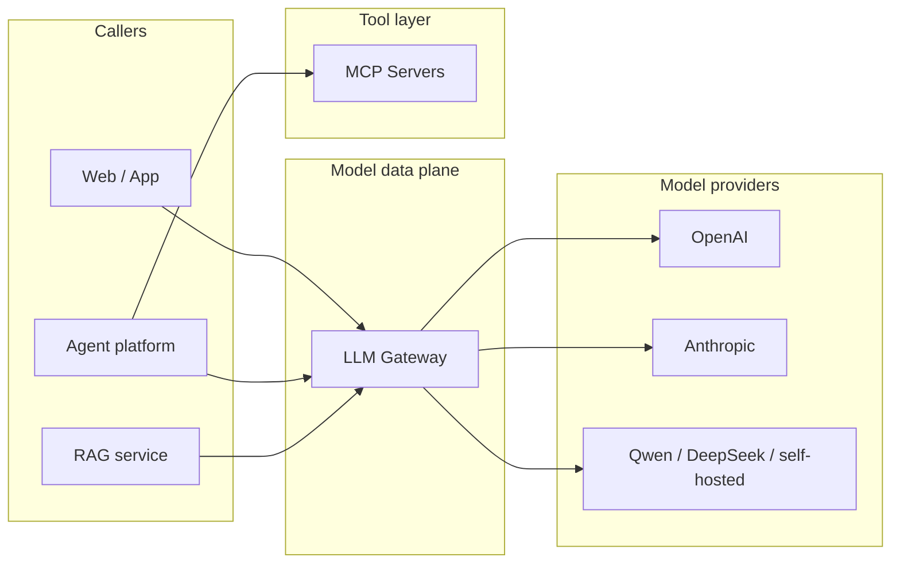
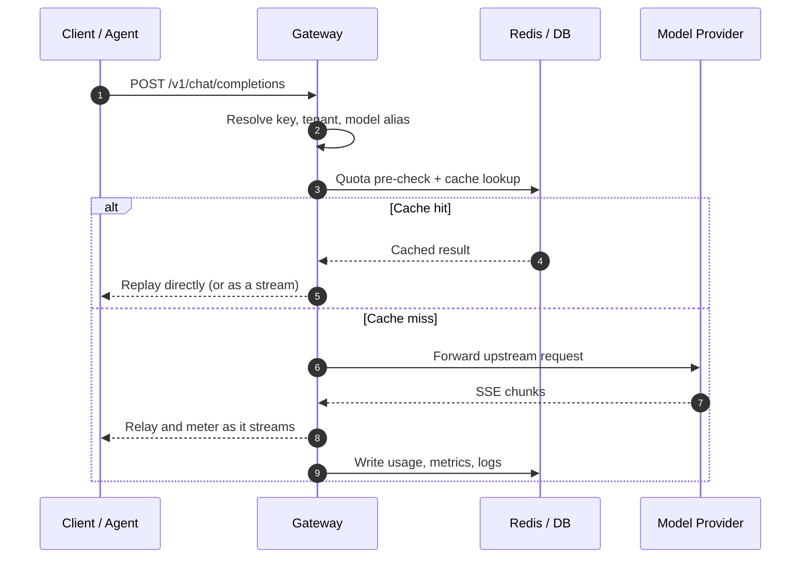

# Where the gateway sits in your AI architecture

Putting the gateway in the wrong place is worse than not having one: it can become a dumping ground for business logic, a second implementation of agent orchestration, or a single point nobody dares to touch.

This chapter does one thing: draw the boundary clearly.

## The big picture



Three boundaries:

- **LLM Gateway** owns "how models get called": protocol, keys, routing, quotas, retries, metering.
- **Agent** owns "why to call, how many times, and what to do with the result": planning, tool selection, memory, evaluation.
- **MCP** owns "how tools are exposed and called": tool protocol, service discovery, tool-level permissions.

The three cooperate, but **must not swallow each other**. Putting an agent loop inside the gateway, or letting an agent hold vendor keys directly, ends in coupling you cannot test.

## Responsibility boundary table

| Capability | LLM Gateway | Agent platform | MCP service |
| --- | --- | --- | --- |
| Vendor auth and key custody | Core | No | No |
| Unified model protocol | Core | Consumer | No |
| Model routing / fallback | Core | Can express semantic requirements | No |
| Tenant quotas and billing | Core | Can handle business quotas | Tool-level quotas |
| Multi-step planning and tool selection | No | Core | No |
| Tool execution and result return | No | Initiator | Core |
| Vector retrieval / document chunking | No | Can orchestrate | Can be provided as a tool |
| End-to-end trace | Emits spans for the model segment | Core: links the full chain | Emits spans for the tool segment |

::: tip One-line memory aid
**The gateway is the model data plane, the agent is the control plane, MCP is the tool plane.** The data plane optimizes for stability and measurement; the control plane for flexibility; the tool plane for clear permissions.
:::

## Lifecycle of a single request



Break it into seven steps and mark whether each must happen "before the first byte" or "can be async":

| Step | What it does | Timing |
| --- | --- | --- |
| 1. Authentication | Validate the gateway key, resolve tenant/project/permissions | Before first byte |
| 2. Normalization | Validate the request body, fill defaults, resolve the model alias | Before first byte |
| 3. Quota pre-check | Check RPM/TPM/budget, reserve quota when needed | Before first byte |
| 4. Routing | Pick a target, check health, decide the fallback chain | Before first byte |
| 5. Caching | Look up exact cache / semantic cache | Before first byte |
| 6. Forwarding | Open the upstream connection, stream through | Connection opened before first byte |
| 7. Metering and observability | Usage, latency, errors, cost, trace | Can be async, but must be reliable |

::: warning The special constraint of streaming
Once you write the first byte to the client, the HTTP status code is fixed. Any upstream error after that can only be expressed as an SSE `event: error`; you cannot change it to a 502. Steps 1–5 must complete before the first byte, and step 7 must tolerate a half-finished state such as "stream interrupted".
:::

## Control plane and data plane

The most common architectural mistake in a homegrown gateway is mixing config, the admin API and request forwarding in one process, so they drag each other down.

| Plane | Contents | Requirements |
| --- | --- | --- |
| Data plane | Request parsing, routing, forwarding, rate limiting, metering | Low latency, high concurrency, stateless, horizontally scalable |
| Control plane | Model catalog, routing config, tenants and keys, quota policies | Strong consistency, auditable, changes revertible |

Early on you can deploy them in the same process, but keep the **interfaces isolated**: the data plane only reads config snapshots; the control plane writes and pushes them. Otherwise one bulk config change from the admin side can stall production traffic.

## Choosing a deployment shape

| Shape | Latency | Isolation | Operational complexity | Fits |
| --- | --- | --- | --- | --- |
| In-process SDK | Lowest | Weak, ships with the business release | Low | One team, one stack |
| Sidecar | Low (localhost loopback) | Medium, per Pod | Medium | Kubernetes, latency-sensitive, polyglot |
| Centralized service | One extra hop | Strong, centralized governance | Medium-high | Multiple teams, quotas and billing |
| Managed gateway | Vendor-dependent | Medium | Low | No ops team, fast launch |

Most organizations end up hybrid: **a centralized gateway for governance and quotas, sidecars or SDKs for ultra-low-latency paths**. But do not start hybrid. Get the minimal centralized loop working first.

## Relationship with RAG

The RAG service handles retrieval and context assembly; the gateway does not touch vector stores. They overlap in exactly three places:

1. When RAG finally calls the generation model, it should go through the gateway to get unified quotas, fallbacks and metering.
2. Long system prompts and fixed documents are good candidates for **prompt/KV cache**; the gateway can own prefix stabilization and cache hit statistics.
3. Embedding calls can also go through the gateway, but note that their billing units differ from chat models.

## Relationship with agents

One agent task may call the model a dozen times. The gateway sees "a dozen independent requests"; the agent sees "one task". To connect the two you need:

- Request headers carrying `x-agent-run-id`, `x-agent-name`, `x-tenant-id`;
- The gateway aggregating cost and tokens by run id;
- In traces, the agent span as the parent and model calls as child spans;
- A token/cost cap per run so an agent loop cannot run away.

For the concrete wiring, see [better-agent integration](../04-scenarios/better-agent.md).

## Relationship with MCP

MCP manages tools; the gateway manages models. **Do not let the gateway execute tools**, and do not put model keys into MCP servers. What they share is tenant identity, the quota system and trace context.

A common combined call chain:

```text
Agent -> MCP Server (look up order) -> Agent -> LLM Gateway (generate reply) -> User
```

The gateway only handles the final model call, but its trace must attach to the same run, and its cost must count toward the same task. See [mcp-patterns integration](../04-scenarios/mcp-patterns.md).

## Four common mistakes

::: danger Mistake 1: the gateway becomes the business logic layer
Writing prompt templates, business validation and result post-processing in the gateway is fast at first, and untestable, unreusable and unreleasable later.
:::

::: danger Mistake 2: stuffing agent orchestration into the gateway
"It calls models anyway, let it loop a few times for me" turns the gateway from a stateless data plane into a stateful execution engine, and the capacity model changes completely.
:::

::: danger Mistake 3: protocol translation only
Protocol translation is just the entrance. Without quotas, timeouts, retries and metering, the gateway is only a better-looking location, not a better system.
:::

::: danger Mistake 4: the gateway becomes an invisible single point
No replicas, no health checks, no capacity planning, no one on call. When it goes down, every model call goes down with it.
:::

## Summary

- The gateway is the model data plane; its core job is to be **stable, controllable and measurable**.
- Agents, MCP and RAG each have their own boundary; they cooperate through tenant identity, traces and quotas instead of swallowing each other.
- In the request lifecycle, authentication, quotas, routing and caching must complete before the first byte.
- Start with a centralized service; consider sidecar/SDK only when latency is actually the bottleneck.

Next: [Open-source gateways: comparison and selection](./comparison.md) — see which wheels already exist.
