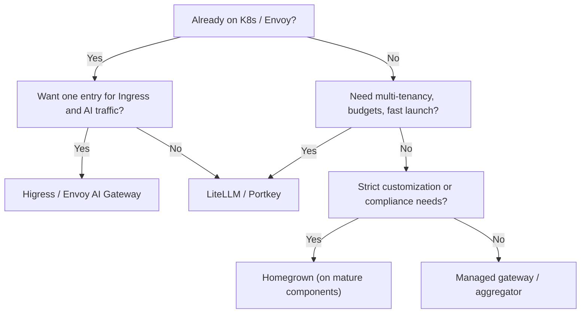

# Open-source gateways: comparison and selection

A quick reality check first: **no open-source gateway ships out of the box with everything you need for multi-tenancy + fine-grained billing + custom routing + enterprise compliance.** Selection is not about finding the strongest option; it is about finding the right starting point.

::: tip Bottom line
- Want OpenAI compatibility + multiple vendors + virtual keys as fast as possible: **LiteLLM**.
- Already running Kubernetes / Envoy: **Higress** or **Envoy AI Gateway**.
- A TypeScript team that needs guardrails and conditional routing: **Portkey Gateway**.
- Heavy customization, strict performance or special compliance needs: **build on mature components**, and do not write an HTTP proxy from scratch.
:::

## First, separate the four kinds of projects

The word "gateway" is used loosely. Classify before you compare:

| Type | Examples | What you get | What you still build yourself |
| --- | --- | --- | --- |
| Standalone AI gateway | LiteLLM, Portkey Gateway | Protocol normalization, routing, keys, budgets, callbacks | Business quotas, org model, deep customization |
| AI plugins for cloud-native gateways | Higress, Envoy AI Gateway, APISIX | Ingress, traffic management, AI proxying and rate limiting | Billing, tenant system, business control plane |
| Observability tools | OpenLLMetry | Traces and metrics for LLM calls | It is **not** a gateway; it does not forward or enforce quotas |
| Managed / aggregator services | OpenRouter, Cloudflare AI Gateway, etc. | No ops, unified billing, fast onboarding | Data boundaries, cost markup, vendor lock-in |

::: warning Do not treat OpenLLMetry as a gateway
OpenLLMetry solves "seeing", not "controlling". Comparing it with a gateway side by side is like confusing a security camera with an access control system.
:::

## Side-by-side comparison

The table lists only the dimensions that most affect engineering decisions. For current capabilities, check each project's own documentation.

| Project | Stack | Multi-vendor | Routing / fallback | Virtual keys / budget | Observability | Deployment complexity | Best for |
| --- | --- | --- | --- | --- | --- | --- | --- |
| LiteLLM | Python | Very broad | Weights, latency, fallback | Native | Callbacks, OTel, Prometheus | Low | Fast launch, multi-tenant MVP |
| Portkey Gateway | TypeScript | Very broad | Conditional routing, fallback, load balancing | Yes | Built-in and OTel | Low–medium | TS teams, guardrails |
| Higress | Go / Envoy | Broad | Plugin-based, K8s traffic management | Needs a control plane | Plugins + ecosystem | Medium | Kubernetes, a single Ingress entry |
| Envoy AI Gateway | Go / Envoy | Growing | Kubernetes-native, token rate limiting | Depends on the ecosystem | OTel-friendly | Medium–high | Envoy shops, platform teams |
| Apache APISIX | Lua / Nginx | Broad | `ai-proxy` and other plugins | Build your own | Plugin ecosystem | Medium | Existing APISIX gateways |
| One API / New API style | Go | Broad | Lightweight | Yes | Basic | Low | Small teams, aggregation relays |
| Homegrown | Anything | Up to you | Fully controllable | Fully controllable | Fully controllable | High | Special needs, long-term platform |

### LiteLLM

The closest thing to a "default answer" for an AI gateway: OpenAI-compatible proxy, a large set of vendor adapters, virtual keys, budgets, routing and callbacks, all reasonably complete. The Python stack lowers the barrier for customization, but also means you must plan capacity more carefully under high concurrency.

**Fits**: teams that want multi-vendor access, tenant keys and budgets running within one or two weeks.
**Watch out**: enterprise org modeling, complex quota inheritance and deep business billing may still need an external control plane.

### Portkey Gateway

A TypeScript implementation driven by config files, supporting conditional routing, fallback, load balancing, caching and guardrails. Friendly to Node/TS teams, and good for expressing "routing policy" as readable config.

**Fits**: frontend/full-stack teams that need input and output guardrails at the gateway layer.
**Watch out**: complex multi-tenant billing still needs to be built or covered by their platform features.

### Higress

A cloud-native gateway built on Envoy, with plugins for AI proxying, AI caching and token rate limiting, tightly integrated with Kubernetes Ingress and microservice governance. Its Chinese-language docs and ecosystem are strong.

**Fits**: platform teams that already run K8s and Envoy and want AI traffic on one entry point.
**Watch out**: it is more "cloud-native gateway + AI capabilities"; tenant billing and business quotas need extra design.

### Envoy AI Gateway

The AI gateway direction within the Envoy Gateway ecosystem, emphasizing Kubernetes-native operation, token-level rate limiting, provider onboarding and observability. Suited to platform engineering teams standardizing the data plane.

**Fits**: heavy Envoy / Gateway API users who want a unified data plane.
**Watch out**: the project is evolving quickly; check a specific version for its capability boundaries.

### Apache APISIX

Connects to multiple models through plugins such as `ai-proxy`, and fits teams that already run APISIX and want to reuse existing auth, rate limiting and observability. AI-specific features (prompt caching, token billing) are less complete than on dedicated gateways.

### One API / New API style projects

Lightweight aggregation and key management with simple deployment, good for individuals or small teams onboarding several models quickly. Routing policies, circuit breaking, fine-grained quotas and observability are usually basic, so avoid putting core production traffic on them directly.

### Homegrown

There are only three good reasons to build your own: **hard constraints on performance or deployment shape, a business model that open-source gateways cannot express, or an organizational requirement for full control of the data plane**. If the reason is just "we want our own gateway", first ask who will maintain it long term.

## Selection decision tree

This chart gives a starting point, not a destination. Real selection usually also goes through the checklist below.

## Six selection questions

1. **Protocol compatibility**: Is it natively compatible with OpenAI Chat Completions? Are tool calls, streaming and usage fields complete?
2. **Tenant model**: Does it support organization → project → key hierarchy? Can quotas be inherited and overridden?
3. **Quota granularity**: Can it enforce RPM, TPM, concurrency and daily/monthly budgets? Is the over-limit behavior configurable?
4. **Routing**: Are weights, tags, priority, failover and canary native? Can config be updated without a restart?
5. **Observability**: Does it emit OTel traces? Can metrics be aggregated by tenant/model/target? Can logs be redacted?
6. **Extensibility and exit**: Does the customization language match the team? Can data be exported? How easily would you be locked into one vendor?

::: tip A practical approach
Turn the six questions into a 1–5 scoring sheet and mark "must-haves" as veto items. Selection discussions drift into feature-list contests; a scoring sheet pulls them back to business constraints.
:::

## Open source is not free

| Hidden cost | How it shows up |
| --- | --- |
| Upgrade cost | Fast release cadence; config and database migrations need testing |
| Capacity cost | Memory and connection counts for a Python gateway under concurrent streaming |
| Customization cost | How to track upstream after forking, so the fork does not drift further |
| Operational cost | Replicas, Redis, database, monitoring, on-call |
| Compliance cost | Log retention, cross-border data, key custody |

If the team has not budgeted people for these costs, a managed option is often cheaper.

## A recommended three-phase path

| Phase | Goal | Suggestion |
| --- | --- | --- |
| Month 0–1 | One working entry point | Start with LiteLLM / Portkey, connect two vendors, get logs and traces flowing |
| Month 1–3 | Governable | Virtual keys, tenant quotas, budget alerts, basic routing and fallback |
| Month 3–6 | Operable | Cost attribution, SLOs, canary, disaster drills, evaluate replacing the data plane |

::: warning Do not build your own on day one
What people underestimate about a homegrown gateway is not forwarding, but **quota consistency, streaming error handling, key lifecycle, observability, and upgrade maintenance**. Get the business running on an open-source option first, then decide which parts are worth writing yourself.
:::

## References

- [LiteLLM documentation](https://docs.litellm.ai/)
- [Portkey Gateway (GitHub)](https://github.com/Portkey-AI/gateway)
- [Higress website](https://higress.io/)
- [Envoy AI Gateway](https://aigateway.envoyproxy.io/)
- [Apache APISIX AI plugins](https://apisix.apache.org/docs/apisix/plugins/ai-proxy/)
- [OpenLLMetry (GitHub)](https://github.com/traceloop/openllmetry)
- [OpenAI Chat Completions API](https://platform.openai.com/docs/api-reference/chat)
