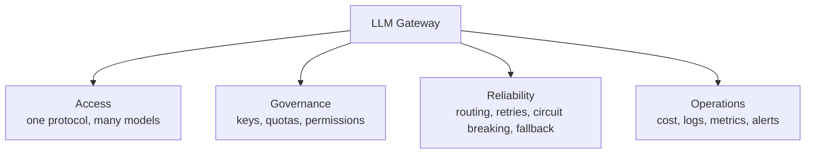

# Why you need an LLM gateway

The first version usually looks like this: one line of `client.chat.completions.create(...)` in your business code, the key in an environment variable, and it runs fine.

Then a second team needs the model too, a second vendor offers a cheaper price, your boss starts asking "how much did we spend on models this month", and 429s and timeouts show up in production now and then. That is when you realize the hard part is not calling a model, but keeping dozens of call sites **controllable** at the same time.

::: tip Bottom line
A gateway should appear when model calls stop being "an implementation detail inside one function" and become "shared infrastructure for several teams". It does not produce intelligence; it produces **determinism**.
:::

## A typical evolution story

| Stage | Typical shape | Main pain |
| --- | --- | --- |
| Demo | One service, one vendor, one key | Almost none; calling the SDK directly is the least work |
| Multi-team | Each service stores its own key and writes its own retries | Key sprawl, inconsistent behavior, bills nobody can explain |
| Multi-vendor | Different businesses use different models; code is full of `if provider ==` | Protocol differences, no failure fallback, runaway cost |
| Platform | One model entry point, governance per tenant/business | Quotas, audit, canary releases, observability and cost allocation |

Most teams do not need a gateway at "stage one". They get pushed into building one while moving from "stage two" to "stage three". Half a step ahead is architecture; three steps ahead is a burden.

## Seven risks of calling models directly

### 1. Key sprawl

Every service, every environment and every developer has a copy of the vendor key. One log line, one accidental frontend bundle, one bad commit, and the blast radius is the full quota of that key.

A gateway consolidates the real keys in one place and hands out only gateway keys that can be revoked, capped and audited.

### 2. Protocol differences leak into the business

OpenAI, Anthropic and Gemini differ in request bodies, streaming events and tool-call formats. Without a normalization layer, business code grows a pile of vendor branches, and switching models means changing the business.

### 3. Runaway traffic and amplified 429s

One upstream timeout, three services each retrying three times, and a 429 storm arrives nine times over. A gateway enforces quotas, concurrency control and retry budgets at the entry point so good intentions do not make things worse.

### 4. Failures with no safety net

When the primary model returns 5xx, the business can only return an error. A gateway can switch to a backup model by tag and priority, turning "vendor outage" into "quality variance".

### 5. Cost black box

The monthly bill is a single total. You don't know which tenant, which feature or which agent loop burned it. No attribution, no optimization.

### 6. No audit, no boundaries

Who called which model, when, with how much data, and whether it hit sensitive content? With direct calls, you can only guess.

### 7. Model upgrades and shutdowns

Vendors change model versions, adjust rate limits and retire old models, and your business code is forced to follow. A gateway isolates this churn behind **model aliases**: the business asks for `chat-default`, and the gateway decides who that is today.

::: warning A common misconception
"We only have one vendor, so we don't need a gateway." Vendor count is not the criterion. **The number of call sites, the number of teams, cost sensitivity and failure tolerance** are.
:::

## What a gateway actually provides

Those four kinds of value compress into one sentence: **pull cross-cutting concerns out of business code and put them behind a boundary that can evolve, scale and be on call independently.**

## When you do **not** need a gateway

This section matters more than the previous one. In the cases below, direct calls plus a thin wrapper are usually the better deal:

| Situation | Better choice | Why |
| --- | --- | --- |
| Solo project / monolith with low daily volume | SDK + thin wrapper | Deploying, upgrading and staffing a gateway costs more than it saves |
| One model, one team, no billing needs | SDK + consistent timeouts and logs | Observability is the urgent gap, not another proxy layer |
| Latency-critical calls within one datacenter | In-process SDK or sidecar | One less network hop, one less failure point |
| Small team with no ops capacity | Managed gateway / aggregator service | A self-hosted gateway needs someone accountable for availability |

A gateway is not free correctness. It adds a network hop, a config surface, a new service to monitor, and a single point that someone must own.

## Rough math: gateway cost vs incident cost

The numbers below are for a sense of magnitude, not a quote:

| Item | Magnitude | Notes |
| --- | --- | --- |
| Fixed cost of a self-hosted gateway | 1–2 people maintaining it + 2–4 small machines | Config, upgrades, alerts, incident handling |
| One key leak | Stolen quota + incident response + compliance conversations | Blast radius depends on the key's permissions |
| One 429 storm | Core features unavailable for tens of minutes | Retry amplification is more common than a single point of failure |
| One month of runaway billing | 10% to several times the budget | Very hard to localize without attribution |

If any row above makes you think "that already happened to us", the gateway usually pays for itself quickly.

## What a gateway does not solve

- **It does not improve model quality**: routing and fallbacks limit damage; they cannot make a weak model strong.
- **It does not replace agent logic**: planning, tool selection and memory stay in the agent layer.
- **It does not guarantee compliance on its own**: it provides audit and isolation capabilities; the policies still need people.
- **It is not highly available just because you installed it**: the gateway can fail too. It needs replicas, health checks and capacity planning.

## One-minute self-check

If you answer "yes" to **three or more** of these, it is worth putting a gateway on the roadmap:

- [ ] Do three or more services or teams call model APIs directly?
- [ ] Do keys live in two or more repositories or environments?
- [ ] Have you used two or more model vendors, or do you plan to?
- [ ] Do you need to split bills or quotas by tenant/business?
- [ ] When upstream fails, can the business only return an error, with no fallback?
- [ ] When something breaks, can you stitch the whole call chain together with a single request id?

::: tip Next
If you have decided to build one, start with [where the gateway sits in your architecture](./architecture.md) and draw the boundary first; then use the [capability checklist](./capabilities.md) to decide what goes into v1.
:::
