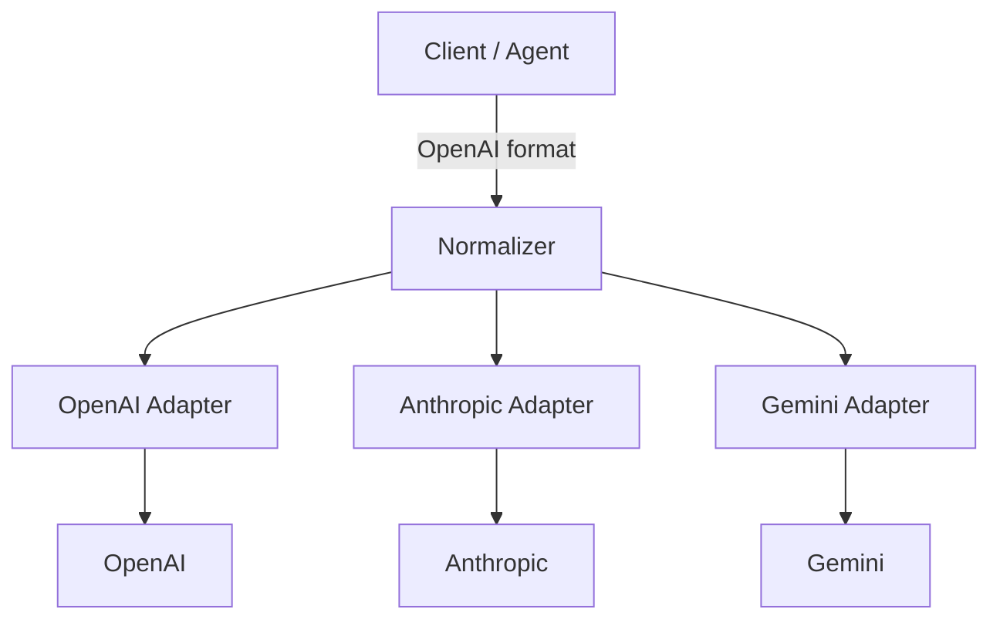

# One protocol: aligning on OpenAI

The first hurdle in multi-vendor integration is not the network, but the fact that **every model speaks its own dialect**. If business code depends on dialects directly, switching models means changing the business.

One of the gateway's core jobs is to pick a lingua franca and translate dialects into it. The industry de facto standard is **OpenAI Chat Completions** — not because it is the most elegant, but because SDKs, frameworks and developer mental models are built around it.

## One entry point, three dialects

| Dimension | OpenAI | Anthropic | Gemini |
| --- | --- | --- | --- |
| Endpoint | `POST /v1/chat/completions` | `POST /v1/messages` | `POST /v1beta/models/{model}:generateContent` |
| Auth | `Authorization: Bearer` | `x-api-key` + `anthropic-version` | `x-goog-api-key` (or a query parameter) |
| System prompt | `system` role in `messages` | top-level `system` field | `systemInstruction` |
| Message content | string or multimodal array | array of content blocks | `contents[].parts[]` |
| Tool calls | `tool_calls` | `tool_use` / `tool_result` blocks | `functionCall` / `functionResponse` |
| Finish reason | `finish_reason` | `stop_reason` | `finishReason` |
| Streaming | `data: {...}` + `[DONE]` | named events (`message_start`, etc.) | SSE chunks |
| Usage fields | `prompt_tokens` / `completion_tokens` | `input_tokens` / `output_tokens` | `promptTokenCount` / `candidatesTokenCount` |

::: tip Why Chat Completions rather than the Responses API
OpenAI's Responses API is a better fit for agents and built-in tools, but its ecosystem compatibility is not yet as broad as Chat Completions. A gateway can expose both entry points, but the **lowest common denominator for normalization** should still be Chat Completions.
:::

## Structure of the normalization layer



Three layers with distinct responsibilities:

1. **Entry validation**: accept exactly one request format, with clear field boundaries.
2. **Adapters**: request mapping, response mapping, streaming event mapping, error mapping.
3. **Passthrough zone**: vendor-specific features travel through `provider_options` unchanged instead of being force-normalized.

### Internal canonical model

Do not convert directly between adapters; land on an internal structure first:

```python
@dataclass
class CanonicalRequest:
    model_alias: str
    messages: list[dict]
    max_tokens: int | None
    temperature: float | None
    top_p: float | None
    stop: list[str] | None
    tools: list[dict] | None
    stream: bool
    provider_options: dict   # vendor-specific fields, passed through as-is
```

That way, adding a vendor means writing one adapter, without touching the entry point or routing.

## Request mapping: OpenAI → Anthropic

The core differences: the system prompt is top-level, content uses block arrays, tool schemas use different fields, and `max_tokens` is required.

```python
import json

def to_anthropic(body: dict, target_model: str) -> dict:
    system_parts: list[str] = []
    messages: list[dict] = []

    for msg in body["messages"]:
        role = msg["role"]

        if role == "system":
            system_parts.append(msg.get("content") or "")
            continue

        if role == "tool":
            messages.append({
                "role": "user",
                "content": [{
                    "type": "tool_result",
                    "tool_use_id": msg["tool_call_id"],
                    "content": msg.get("content") or "",
                }],
            })
            continue

        if role == "assistant" and msg.get("tool_calls"):
            blocks = []
            if msg.get("content"):
                blocks.append({"type": "text", "text": msg["content"]})
            for call in msg["tool_calls"]:
                blocks.append({
                    "type": "tool_use",
                    "id": call["id"],
                    "name": call["function"]["name"],
                    "input": json.loads(call["function"].get("arguments") or "{}"),
                })
            messages.append({"role": "assistant", "content": blocks})
            continue

        messages.append({"role": role, "content": msg.get("content") or ""})

    out = {
        "model": target_model,
        # Anthropic requires it; use a conservative default when missing
        "max_tokens": body.get("max_tokens", 1024),
        "messages": messages,
    }
    if system_parts:
        out["system"] = "\n\n".join(system_parts)
    if body.get("temperature") is not None:
        out["temperature"] = body["temperature"]
    if body.get("top_p") is not None:
        out["top_p"] = body["top_p"]
    if body.get("stop"):
        stop = body["stop"]
        out["stop_sequences"] = stop if isinstance(stop, list) else [stop]
    if body.get("stream"):
        out["stream"] = True
    if body.get("tools"):
        out["tools"] = [
            {
                "name": tool["function"]["name"],
                "description": tool["function"].get("description", ""),
                "input_schema": tool["function"].get("parameters", {"type": "object"}),
            }
            for tool in body["tools"]
            if tool.get("type") == "function"
        ]
    return out
```

::: warning The default `max_tokens` is a product decision
Too small truncates answers; too large amplifies cost and timeout risk. Configure a "default + hard ceiling" at the gateway, overridable per tenant, instead of copying some 4096.
:::

## Response mapping: Anthropic → OpenAI

```python
import time

STOP_REASON_MAP = {
    "end_turn": "stop",
    "stop_sequence": "stop",
    "max_tokens": "length",
    "tool_use": "tool_calls",
}

def from_anthropic_response(data: dict, model_alias: str) -> dict:
    text_parts: list[str] = []
    tool_calls: list[dict] = []

    for block in data.get("content", []):
        if block["type"] == "text":
            text_parts.append(block["text"])
        elif block["type"] == "tool_use":
            tool_calls.append({
                "id": block["id"],
                "type": "function",
                "function": {
                    "name": block["name"],
                    "arguments": json.dumps(block.get("input", {}), ensure_ascii=False),
                },
            })

    message: dict = {"role": "assistant", "content": "".join(text_parts) or None}
    if tool_calls:
        message["tool_calls"] = tool_calls

    usage = data.get("usage", {})
    prompt = usage.get("input_tokens", 0)
    completion = usage.get("output_tokens", 0)

    return {
        "id": data.get("id", ""),
        "object": "chat.completion",
        "created": int(time.time()),
        "model": model_alias,
        "choices": [{
            "index": 0,
            "message": message,
            "finish_reason": STOP_REASON_MAP.get(data.get("stop_reason"), "stop"),
        }],
        "usage": {
            "prompt_tokens": prompt,
            "completion_tokens": completion,
            "total_tokens": prompt + completion,
        },
    }
```

A few details that are easy to miss:

- OpenAI's `message.content` may be `null` for pure tool calls; do not force an empty string into it.
- `finish_reason` must be mapped, otherwise agent frameworks cannot tell whether to keep executing tools.
- When `usage` is missing, prefer marking `estimated=true` over fabricating precise numbers.

## Streaming mapping: different event semantics

Anthropic streams **named events**; OpenAI streams **uniform data chunks + [DONE]**. For text, the mapping is:

| Anthropic event | Handling |
| --- | --- |
| `message_start` | Record `input_tokens`; may emit a role delta |
| `content_block_start` (text) | Ignore, or emit an empty delta |
| `content_block_delta` (text_delta) | Convert to `delta.content` |
| `content_block_start` (tool_use) | Initialize `delta.tool_calls` (id / name) |
| `content_block_delta` (input_json_delta) | Append `partial_json` to `function.arguments` |
| `message_delta` | Take `stop_reason` and `output_tokens`, emit `finish_reason` |
| `message_stop` | Emit `data: [DONE]` |
| `ping` | Ignore, or use as a heartbeat |
| `error` | Convert to an SSE error event |

Minimal text-stream implementation:

```python
async def anthropic_sse_to_openai(lines, model_alias: str):
    async for line in lines:
        if not line.startswith("data:"):
            continue
        payload = line[5:].strip()
        if not payload:
            continue

        event = json.loads(payload)
        etype = event.get("type")

        if etype == "content_block_delta" and event["delta"].get("type") == "text_delta":
            chunk = {
                "object": "chat.completion.chunk",
                "model": model_alias,
                "choices": [{
                    "index": 0,
                    "delta": {"content": event["delta"]["text"]},
                    "finish_reason": None,
                }],
            }
            yield f"data: {json.dumps(chunk, ensure_ascii=False)}\n\n"

        elif etype == "message_delta":
            reason = STOP_REASON_MAP.get(event["delta"].get("stop_reason"), "stop")
            chunk = {
                "object": "chat.completion.chunk",
                "model": model_alias,
                "choices": [{"index": 0, "delta": {}, "finish_reason": reason}],
            }
            yield f"data: {json.dumps(chunk, ensure_ascii=False)}\n\n"

        elif etype == "message_stop":
            yield "data: [DONE]\n\n"
```

::: warning Streaming tool-call mapping is the most underestimated part
`input_json_delta` carries **incomplete JSON fragments**, which must be concatenated in order before parsing. Do not call `json.loads()` on each fragment, or you will fail on the very first chunk.
:::

## Tool call field mapping

OpenAI:

```json
{
  "type": "function",
  "function": {
    "name": "get_weather",
    "description": "Look up the weather",
    "parameters": {"type": "object", "properties": {"city": {"type": "string"}}}
  }
}
```

Anthropic:

```json
{
  "name": "get_weather",
  "description": "Look up the weather",
  "input_schema": {"type": "object", "properties": {"city": {"type": "string"}}}
}
```

Tool results come back completely differently too:

```json
// OpenAI: role = tool
{"role": "tool", "tool_call_id": "call_123", "content": "{\"temp\": 21}"}

// Anthropic: a tool_result block inside a user message
{"role": "user", "content": [{"type": "tool_result", "tool_use_id": "toolu_123", "content": "{\"temp\": 21}"}]}
```

When mapping, watch out for:

- `tool_use.id` and `tool_call_id` must correspond one-to-one; a mismatch means the agent never sees the result.
- `arguments` is a JSON string while `input` is an object, so conversion is needed in both directions.
- Parallel tool calls must preserve order and `index`.

## Do not over-normalize

The goal of a unified protocol is "common capabilities are portable", not "smooth out every difference". Pass the following through via extension fields:

| Capability | Passthrough |
| --- | --- |
| Anthropic `cache_control` | `provider_options.anthropic.cache_control` |
| Reasoning/thinking modes | `provider_options.*.thinking` |
| Gemini safety settings | `provider_options.gemini.safety_settings` |
| Strict JSON Schema | Prefer OpenAI `response_format`; if unsupported, degrade and fail explicitly |
| Vendor-specific parameters | Pass through as-is; never drop silently |

::: danger Silently dropping parameters is an incident source
The client sends `response_format`, the gateway decides upstream does not support it and quietly deletes it, and the business ends up with text it cannot parse. **If it is unsupported, fail explicitly**, or return `degraded: true` and log it.
:::

## How to test compatibility

Do not stop at "it returns a sentence". Cover at least:

- [ ] Non-streaming text
- [ ] Streaming text, with the fixture split in the middle of a JSON object
- [ ] A single tool call
- [ ] Parallel tool calls
- [ ] A second turn after returning tool results
- [ ] `max_tokens` truncation (`finish_reason=length`)
- [ ] Error mapping for upstream 429 / 401 / 500
- [ ] Presence and sanity of usage fields
- [ ] Multimodal input (if the business needs it)
- [ ] Empty content, pure tool call, extremely long system prompt

Store real vendor responses as fixtures and run contract tests in CI. When a protocol changes, the tests go red first.

## Launch checklist

- [ ] Only one client protocol is exposed
- [ ] Every vendor has its own adapter and fixtures
- [ ] `finish_reason` / `stop_reason` fully mapped
- [ ] Tool calls and tool results mapped in both directions
- [ ] Streaming events mapped by semantics, not string substitution
- [ ] Missing usage is estimated and flagged
- [ ] Vendor-specific parameters can pass through, never silently dropped
- [ ] Unsupported capabilities return explicit errors

## References

- [OpenAI Chat Completions](https://platform.openai.com/docs/api-reference/chat)
- [OpenAI Streaming](https://platform.openai.com/docs/api-reference/streaming)
- [Anthropic Messages API](https://platform.claude.com/docs/en/api/messages)
- [Gemini API: generateContent](https://ai.google.dev/api/generate-content)
- [OpenAI error codes](https://platform.openai.com/docs/guides/error-codes)

The next chapter closes the loop on errors and timeouts: [Timeouts, exceptions and error codes](./errors-timeout.md).
