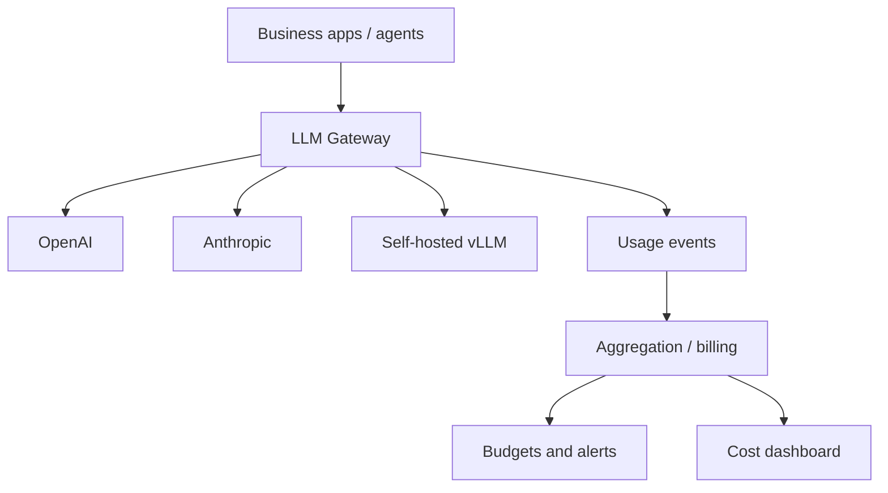
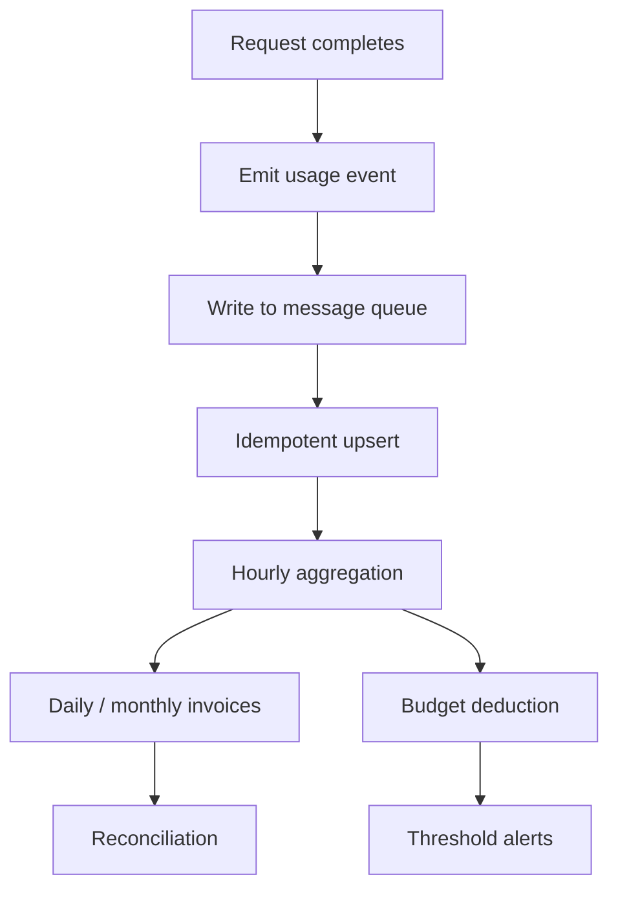

# Cost Tracking and Budget Alerts

The two most common LLM billing incidents: **finding out at month end that you overspent**, and **overspending without knowing who did it**. The first is missing alerts; the second is missing attribution. The gateway is the best place to fix both — every request passes through it, and it is the only component that simultaneously knows who is calling, which model they used, and how many tokens it took.

## The short version

- **The primary key for cost tracking is the request, not the invoice.** Every request emits one usage event; the invoice is an aggregation of events.
- **Streaming requests must yield usage too**: on the OpenAI side add `stream_options: {"include_usage": true}`; Anthropic/Gemini emit a dedicated event at the end of the stream.
- **Do not hardcode prices in code**; use a price table keyed by model and effective date.
- **Check the budget before forwarding, deduct after the response**. Check-then-deduct has a concurrency race, so you need "reserve + settle".
- **Internal and vendor books will never match exactly**; differences must be explainable instead of pretending they are equal.

## Why put it in the gateway



If every business unit keeps its own books, three problems are inevitable:

1. **Inconsistent definitions**: some count input and output, some count only output, some estimate by character.
2. **Missed records**: async tasks, failed retries, and background batch jobs are the easiest to lose.
3. **No reconciliation**: you cannot tell where the internal numbers diverge from the vendor invoice.

Once the gateway keeps the books centrally, the business only has to put attribution information in request headers and leave the rest to the platform.

## Step 1: Capture the full usage

### Non-streaming responses

Major vendors return usage in the response body, with different field names but the same semantics:

| Vendor | Input field | Output field | Cache field | Notes |
| --- | --- | --- | --- | --- |
| OpenAI | `prompt_tokens` | `completion_tokens` | `prompt_tokens_details.cached_tokens` | Reasoning models also report `reasoning_tokens` |
| Anthropic | `input_tokens` | `output_tokens` | `cache_read_input_tokens` / `cache_creation_input_tokens` | Cache writes usually cost more |
| Gemini | `promptTokenCount` | `candidatesTokenCount` | `cachedContentTokenCount` | Fields live under `usageMetadata` |
| DeepSeek | `prompt_tokens` | `completion_tokens` | `prompt_cache_hit_tokens` / `prompt_cache_miss_tokens` | Hits and misses are priced separately |
| vLLM / SGLang | `prompt_tokens` | `completion_tokens` | Depends on prefix cache config | Self-hosted usually has no money charged; record tokens only |

::: tip Do not estimate tokens yourself
Estimates like `len(text) / 4` are fine for rough rate-limit pre-checks and **must never be used for billing**. Billing always follows the usage returned in the response; when usage is unavailable, record `usage_missing` and alert instead of guessing a number.
:::

### Streaming responses

Streaming does not return usage by default. OpenAI-compatible APIs need it enabled explicitly:

```json
{
  "model": "gpt-4o-mini",
  "stream": true,
  "stream_options": { "include_usage": true },
  "messages": [{ "role": "user", "content": "Hello" }]
}
```

Once enabled, the last chunk has an empty `choices` and a populated `usage`. When forwarding, **do not drop this chunk** — it is harmless to clients (most SDKs ignore empty choices) but essential for billing.

Anthropic's stream carries `usage` in the `message_delta` event; Gemini puts it in `usageMetadata` of the final chunk. The adapter's job is to **produce one unified Usage object when the stream ends**, instead of making the layer above parse each vendor's fields.

```python
from dataclasses import dataclass


@dataclass
class Usage:
    input_tokens: int = 0
    output_tokens: int = 0
    cached_input_tokens: int = 0
    cache_write_tokens: int = 0
    reasoning_tokens: int = 0

    @property
    def total_tokens(self) -> int:
        return self.input_tokens + self.output_tokens
```

### What if the stream breaks

A client disconnect, an upstream timeout, or a gateway restart can all leave a stream that never ends normally. The principle:

| Situation | Billing policy |
| --- | --- |
| Disconnected after usage was received | Bill normally per usage |
| No usage received, but some content was emitted | Estimate input from the request and output from forwarded chunks; mark `usage_estimated` |
| Failed before the connection was established | Do not bill; record a failure event for analysis |
| Upstream 429 with no tokens produced | Do not bill |

What matters is not precision but that **every case has an explicit, queryable rule**.

## Step 2: The price book

Prices change, vary by time of day, and have tiers, so prices must be data, not constants:

```python
from dataclasses import dataclass
from datetime import date
from decimal import Decimal


@dataclass(frozen=True)
class Price:
    model: str
    effective_from: date
    input_per_mtok: Decimal        # price per million input tokens
    output_per_mtok: Decimal
    cached_input_per_mtok: Decimal | None = None
    cache_write_per_mtok: Decimal | None = None
    currency: str = "USD"


PRICE_BOOK: list[Price] = [
    Price("gpt-4o-mini", date(2025, 1, 1), Decimal("0.15"), Decimal("0.60"),
          cached_input_per_mtok=Decimal("0.075")),
    Price("claude-sonnet", date(2025, 1, 1), Decimal("3.00"), Decimal("15.00"),
          cached_input_per_mtok=Decimal("0.30"),
          cache_write_per_mtok=Decimal("3.75")),
]


def resolve_price(model: str, on: date) -> Price:
    candidates = [p for p in PRICE_BOOK if p.model == model and p.effective_from <= on]
    if not candidates:
        raise LookupError(f"no price for model={model} on={on}")
    return max(candidates, key=lambda p: p.effective_from)
```

A few easy traps:

- **Currency**: the vendor invoices in USD while your tenant contracts are in CNY. Store exchange rates in a separate table, locked to the invoice date; never recompute history with live rates.
- **Cache pricing is tiered**: cache hits are usually 50%–90% cheaper, while cache writes may cost more than normal input. Computing only `input × price` systematically overestimates or underestimates.
- **Volume tiers**: some vendors tier by monthly volume. If your volume is large enough, pricing must support "progressive bands" rather than a single flat rate.
- **Multimodality**: images convert to tokens by resolution, audio is billed by the second; do not mix them into text tokens.

## Step 3: The cost formula

```python
from decimal import Decimal


def compute_cost(usage: Usage, price: Price) -> Decimal:
    cached = usage.cached_input_tokens
    uncached = max(usage.input_tokens - cached, 0)

    cached_rate = price.cached_input_per_mtok or price.input_per_mtok
    write_rate = price.cache_write_per_mtok or price.input_per_mtok

    cost = (
        Decimal(uncached) * price.input_per_mtok
        + Decimal(cached) * cached_rate
        + Decimal(usage.cache_write_tokens) * write_rate
        + Decimal(usage.output_tokens) * price.output_per_mtok
    ) / Decimal(1_000_000)

    return cost.quantize(Decimal("0.000001"))
```

Watch out for `reasoning_tokens`: OpenAI's reasoning tokens are usually already included in `completion_tokens`, so **do not add them again**. Anthropic's `thinking` tokens count toward `output_tokens`. Follow the official docs, and leave an assertion or comment in the code stating how you handle it.

## Step 4: Attribution dimensions

A cost record must answer "who, in what scenario, through which path spent this":

| Dimension | Source | Purpose |
| --- | --- | --- |
| `tenant_id` | Bound to the API key | Per-tenant invoices |
| `project_id` | Key or request header | Project cost |
| `key_id` | Auth result | Locate leaks or abuse |
| `feature` | Request header `X-Feature` | Product line cost |
| `model_alias` | Request body | The model as users see it |
| `model_target` | Routing result | Which vendor was actually called |
| `route_group` | Routing result | Cost share of degraded/backup paths |
| `run_id` / `trace_id` | Request headers | Correlate with one agent task |
| `cache_hit` | Cache layer | How much money was saved |

Fields like `feature` **cannot be trusted from arbitrary client input**; validate them against an allowlist or attribution data gets polluted. The safer approach is to derive them from key metadata.

## Step 5: The billing pipeline



### Event structure

```json
{
  "event_id": "ue_01J8Z3K4",
  "request_id": "req_9f2c1a",
  "occurred_at": "2026-10-30T12:34:56.789Z",
  "tenant_id": "t_1001",
  "project_id": "p_42",
  "key_id": "key_7d",
  "feature": "chat",
  "model_alias": "chat-default",
  "model_target": "deepseek-chat",
  "provider": "deepseek",
  "input_tokens": 1832,
  "output_tokens": 517,
  "cached_input_tokens": 1024,
  "usage_source": "upstream",
  "status": 200,
  "latency_ms": 2380,
  "ttft_ms": 410,
  "cost_usd": "0.001284",
  "price_version": "2025-01-01"
}
```

`usage_source` matters: `upstream` means it came from the vendor, `estimated` means the gateway estimated it, `missing` means it was unavailable. Reports must be able to split by it, or finance will ask why you have two sets of numbers.

### Idempotency

Retries, queue redelivery, and backfill scripts all produce duplicate events. Use `request_id` as the unique key and write with `ON CONFLICT DO NOTHING`:

```sql
CREATE TABLE usage_events (
  event_id        TEXT PRIMARY KEY,
  request_id      TEXT NOT NULL,
  occurred_at     TIMESTAMPTZ NOT NULL,
  tenant_id       TEXT NOT NULL,
  project_id      TEXT,
  key_id          TEXT,
  feature         TEXT,
  model_alias     TEXT NOT NULL,
  model_target    TEXT NOT NULL,
  provider        TEXT NOT NULL,
  input_tokens    BIGINT NOT NULL DEFAULT 0,
  output_tokens   BIGINT NOT NULL DEFAULT 0,
  cached_input_tokens BIGINT NOT NULL DEFAULT 0,
  usage_source    TEXT NOT NULL,
  status          INT NOT NULL,
  latency_ms      INT,
  ttft_ms         INT,
  cost_usd        NUMERIC(18, 8) NOT NULL,
  price_version   TEXT NOT NULL,
  UNIQUE (request_id)
);

CREATE INDEX idx_usage_tenant_time ON usage_events (tenant_id, occurred_at);
CREATE INDEX idx_usage_model_time ON usage_events (model_target, occurred_at);
```

A daily aggregate table serves dashboards and budgets so you do not scan raw events every time:

```sql
CREATE TABLE usage_daily (
  day         DATE NOT NULL,
  tenant_id   TEXT NOT NULL,
  model_target TEXT NOT NULL,
  requests    BIGINT NOT NULL,
  input_tokens  BIGINT NOT NULL,
  output_tokens BIGINT NOT NULL,
  cached_tokens BIGINT NOT NULL,
  cost_usd    NUMERIC(18, 6) NOT NULL,
  PRIMARY KEY (day, tenant_id, model_target)
);
```

Aggregation jobs must be **rerunnable**: recompute and overwrite by day instead of accumulating incrementally. Once incremental accumulation goes wrong, fixing it is painful.

## Step 6: Budgets and alerts

### Three budget levels

| Level | Purpose | Behavior when exceeded |
| --- | --- | --- |
| Tenant monthly budget | Contracted allowance | Hard rate limit or degrade to a cheaper model |
| Project/environment budget | Stop test environments from burning money | Alert + throttle |
| Key daily budget | Stop leaked keys from being drained | Block immediately |

### Reserve + settle

Deducting only after the request completes lets all concurrent requests pass the check. Do it in two steps:

```python
async def reserve_budget(redis, tenant_id: str, estimate_usd: float) -> str | None:
    """Return the reservation id; return None when the budget is insufficient."""
    key = f"budget:{tenant_id}:{today()}"
    remaining = await redis.eval(RESERVE_LUA, 1, key, estimate_usd)
    if remaining is None:
        return None
    return f"rsv_{uuid4().hex[:12]}"


async def settle_budget(redis, tenant_id: str, reserved: float, actual: float) -> None:
    key = f"budget:{tenant_id}:{today()}"
    await redis.eval(SETTLE_LUA, 1, key, reserved, actual)
```

`RESERVE_LUA` does "read balance → check → deduct the estimate"; `SETTLE_LUA` does "refund the estimate → deduct the actual". Estimate an upper bound from "input tokens + max output tokens", and lean toward reserving a bit more.

::: warning Estimates cannot be absurd
Reserving the full `max_tokens` every time badly understates your concurrency capacity. A more practical approach: estimate from the P95 output length of recent similar requests, and set a per-request cap; requests above the cap go through manual approval or a separate quota.
:::

### Threshold design

| Threshold | Action |
| --- | --- |
| 50% | Mark on the dashboard, mention in the weekly report |
| 80% | Notify the tenant owner, start throttling non-production environments |
| 95% | Degrade production to a cheaper model, page the platform on-call |
| 100% | Hard stop or allow allowlisted keys only |

Alerts need context: current spend, budget, projected month-end spend (extrapolated at the current rate), and the top 3 consumption sources. A bare "80% exceeded" message is as good as no alert.

### How budgets relate to rate limiting

Budgets are not a substitute for rate limiting. Rate limiting protects **upstream capacity**; budgets protect **the wallet**. You need both, and the budget check should happen after rate limiting and before forwarding — reject cheaply first, then do the expensive checks.

## Step 7: Reconciliation

Internal and vendor books never match exactly; differences usually come from:

| Source of difference | Symptom | Handling |
| --- | --- | --- |
| Time zone | A day's worth of usage differs around month boundaries | Use UTC or the billing time zone consistently, and document it |
| Retries | Internal counts one, vendor counts two (or the reverse) | Bill by actual vendor requests; mark retries separately |
| Cache pricing | Internally computed as normal input | Fix the price book and add cache fields |
| Missing usage | Internally estimated | Mark `estimated` and track the deviation separately |
| Free credits/grants | Already deducted on the vendor invoice | Record the deduction as a separate line internally |
| Exchange rate | Recomputed with live rates | Lock the rate to the invoice date |

Reconciliation cadence: **a small daily check (compare token volume by model) and a large monthly check (compare money)**. Investigate any difference above 2%; do not wait for the quarterly audit.

```sql
-- Daily comparison by model: internal token counts vs imported vendor billing
SELECT
  i.model_target,
  i.input_tokens  AS internal_input,
  v.input_tokens  AS vendor_input,
  ROUND((i.input_tokens - v.input_tokens)::numeric / NULLIF(v.input_tokens, 0) * 100, 2) AS diff_pct
FROM usage_daily i
JOIN vendor_daily v
  ON v.day = i.day AND v.model = i.model_target
WHERE i.day = CURRENT_DATE - 1
ORDER BY ABS(i.input_tokens - v.input_tokens) DESC;
```

## Step 8: Anomaly detection

Cost anomalies usually surface problems before business anomalies do:

- **A sudden jump in per-request cost**: the context swallowed a whole document, or the output length ran away.
- **A steep cost curve for one key**: the key leaked or is being drained by a script.
- **Cache hit rate dropping**: the prompt prefix is polluted by dynamic content (see [Caching](./caching.md)).
- **Retry rate climbing**: the upstream is unstable and failed requests also burn quota.
- **An abnormal number of calls for one `run_id`**: the agent is stuck in a loop.

These can all be implemented with simple rules; no complex models required:

```python
def detect_anomaly(current: float, baseline_p95: float) -> str | None:
    if baseline_p95 <= 0:
        return None
    ratio = current / baseline_p95
    if ratio >= 10:
        return "critical"
    if ratio >= 3:
        return "warning"
    return None
```

Use the P95 of the same tenant, same model, and same time window as the baseline; it is more sensitive and produces fewer false positives than global averages.

## What the dashboard should show

| Metric | Notes |
| --- | --- |
| Daily cost / month to date | The basics, split by tenant and model |
| Unit cost | Cost per thousand requests, cost per million tokens |
| Cache savings | `cost without caching - actual cost` |
| Cost distribution | Share of the top 10 tenants/projects |
| Budget burn rate | Used / budget, with a projection |
| `usage_source` share | The higher the estimated share, the less trustworthy the books |
| Failed request cost | 4xx/5xx can still consume tokens |

An example monthly invoice:

| Item | Requests | Input tokens | Output tokens | Cache hit | Amount (USD) |
| --- | ---: | ---: | ---: | ---: | ---: |
| Support bot | 1,284,300 | 812M | 96M | 61% | 1,842.60 |
| Code assistant | 402,115 | 1,930M | 210M | 44% | 4,918.22 |
| Internal knowledge base | 88,402 | 310M | 22M | 72% | 402.15 |
| Test environment | 51,003 | 74M | 9M | 12% | 96.40 |
| **Total** | **1,825,820** | **3,126M** | **337M** | — | **7,259.37** |

## Anti-patterns

| Anti-pattern | Consequence |
| --- | --- |
| Estimating billing from character counts | Systematic error in the books; reconciliation impossible |
| Hardcoding prices in business code | A price change needs a deploy, and historical bills cannot be recomputed |
| Recording only after a successful response | Costs from broken streams and timeouts are lost entirely |
| Budget check and deduction separated with no reservation | Overspend several times over under concurrency |
| Incrementally accumulating the aggregate table | One mistake poisons the data permanently |
| Looking only at the total, not `model_target` | Degraded paths quietly get more expensive with nobody noticing |

## Checklist

- [ ] Both streaming and non-streaming yield usage, with a `usage_source` marker when they do not
- [ ] The price book is queryable by model and effective date, with cache prices configured separately
- [ ] Cost math uses `Decimal` with enough precision
- [ ] Events are written idempotently keyed by `request_id`
- [ ] Attribution fields are complete, and fields like `feature` come from trusted sources
- [ ] Budgets use reserve + settle and cover concurrent requests
- [ ] Alerts at 50/80/95/100%, with projections and top sources in the notification
- [ ] Daily aggregates are rerunnable and support overwriting by day
- [ ] A daily reconciliation job runs and differences are explained
- [ ] The dashboard includes unit cost, cache savings, and failed request cost

## Next

Once the cost is clear, the next step is making it **observable**: where a request is slow, where it fails, and where the money goes should all be visible in the same trace.

Next: [Logging and tracing](../03-observability/logging-tracing.md).
