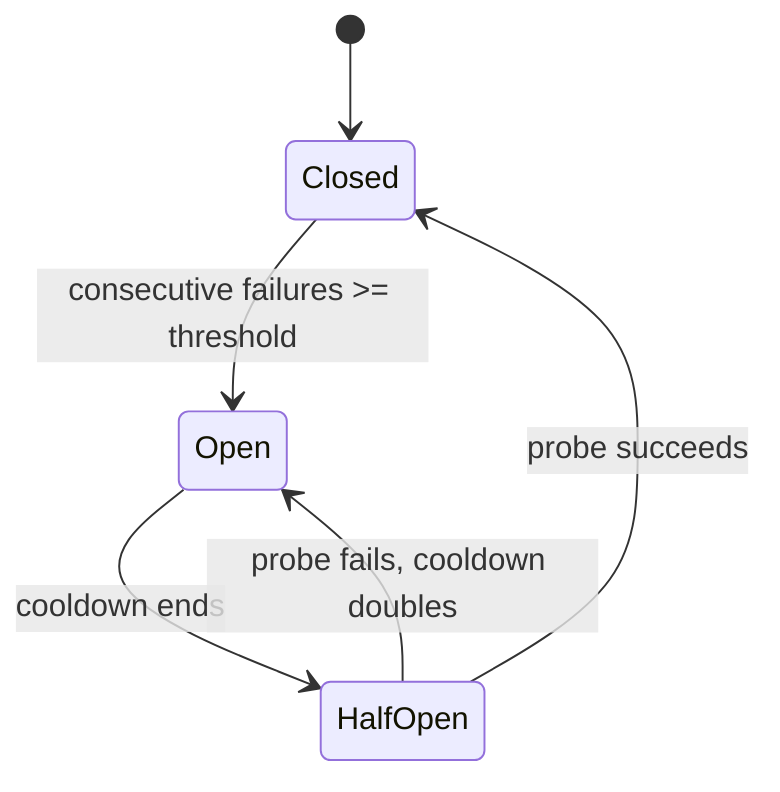

# Retries, Circuit Breakers, Degradation, and Fallbacks

Failure handling has two extremes to fear: **doing nothing** and **retrying everything**. The first turns one blip into one outage; the second turns one outage into one avalanche.

This chapter lays out a fault-tolerance strategy with clear boundaries.

## Failure classification

| Failure | Retry? | Handling |
| --- | --- | --- |
| DNS / TCP / TLS failure | ✅ | Switch targets or retry with backoff |
| Connection timeout | ✅ | Same as above |
| First token timeout | ✅ (before the first byte) | Switch targets |
| 408 / 504 | ✅ | Retry with backoff |
| 429 | ✅ | Respect `Retry-After`, count against the retry budget |
| 500 / 502 / 503 | ✅ | Switch targets or back off |
| 400 / 422 | ❌ | Request problem; retrying is useless |
| 401 / 403 | ❌ | Configuration/permission problem that must surface |
| 404 | ❌ | Wrong model or route configuration |
| Content filter | ❌ | Blocked by policy |
| Interrupted after the stream started | ❌ | Cannot be rolled back; only report the error |
| Client disconnected voluntarily | ❌ | Cancel the upstream immediately and stop billing |

::: warning Retryable ≠ should retry
Also check: has the request already incurred cost, has anything been sent to the user, is the current retry rate too high, does the tenant still have budget.
:::

## Retries: exponential backoff with full jitter

Fixed-interval retries make all replicas hit the upstream at the same moment again. Prefer **full jitter**:

```python
import asyncio
import random

class RetryableError(Exception):
    def __init__(self, message: str, retry_after: float | None = None):
        self.message = message
        self.retry_after = retry_after

async def call_with_retry(fn, attempts: int = 3, base_delay: float = 0.3, max_delay: float = 5.0):
    last_error: Exception | None = None

    for attempt in range(1, attempts + 1):
        try:
            return await fn()
        except RetryableError as exc:
            last_error = exc
            if attempt == attempts:
                break
            delay = min(max_delay, base_delay * (2 ** (attempt - 1)))
            if exc.retry_after is not None:
                delay = max(delay, min(exc.retry_after, 30.0))
            await asyncio.sleep(random.uniform(0, delay))

    raise last_error or RuntimeError("retry failed")
```

| Attempt | Exponential delay | Full jitter range |
| --- | --- | --- |
| 1 → 2 | 0.3s | 0–0.3s |
| 2 → 3 | 0.6s | 0–0.6s |
| 3 → 4 | 1.2s | 0–1.2s |

### Retry budget

Retries without a budget turn "10% failures" into "30% extra traffic". Recommendations:

- At most 2 retries per request;
- When the global retry rate exceeds 10%, stop automatic retries and only do failover;
- Cap retries per tenant so a single user cannot amplify load;
- For streaming requests, retry only before the first byte.

## Circuit breakers: give a bad target a cooling-off period



```python
import asyncio
import time

class CircuitBreaker:
    def __init__(self, failure_threshold: int = 3, recovery_timeout: float = 15.0):
        self.failure_threshold = failure_threshold
        self.recovery_timeout = recovery_timeout
        self.failures = 0
        self.opened_at = 0.0
        self.state = "closed"
        self._lock = asyncio.Lock()

    async def allow(self) -> bool:
        async with self._lock:
            if self.state == "closed":
                return True
            if self.state == "open" and time.monotonic() - self.opened_at >= self.recovery_timeout:
                self.state = "half_open"
                return True
            return False

    async def success(self) -> None:
        async with self._lock:
            self.state = "closed"
            self.failures = 0

    async def failure(self) -> None:
        async with self._lock:
            self.failures += 1
            if self.state == "half_open" or self.failures >= self.failure_threshold:
                self.state = "open"
                self.opened_at = time.monotonic()
                self.recovery_timeout = min(self.recovery_timeout * 2, 300.0)
```

Production notes:

- Breaker dimension: `target + model`, never one blanket breaker per vendor;
- Share state across replicas (Redis), otherwise each replica probes on its own;
- Half-open should admit exactly one probe request, then ramp traffic gradually after it succeeds;
- A 429 should not trip the breaker directly; it usually means "temporarily rate limited".

## Fallbacks: is it still usable after the switch

The most common fallback mistake is **considering only availability and not capability**.

| Request needs | Primary model | Backup model | Can it fall back |
| --- | --- | --- | --- |
| Plain text | ✅ | ✅ | Yes |
| Tool calls | ✅ | ✅ | Requires tool schema mapping |
| Vision input | ✅ | ❌ | No; must be filtered in advance |
| Strict JSON | ✅ | Text only | Degrade and flag, or fail outright |
| Very long context | ✅ | Smaller window | No; route by tag |

Declare capabilities in the route configuration:

```json
{
  "model": "gpt-4o-mini",
  "tags": ["fast", "tools", "vision"],
  "fallback_of": null
}
```

Requests carry `required_tags`, and only targets that satisfy all of them can enter the fallback chain.

### Fallbacks need a cost ceiling too

Backup models may be more expensive. A fallback policy must answer:

- What is the per-request cost ceiling?
- If the outage lasts 30 minutes, what is the extra cost budget?
- Should non-critical workloads degrade first instead of switching straight to an expensive model?

::: danger Silent degradation destroys trust
Switching from GPT-4o to a small model may go unnoticed once, but over time users ask "why are the answers worse lately". Add `x-fallback: true` to response headers, log the reason, and let the business decide whether to tell the user.
:::

## Degradation: finer-grained than switching models

| Lever | Fits | Trade-off |
| --- | --- | --- |
| Lower `max_tokens` | Long answers timing out | Shorter answers |
| Switch to a cheaper model | Cost or capacity pressure | Lower quality |
| Disable tool calls | Tool upstream outage | Reduced capability |
| Disable streaming | Broken streaming path | Slower first paint |
| Queue and defer | Short peaks | Higher latency |
| Static fallback message | Total outage | No intelligence |

Degradation needs an **explicit switch** and **recovery conditions**; do not write it as a permanent `if error: return "try again later"`.

## Hedged requests

For scenarios that are extremely latency-sensitive and can absorb the cost, you can fire a second request to another target after the p95 latency, keep whichever returns first, and cancel the other.

```text
t=0     sent to A
t=p95   still no first token, sent to B
t=x     A returns -> cancel B
```

The price is higher cost and double upstream load. Use it only when:

- Non-streaming, short output;
- No side effects;
- A strict latency SLO;
- The hedge ratio is controlled (for example, only 5% of slow requests).

## Bulkhead isolation

Do not let one tenant or one upstream drag everything down:

- A separate connection pool and concurrency semaphore per upstream target;
- A separate concurrency cap per tenant;
- Dedicated targets or instances for large customers;
- Queues isolated per tenant so one tenant cannot fill the global queue.

## Failure drill checklist

Fault tolerance is not written, it is rehearsed:

- [ ] Set the primary model key wrong: does it fail fast without switching incorrectly?
- [ ] Make the upstream return 503: does it switch within N seconds, and are the logs clear?
- [ ] Delay the first token by 30 seconds: does the first token timeout fire?
- [ ] Break the stream mid-way: does the client receive an error event?
- [ ] Create a 429 storm: are retries capped by the budget?
- [ ] Take Redis down: is rate limiting fail-open or fail-closed, and is that what you intended?
- [ ] Shut down one replica: do streaming connections migrate or reconnect gracefully?

Record for each drill: detection time, switch time, error rate peak, cost change, recovery time.

## Checklist

- [ ] Retryable and non-retryable errors are separated
- [ ] Retries have a cap, exponential backoff, and full jitter
- [ ] `Retry-After` is respected and there is a global retry budget
- [ ] Breakers are per target + model and support half-open
- [ ] Breaker state is shared across replicas
- [ ] Fallback chains match on capability tags
- [ ] Fallbacks have a cost ceiling and an observability marker
- [ ] Degradation has a switch and recovery conditions
- [ ] Every upstream and tenant has bulkhead isolation
- [ ] At least one failure drill per quarter

Next: [Cost tracking and budget alerts](./cost.md), where we work out exactly how much money is burning.
