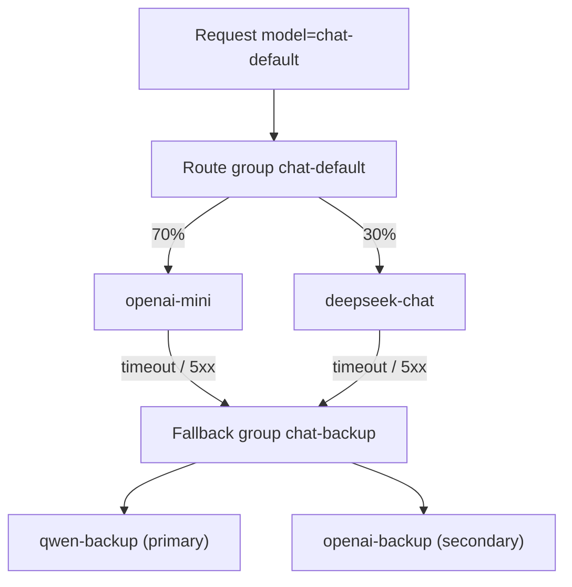
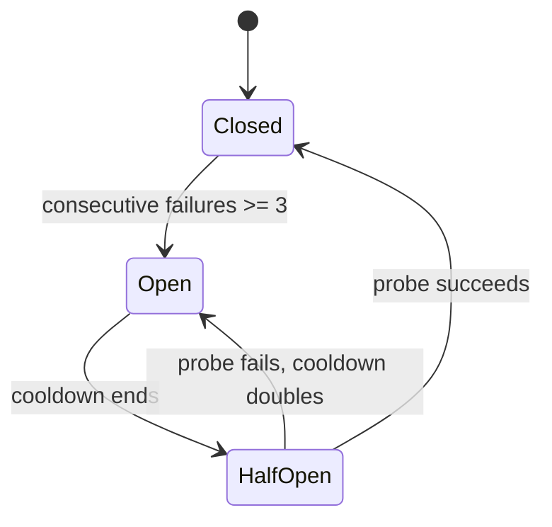

# Routing Patterns: Weights, Tags, and Traffic Shifting

"Connecting a few more model providers" is just a procurement action. Real routing has to answer four questions:

1. Which model **should** this request go to?
2. When that one is unavailable, **who can take it**?
3. How do you decide that it is "unavailable"?
4. After switching, are **quality and cost** still acceptable?

This chapter ties those four questions together with a runnable routing gateway.

## Four concepts to keep apart

| Concept | Role | Example |
| --- | --- | --- |
| Model alias | The stable name the client sees | `chat-default` |
| Target | One callable upstream model | `openai-mini`, `deepseek-chat` |
| Route group (Group) | A set of targets + strategy + fallbacks | `chat-default`, `chat-backup` |
| Health state | Whether a target is currently usable | closed / open / half-open |

::: tip Model aliases are the key to decoupling
Business code only knows `chat-default`. Today it points to GPT-4o mini; tomorrow it can point to DeepSeek with zero client changes. Without aliases, routing is just "writing if statements in the business layer".
:::

## Four common strategies

| Strategy | Use for | Key point |
| --- | --- | --- |
| Weight | Canary releases, cost sharing, A/B tests | Weights are not quotas and cannot replace rate limiting |
| Tags | Capability, region, compliance, price tier | Keep tags few and stable; do not turn them into free text |
| Priority | Primary/backup, fallback chains | Backup models must be capability-aligned |
| Sticky | Prompt/KV cache, session consistency | Failover breaks cache affinity |



## Complete demo

### Layout

```text
router-gateway/
├── router_gateway.py
├── routes.json
└── requirements.txt
```

`requirements.txt`:

```text
fastapi>=0.115
uvicorn[standard]>=0.30
httpx>=0.27
```

### Configuration

`routes.json`. Real keys never go here, only environment variable names:

```json
{
  "targets": {
    "openai-mini": {
      "base_url": "https://api.openai.com/v1",
      "api_key_env": "OPENAI_API_KEY",
      "model": "gpt-4o-mini",
      "weight": 70,
      "priority": 1,
      "tags": ["fast", "cheap", "tools"]
    },
    "deepseek-chat": {
      "base_url": "https://api.deepseek.com/v1",
      "api_key_env": "DEEPSEEK_API_KEY",
      "model": "deepseek-chat",
      "weight": 30,
      "priority": 1,
      "tags": ["cheap", "cn", "tools"]
    },
    "qwen-backup": {
      "base_url": "https://dashscope.aliyuncs.com/compatible-mode/v1",
      "api_key_env": "DASHSCOPE_API_KEY",
      "model": "qwen-plus",
      "weight": 1,
      "priority": 1,
      "tags": ["fast", "cn", "tools"]
    },
    "openai-backup": {
      "base_url": "https://api.openai.com/v1",
      "api_key_env": "OPENAI_API_KEY",
      "model": "gpt-4o",
      "weight": 1,
      "priority": 2,
      "tags": ["fast", "quality", "tools"]
    }
  },
  "groups": {
    "chat-default": {
      "strategy": "weighted",
      "targets": ["openai-mini", "deepseek-chat"],
      "fallbacks": ["chat-backup"]
    },
    "chat-backup": {
      "strategy": "priority",
      "targets": ["qwen-backup", "openai-backup"]
    }
  }
}
```

### Gateway code

`router_gateway.py`:

```python
"""A minimal routing gateway with weights, tags, health checks, and fallback chains."""

from __future__ import annotations

import json
import os
import random
import time
import uuid
from contextlib import asynccontextmanager
from dataclasses import dataclass, field
from pathlib import Path
from typing import AsyncIterator

import httpx
from fastapi import FastAPI, Request
from fastapi.responses import JSONResponse, Response, StreamingResponse

CONFIG_PATH = Path(os.getenv("ROUTES_FILE", "routes.json"))
MAX_ATTEMPTS = int(os.getenv("MAX_ATTEMPTS", "3"))
FAILURE_THRESHOLD = 3
BASE_COOLDOWN_S = 15.0
MAX_COOLDOWN_S = 300.0
TIMEOUT = httpx.Timeout(connect=5.0, read=300.0, write=30.0, pool=5.0)


@dataclass
class Target:
    name: str
    base_url: str
    api_key_env: str
    model: str
    weight: int = 1
    priority: int = 100
    tags: set[str] = field(default_factory=set)

    @property
    def api_key(self) -> str:
        return os.getenv(self.api_key_env, "")


@dataclass
class Group:
    name: str
    strategy: str
    targets: list[str]
    fallbacks: list[str] = field(default_factory=list)


@dataclass
class TargetState:
    failures: int = 0
    open_until: float = 0.0
    cooldown_s: float = BASE_COOLDOWN_S

    def available(self) -> bool:
        return time.monotonic() >= self.open_until

    def record_success(self) -> None:
        self.failures = 0
        self.open_until = 0.0
        self.cooldown_s = BASE_COOLDOWN_S

    def record_failure(self) -> None:
        self.failures += 1
        if self.failures >= FAILURE_THRESHOLD:
            self.open_until = time.monotonic() + self.cooldown_s
            self.cooldown_s = min(self.cooldown_s * 2, MAX_COOLDOWN_S)


def load_config(path: Path):
    raw = json.loads(path.read_text(encoding="utf-8"))
    targets = {
        name: Target(
            name=name,
            base_url=cfg["base_url"].rstrip("/"),
            api_key_env=cfg["api_key_env"],
            model=cfg["model"],
            weight=cfg.get("weight", 1),
            priority=cfg.get("priority", 100),
            tags=set(cfg.get("tags", [])),
        )
        for name, cfg in raw["targets"].items()
    }
    groups = {
        name: Group(
            name=name,
            strategy=cfg.get("strategy", "weighted"),
            targets=cfg["targets"],
            fallbacks=cfg.get("fallbacks", []),
        )
        for name, cfg in raw["groups"].items()
    }
    return targets, groups


TARGETS, GROUPS = load_config(CONFIG_PATH)
STATES = {name: TargetState() for name in TARGETS}

client: httpx.AsyncClient | None = None


@asynccontextmanager
async def lifespan(app: FastAPI):
    global client
    client = httpx.AsyncClient(timeout=TIMEOUT)
    yield
    await client.aclose()


app = FastAPI(title="llm-router-demo", lifespan=lifespan)


class GatewayError(Exception):
    def __init__(self, status: int, code: str, message: str, retryable: bool = False):
        self.status = status
        self.code = code
        self.message = message
        self.retryable = retryable


@app.exception_handler(GatewayError)
async def gateway_error_handler(request: Request, exc: GatewayError):
    request_id = getattr(request.state, "request_id", "req_unknown")
    return JSONResponse(
        status_code=exc.status,
        headers={"x-request-id": request_id},
        content={
            "error": {
                "message": exc.message,
                "type": "gateway_error",
                "code": exc.code,
                "retryable": exc.retryable,
                "request_id": request_id,
            }
        },
    )


@app.middleware("http")
async def attach_request_id(request: Request, call_next):
    request.state.request_id = (
        (request.headers.get("x-request-id") or "").strip()[:128]
        or f"req_{uuid.uuid4().hex[:16]}"
    )
    response = await call_next(request)
    response.headers["x-request-id"] = request.state.request_id
    return response


def pick(group: Group, tags: set[str], exclude: set[str]) -> Target | None:
    pool = [
        TARGETS[name]
        for name in group.targets
        if name not in exclude
        and STATES[name].available()
        and tags.issubset(TARGETS[name].tags)
    ]
    if not pool:
        return None
    if group.strategy == "priority":
        return min(pool, key=lambda item: item.priority)
    return random.choices(pool, weights=[max(item.weight, 1) for item in pool])[0]


def attempt_plan(group: Group, tags: set[str], limit: int) -> list[Target]:
    """Pick within the main group by strategy, then move through fallback groups; no target repeats in one request."""
    plan: list[Target] = []
    exclude: set[str] = set()

    def drain(current: Group) -> None:
        for _ in range(len(current.targets)):
            if len(plan) >= limit:
                return
            target = pick(current, tags, exclude)
            if target is None:
                return
            plan.append(target)
            exclude.add(target.name)

    drain(group)
    for fallback_name in group.fallbacks:
        fallback = GROUPS.get(fallback_name)
        if fallback is not None:
            drain(fallback)
        if len(plan) >= limit:
            break
    return plan


def retryable_status(status: int) -> bool:
    return status in (408, 429, 500, 502, 503, 504)


def upstream_message(raw: bytes) -> str:
    try:
        data = json.loads(raw)
        err = data.get("error", data)
        return str(err.get("message") or "Upstream request failed")[:300]
    except (json.JSONDecodeError, AttributeError):
        return raw.decode("utf-8", "replace")[:300]


def sse_error(code: str, message: str, request_id: str) -> bytes:
    payload = {"error": {"code": code, "message": message, "request_id": request_id}}
    return f"event: error\ndata: {json.dumps(payload, ensure_ascii=False)}\n\n".encode()


@app.get("/healthz")
async def healthz():
    return {
        "status": "ok",
        "targets": {
            name: {"available": state.available(), "failures": state.failures}
            for name, state in STATES.items()
        },
    }


@app.post("/v1/chat/completions")
async def chat_completions(request: Request):
    request_id = request.state.request_id
    try:
        body = await request.json()
    except json.JSONDecodeError as exc:
        raise GatewayError(400, "invalid_json", "Request body must be valid JSON.") from exc

    alias = body.get("model")
    group = GROUPS.get(alias)
    if group is None:
        raise GatewayError(
            404,
            "model_not_found",
            f"Unknown model alias '{alias}'. Available: {', '.join(sorted(GROUPS))}",
        )

    tags = {
        item.strip()
        for item in request.headers.get("x-route-tags", "").split(",")
        if item.strip()
    }
    stream = body.get("stream") is True
    plan = attempt_plan(group, tags, MAX_ATTEMPTS)
    if not plan:
        raise GatewayError(503, "no_target_available", "No target matches the requested tags.", True)

    assert client is not None
    failures: list[str] = []

    for attempt, target in enumerate(plan, start=1):
        if not target.api_key:
            failures.append(f"{target.name}:missing_key")
            continue

        payload = dict(body)
        payload["model"] = target.model
        headers = {
            "authorization": f"Bearer {target.api_key}",
            "content-type": "application/json",
            "x-request-id": request_id,
        }

        try:
            upstream = await client.send(
                client.build_request(
                    "POST",
                    f"{target.base_url}/chat/completions",
                    json=payload,
                    headers=headers,
                ),
                stream=stream,
            )
        except httpx.HTTPError as exc:
            STATES[target.name].record_failure()
            failures.append(f"{target.name}:{type(exc).__name__}")
            continue

        if upstream.status_code >= 400:
            raw = await upstream.aread()
            await upstream.aclose()
            message = upstream_message(raw)
            failures.append(f"{target.name}:{upstream.status_code}")
            if retryable_status(upstream.status_code):
                # Do not trip the breaker on 429; avoid mistaking "temporarily rate limited" for "down for good"
                if upstream.status_code != 429:
                    STATES[target.name].record_failure()
                continue
            if upstream.status_code in (401, 403):
                raise GatewayError(
                    502,
                    "upstream_auth_error",
                    "Upstream rejected the gateway credentials.",
                )
            raise GatewayError(upstream.status_code, "upstream_rejected", message)

        STATES[target.name].record_success()

        if not stream:
            data = await upstream.aread()
            await upstream.aclose()
            return Response(
                content=data,
                media_type="application/json",
                headers={
                    "x-gateway-target": target.name,
                    "x-gateway-attempts": str(attempt),
                },
            )

        async def relay(open_response: httpx.Response = upstream, chosen: Target = target):
            try:
                async for chunk in open_response.aiter_bytes():
                    yield chunk
            except httpx.HTTPError as exc:
                STATES[chosen.name].record_failure()
                yield sse_error("stream_interrupted", str(exc), request_id)
            finally:
                await open_response.aclose()

        return StreamingResponse(
            relay(),
            media_type="text/event-stream",
            headers={
                "cache-control": "no-cache, no-transform",
                "x-accel-buffering": "no",
                "x-gateway-target": target.name,
                "x-gateway-attempts": str(attempt),
            },
        )

    raise GatewayError(
        503,
        "all_targets_failed",
        f"All {len(plan)} targets failed: {', '.join(failures)}",
        retryable=True,
    )
```

::: warning Limits of the demo code
Health state lives in single-process memory, so multiple replicas each decide on their own; there is no persistent quota, no authentication, and no caching. Its value is showing you the order of routing decisions, not shipping as-is.
:::

## Run it

Prepare API keys for at least two upstreams first. It runs with just one, but you will not see switching in action.

```bash
export OPENAI_API_KEY="sk-..."
export DEEPSEEK_API_KEY="sk-..."
export DASHSCOPE_API_KEY="sk-..."
export ROUTES_FILE="routes.json"

uvicorn router_gateway:app --port 8001
```

### Scenario 1: default weighted routing

```bash
for i in $(seq 1 10); do
  curl -s -D - http://127.0.0.1:8001/v1/chat/completions \
    -H "content-type: application/json" \
    -d '{"model":"chat-default","messages":[{"role":"user","content":"Say one sentence."}]}' \
    -o /dev/null | grep -i x-gateway-target
done
```

You should see `openai-mini` and `deepseek-chat` alternate at roughly 7:3. Deviation on a small sample is normal.

### Scenario 2: routing by tags

Only targets that are "in China and support tool calling":

```bash
curl -i http://127.0.0.1:8001/v1/chat/completions \
  -H "content-type: application/json" \
  -H "x-route-tags: cn, tools" \
  -d '{"model":"chat-default","messages":[{"role":"user","content":"Hello"}]}'
```

Now `openai-mini` does not satisfy the `cn` tag, so it is filtered out and only `deepseek-chat` remains.

### Scenario 3: failover

Change `OPENAI_API_KEY` to an invalid value, then request only the `fast` tag:

```bash
curl -i http://127.0.0.1:8001/v1/chat/completions \
  -H "content-type: application/json" \
  -H "x-route-tags: fast" \
  -d '{"model":"chat-default","messages":[{"role":"user","content":"Hello"}]}'
```

Expected behavior:

1. In the main group only `openai-mini` carries `fast`, so it is called first;
2. The upstream returns 401, which is not a retryable status, so the gateway returns `502 upstream_auth_error` — **it does not blindly switch to a backup model**.

This may look "not automatic enough", but it matters: **a 401 is a configuration error, not an outage**. Shifting configuration errors onto a backup model only hides the problem.

If you point the upstream at an address that returns 503, the gateway retries and switches to `qwen-backup` in `chat-backup`, and the response headers show:

```text
x-gateway-target: qwen-backup
x-gateway-attempts: 2
```

### Scenario 4: observing health state

```bash
curl -s http://127.0.0.1:8001/healthz | jq
```

Once consecutive failures reach the threshold, the target enters cooldown and `available` becomes `false`; after cooldown ends it automatically tries again.

## Key design decisions

### 1. Weights are not quotas

Weights only decide "who gets the request when there are no other constraints". They cannot stop one tenant from saturating an upstream's RPM.

> Weights spread traffic, rate limits cap volume, budgets cap money. Configure all three separately.

### 2. Which errors may trigger a switch

| Upstream result | Switch? | Why |
| --- | --- | --- |
| Connection failure / DNS / TLS | ✅ | Target unreachable |
| 408 / 504 | ✅ | Timeout; another target may be faster |
| 429 | ✅, but no breaker trip | Rate limiting is temporary; another target may succeed |
| 500 / 502 / 503 | ✅ | Upstream failure |
| 400 / 422 | ❌ | The request itself is wrong; another target changes nothing |
| 401 / 403 | ❌ | Gateway configuration/permission problem; switching hides it |
| 404 | ❌ | Wrong model name or route configuration |
| Interrupted after the stream started | ❌ | Already-sent content cannot be rolled back |

This table is the core of routing correctness. Many "automatic disaster recovery" incidents come from treating 400s as failures and shifting them away, which only buries the problem.

### 3. Circuit breaker state machine



In production you also need to watch for:

- Circuit state must be tracked **per target + model**, not one breaker for all models of a vendor;
- Health state must be shared across replicas (Redis), otherwise each replica probes on its own;
- The half-open state should admit only a small amount of probe traffic so recovery does not slam the upstream.

### 4. Sticky routing and caching

If Prompt/KV cache is enabled, the same prefix should land on the same target or even the same replica. You can use consistent hashing on `session_id`:

```python
def sticky_target(group: Group, session_id: str) -> Target:
    pool = [TARGETS[name] for name in group.targets if STATES[name].available()]
    if not pool:
        raise GatewayError(503, "no_target_available", "No healthy target.", True)
    index = hash(session_id) % len(pool)
    return pool[index]
```

The trade-off: failover breaks cache affinity and the hit rate drops for a while. **Availability first, caching second**.

### 5. Backup models must be capability-aligned

If the primary model supports tool calls, JSON Schema, and vision but the backup supports none of them, the agent crashes the moment traffic shifts. A fallback chain must match on capability tags:

```text
chat-default (tools, json, vision)
  └─ fallback: chat-backup (tools, json)        # no vision, so vision requests never enter
```

Vision requests should be filtered out at the routing stage because no target matches the tags, rather than failing after the switch.

## What is still missing for production

| Gap | Suggestion |
| --- | --- |
| Health state only in memory | Share it via Redis, aggregate per replica |
| No quota | Run an RPM/TPM pre-check before routing |
| No total timeout budget | Share one deadline across attempts |
| No hot reload | Version the config; the data plane reads a snapshot |
| No canary | Route 1% of traffic by weight and watch dedicated metrics |
| No cost guardrail | Set a per-request cost ceiling on the backup model |
| No authentication | Client keys and tenant identity |

## Checklist

- [ ] Clients depend only on model aliases
- [ ] Weight, tag, and priority strategies each have a clear use case
- [ ] Switchable and non-switchable errors are separated
- [ ] 429 does not trip the breaker directly
- [ ] Breakers are per target and include half-open probes
- [ ] Backup models match on capability tags
- [ ] Health state is shareable across replicas
- [ ] Response headers expose `x-gateway-target` and the attempt count (for troubleshooting)

## Next

Routing answers "where to go"; caching answers "can we avoid going at all": [Caching patterns: responses, KV, and stampede protection](./caching.md).
