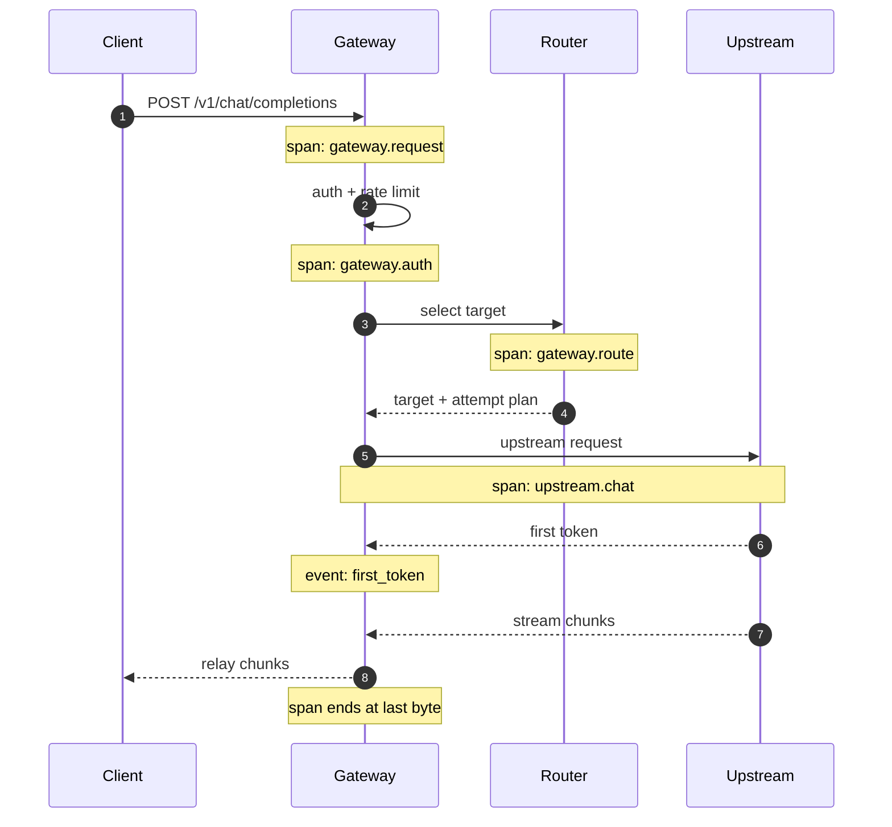

# Structured Logging and Tracing

One of the worst moments in production: a user sends a screenshot saying "that answer was really slow earlier", and you open the logs to find a few hundred `INFO request completed` lines with no context. No trace ID, no model name, no phase timing. All you can do is apologize.

## The short version

- **One request = one TraceId = one set of structured fields**, carried from the entry point all the way to the upstream.
- **Logs record what happened; spans record where the time went.** Both are joined by the same ID.
- **Prompts are not logged by default.** If you must log them, tier them, redact them, cap their length, and state who can see them.
- **Sample in tiers**: low sampling for successful requests, 100% for errors and slow requests.
- **Do not stuff metrics into logs.** Logs serve individual investigation, metrics serve aggregate trends.

## Three kinds of logs, kept separate

| Type | Content | Retention | Purpose |
| --- | --- | --- | --- |
| Access log | Method, path, status code, duration, bytes | 7–30 days | Traffic analysis, billing reconciliation |
| Application log | Phase timing, routing decisions, retries, exceptions | 7–30 days | Troubleshooting |
| Audit log | Who did what to which resource, and when | 180 days or more | Compliance, accountability |

Audit logs should use a separate write path from ordinary logs: they must be **tamper-proof and lossless**, usually stored in their own database or dedicated storage, and must never be dropped because of log sampling.

## Common fields

The same field name must mean the same thing in every module of the gateway. A recommended minimum set:

| Field | Example | Notes |
| --- | --- | --- |
| `timestamp` | `2026-10-30T12:34:56.789Z` | Always UTC, ISO 8601 |
| `level` | `info` | `debug/info/warn/error` |
| `event` | `request.completed` | Stable event name, easy to aggregate |
| `trace_id` | `4bf92f3577b34da6a3ce929d0e0e4736` | W3C 32-character hex |
| `span_id` | `00f067aa0ba902b7` | Current span |
| `request_id` | `req_9f2c1a` | Request ID visible to callers |
| `tenant_id` | `t_1001` | Tenant |
| `key_id` | `key_7d` | Credential |
| `model_alias` | `chat-default` | Model the user requested |
| `model_target` | `deepseek-chat` | Target actually called |
| `provider` | `deepseek` | Vendor |
| `stream` | `true` | Whether the request is streaming |
| `status` | `200` | Status returned to the client |
| `upstream_status` | `200` | Upstream status |
| `latency_ms` | `2380` | Total duration |
| `ttft_ms` | `410` | Time to first token; null for non-streaming |
| `attempt` | `1` | Attempt number |
| `error_code` | `upstream_timeout` | Normalized error code |

`event` uses dotted levels (`request.started`, `route.selected`, `upstream.retry`, `request.completed`), which beats free text by a wide margin — you can aggregate and alert on event names directly in your log system.

## Span breakdown for one request



The principle: **every phase that can independently slow down or fail should have its own span**. Typical phases include authentication, rate limiting, cache lookup, route selection, the upstream request, streaming relay, and billing persistence.

The upstream span should record:

- `gen_ai.system` (openai / anthropic / deepseek)
- `gen_ai.request.model`
- `gen_ai.response.model` (the model the upstream actually served, which may differ from the request)
- `gen_ai.usage.input_tokens` / `output_tokens`
- `http.response.status_code`
- `retry.count`

These fields align with OpenTelemetry's GenAI semantic conventions, so adopting OTel later won't require rework.

## Where the TraceId comes from

Three sources, in priority order:

1. **A W3C `traceparent` from the client**: if the caller is already tracing, reuse it so the trace connects end to end.
2. **An `X-Request-Id` from the client**: use it as `request_id`, but not as `trace_id` — the format and semantics differ.
3. **Generated by the gateway**: 128 random bits for `trace_id`, 64 for `span_id`.

```python
import secrets


def new_trace_id() -> str:
    return secrets.token_hex(16)


def new_span_id() -> str:
    return secrets.token_hex(8)


def parse_traceparent(value: str | None) -> tuple[str, str] | None:
    if not value:
        return None
    parts = value.split("-")
    if len(parts) != 4 or parts[0] != "00":
        return None
    trace_id, parent_id = parts[1], parts[2]
    if len(trace_id) != 32 or len(parent_id) != 16:
        return None
    return trace_id, parent_id
```

Be careful when propagating upstream: **not every vendor accepts `traceparent`**; some reject requests that carry unknown headers. The safe route is to forward only custom headers such as `X-Request-Id`, or to decide per vendor with an allowlist.

## Carrying context through async calls with contextvars

In an async FastAPI + httpx stack, `contextvars` is the most reliable way to propagate:

```python
import contextvars
import logging
import json
from datetime import datetime, timezone

_request_ctx: contextvars.ContextVar[dict] = contextvars.ContextVar("request_ctx", default={})


class JsonFormatter(logging.Formatter):
    def format(self, record: logging.LogRecord) -> str:
        payload = {
            "timestamp": datetime.now(timezone.utc).isoformat(timespec="milliseconds"),
            "level": record.levelname.lower(),
            "event": record.getMessage(),
            **_request_ctx.get(),
        }
        extra = getattr(record, "fields", None)
        if extra:
            payload.update(extra)
        if record.exc_info:
            payload["exception"] = self.formatException(record.exc_info)
        return json.dumps(payload, ensure_ascii=False)


logger = logging.getLogger("gateway")
logger.setLevel(logging.INFO)
handler = logging.StreamHandler()
handler.setFormatter(JsonFormatter())
logger.addHandler(handler)
logger.propagate = False
```

Set the context in middleware and clear it when the request ends, so coroutine reuse doesn't cross-contaminate IDs:

```python
@app.middleware("http")
async def bind_context(request: Request, call_next):
    trace_id, parent_id = parse_traceparent(request.headers.get("traceparent")) or (
        new_trace_id(), None
    )
    request_id = request.headers.get("x-request-id") or f"req_{secrets.token_hex(6)}"
    token = _request_ctx.set(
        {
            "trace_id": trace_id,
            "parent_span_id": parent_id,
            "span_id": new_span_id(),
            "request_id": request_id,
            "path": request.url.path,
        }
    )
    try:
        response = await call_next(request)
        response.headers["x-request-id"] = request_id
        response.headers["traceparent"] = f"00-{trace_id}-{new_span_id()}-01"
        return response
    finally:
        _request_ctx.reset(token)
```

::: warning Context in subtasks
`asyncio.create_task` copies the current context, but if you run synchronous code in a thread pool you must call `contextvars.copy_context().run(...)` explicitly. Otherwise subtask logs carry no `trace_id` and the chain breaks during investigation.
:::

## Recording phase timings

Don't emit a single total at the end of the request. Use a phase timer to record each segment:

```python
import time


class PhaseTimer:
    def __init__(self) -> None:
        self._marks: dict[str, float] = {}
        self._start = time.perf_counter()

    def mark(self, name: str) -> None:
        self._marks[name] = time.perf_counter()

    @property
    def ttft_ms(self) -> int | None:
        if "first_token" not in self._marks:
            return None
        return int((self._marks["first_token"] - self._start) * 1000)

    def elapsed_ms(self, name: str | None = None) -> int:
        end = self._marks.get(name) if name else time.perf_counter()
        return int(((end or time.perf_counter()) - self._start) * 1000)
```

Emit everything at once when the request ends:

```python
logger.info(
    "request.completed",
    extra={
        "fields": {
            "model_target": target.name,
            "provider": target.provider,
            "stream": body.get("stream", False),
            "status": status,
            "upstream_status": upstream_status,
            "latency_ms": timer.elapsed_ms(),
            "ttft_ms": timer.ttft_ms,
            "attempt": attempt,
            "error_code": error_code,
        }
    },
)
```

One log line then answers: which model, which attempt, how long to the first token, how long in total, and where it failed.

## Should you log prompts?

This is where most incidents start. Three tiers:

| Tier | Content | When to use |
| --- | --- | --- |
| L0 default | Token counts, message count, whether tools are present | All production environments |
| L1 redacted summary | First N characters truncated + hash, PII replaced | Temporarily enabled when troubleshooting |
| L2 full text | Complete messages | Test environments only, or with explicit user consent |

Even L1 needs care: **regex redaction misses things.** Emails and phone numbers match, but names, addresses and internal codenames do not. A field allowlist plus manual sampling is safer than dumping everything and trusting redaction rules.

Also, prompts may contain API keys or database connection strings that users pasted in. Log systems tend to have the loosest permissions; once a full prompt lands there, you have copied secrets to a place far more people can reach.

## Sampling

Full collection is expensive at high traffic, but failed requests must always be captured:

```python
import random


def should_sample(status: int, latency_ms: int, base_rate: float = 0.05) -> bool:
    if status >= 500 or status == 429:
        return True
    if latency_ms >= 10_000:
        return True
    return random.random() < base_rate
```

This is a simplified tail sampling: produce all spans first, decide what to keep before export. Real tail sampling runs in the OTel Collector, where it can decide on the whole trace (for example, "keep every trace that contains an error span"), which is more complete than per-span decisions.

::: tip Sampling rates should be adjustable per tenant
When a large customer needs troubleshooting, you want to raise their sampling rate to 100% temporarily. Making the rate configurable (even overridable per `tenant_id`) ships much faster than a code change.
:::

## Example log queries

High-frequency queries when logs live in ClickHouse:

```sql
-- Slow requests for one tenant in the last hour
SELECT trace_id, model_target, status, latency_ms, ttft_ms, error_code
FROM gateway_logs
WHERE tenant_id = 't_1001'
  AND timestamp >= now() - INTERVAL 1 HOUR
  AND event = 'request.completed'
  AND latency_ms > 5000
ORDER BY latency_ms DESC
LIMIT 50;

-- Aggregate by error code to find the top issues
SELECT error_code, count() AS n
FROM gateway_logs
WHERE timestamp >= now() - INTERVAL 1 DAY
  AND level = 'error'
GROUP BY error_code
ORDER BY n DESC;
```

If logs are in Loki, LogQL is similar:

```logql
{app="llm-gateway"} | json | event="request.completed" | latency_ms > 5000
```

## Connecting to cost and metrics

With `request_id` and `run_id` in logs, you can join three data sets:

- From a slow request log → find the matching trace → see upstream time.
- From an agent run → find every request it triggered → compute the total cost of the task.
- From a cost anomaly → find the top-consuming `key_id` → inspect its request logs.

That is why `run_id` is worth propagating from the agent layer all the way to the gateway: **it is the smallest unit of cross-service attribution.**

## Anti-patterns

| Anti-pattern | Problem |
| --- | --- |
| Logging only at entry and exit | You can't tell whether time went to auth, routing or upstream |
| `print` or unstructured strings | Can't filter or aggregate by field |
| Full messages on every log line | Storage explosion plus leak risk |
| Auto-increment IDs as `trace_id` | Enumerable, incompatible across systems |
| API keys in logs | Expands the leak surface to the log system |
| Sampling away errors | No logs when the incident hits |
| Async tasks without context | Orphaned subtask logs you can't correlate |

## Checklist

- [ ] All logs are JSON with consistent field names
- [ ] `trace_id` accepts W3C `traceparent` and generates one when absent
- [ ] Responses return `x-request-id` so users can report issues
- [ ] Phase timings (auth / routing / upstream / first token / total) are recorded
- [ ] Prompts are off by default; L1/L2 have explicit switches and permissions
- [ ] Errors and slow requests are sampled at 100%; successes may be downsampled
- [ ] Audit logs are stored separately and unaffected by sampling
- [ ] Log retention matches compliance requirements
- [ ] You can trace all requests of one task back from `run_id`

## Next

With per-request logs in place, you still need the aggregate view. The next page covers metrics: [Metrics and Monitoring](./metrics.md).
