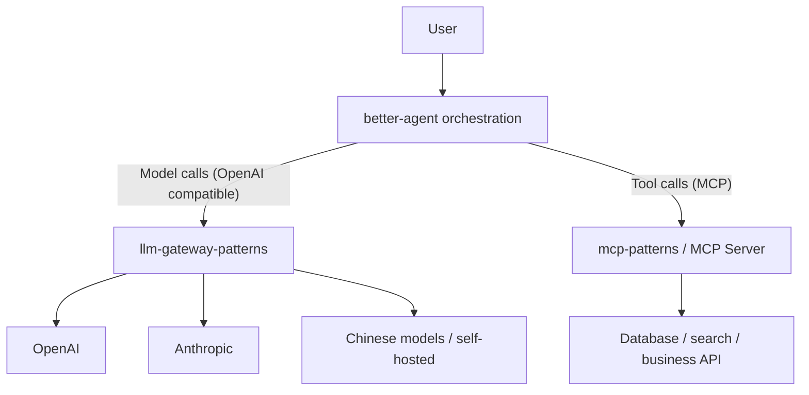

# Integrating with better-agent

A single agent task can trigger dozens of model calls: plan, pick tools, summarize tool results, reflect, plan again. If each call goes straight to a provider, you get three outcomes: **cost can't be attributed to a task**, **every step uses the same expensive model**, and **one loop can burn through the budget**.

The gateway's role here isn't "one more proxy layer". It is to **turn an agent's calls into resource units with boundaries, a ledger, and an exit path**.

::: tip Further reading
The agent orchestration patterns themselves (planning, memory, tool selection, reflection loops) are covered in the companion project [better-agent](https://yuxinrun.github.io/better-agent/). This page only covers its seams with the gateway.
:::

## Key takeaways

- **The agent sees one OpenAI-compatible endpoint** and doesn't care which model sits behind it.
- **Tier models by step**: strong models for planning, fast models for execution, cheap models for summarization.
- **Every task carries a `run_id`** so the gateway can attribute cost and enforce budget per run.
- **Only one layer owns retries.** The gateway retries upstream, the agent retries at the task level; stacking both multiplies attempts exponentially.
- **Externalize or truncate tool results**, otherwise context and bills explode together.
- **Parallel tool calls create concurrency spikes** that the gateway must cap.

## Layering



Keep the boundaries clear:

- **The gateway does not execute tools** and doesn't understand MCP. It only handles model calls.
- **The agent does no model adaptation** and doesn't care where Anthropic puts `system`.
- **The MCP layer doesn't care about models**; it only describes and executes tools.

The three are decoupled by standard protocols, so replacing any one layer doesn't affect the other two.

## What the gateway does extra for agents

A normal chat app has one request per question. Agent requests have several additional traits:

| Trait | What the gateway needs to provide |
| --- | --- |
| Many calls per task | Attribution and budget by `run_id` |
| Steps play different roles | Routing to different models by `step_type` |
| Rapidly growing context | Token budget, long-context downgrade |
| Unbounded tool results | Input length limits, truncation policy |
| Parallel tool calls | Concurrency limits and queuing |
| Long tasks are easily interrupted | Idempotency, resumability, caching |

### Header contract

Agree on a set of headers between the agent and the gateway so the gateway can do attribution and policy:

| Header | Example | Purpose |
| --- | --- | --- |
| `X-Run-Id` | `run_01J8Z3K4` | Task-level attribution |
| `X-Agent-Id` | `agent_research` | Agent type |
| `X-Step-Type` | `plan` / `act` / `observe` / `summarize` | Step-tiered routing |
| `X-Step-Index` | `7` | Which step, used for loop detection |
| `X-Feature` | `deep_research` | Product feature |
| `X-Budget-Usd` | `0.50` | Remaining budget for this task |
| `X-Trace-Id` | `4bf92f...` | Distributed tracing |

The agent maintains `X-Budget-Usd`; the gateway only validates and debits. That way the business decides the total budget and the platform enforces it.

### Step-tiered routing

```yaml
groups:
  agent-plan:
    strategy: priority
    targets: [claude-sonnet, gpt-4o, qwen-max]

  agent-act:
    strategy: weighted
    targets:
      - { name: gpt-4o-mini, weight: 80 }
      - { name: qwen-turbo, weight: 20 }

  agent-summarize:
    strategy: cheapest
    targets: [gpt-4o-mini, qwen-turbo, deepseek-chat]
```

The gateway selects a group by `X-Step-Type`:

```python
STEP_GROUP = {
    "plan": "agent-plan",
    "act": "agent-act",
    "observe": "agent-act",
    "summarize": "agent-summarize",
}


def resolve_group(headers, body) -> str:
    step = headers.get("x-step-type", "").lower()
    return STEP_GROUP.get(step, "chat-default")
```

This puts the "strongest for planning, fastest for acting, cheapest for summarizing" policy in one place, so you don't touch agent code to change it.

::: warning Don't let the model choose the model
"Let the agent decide which model to use" sounds smart but is hard to stabilize: the model has no accurate sense of price and can't see real-time quotas. Put the decision in the gateway's routing layer, where rules are testable and reversible.
:::

## Wiring it up on the agent side

Point the official OpenAI SDK at the gateway; you don't need a custom client:

```python
from openai import OpenAI

client = OpenAI(
    base_url="https://gateway.example.com/v1",
    api_key=os.environ["LGW_API_KEY"],
    default_headers={
        "X-Agent-Id": "agent_research",
        "X-Feature": "deep_research",
    },
)


def step(run_id: str, step_type: str, index: int, messages: list[dict], tools: list[dict]):
    return client.chat.completions.create(
        model="agent-default",
        messages=messages,
        tools=tools,
        stream=True,
        extra_headers={
            "X-Run-Id": run_id,
            "X-Step-Type": step_type,
            "X-Step-Index": str(index),
        },
        extra_body={"stream_options": {"include_usage": True}},
    )
```

Note `stream_options.include_usage`: agent workloads make many calls, and without usage you can't control cost per task.

## Attributing cost per run

`run_id` takes billing from "per tenant" down to "per task":

```sql
SELECT
  run_id,
  count(*) AS calls,
  sum(input_tokens + output_tokens) AS tokens,
  sum(cost_usd) AS cost,
  max(step_index) AS steps
FROM usage_events
WHERE tenant_id = 't_1001'
  AND occurred_at >= now() - INTERVAL '7 days'
GROUP BY run_id
ORDER BY cost DESC
LIMIT 20;
```

With this table you can answer:

- Which kind of task costs the most, research or support?
- How many times was the same task retried?
- Is the money going into planning or execution?
- Which tasks hit the step limit?

### Per-run budget

The most dangerous property of an agent loop is that it **doesn't stop**. Two levels of protection:

1. **Step limit**: enforced by the agent itself, say 30 steps at most.
2. **Budget limit**: the gateway checks cumulative spend for that `run_id` before each call.

```python
async def check_run_budget(redis, run_id: str, estimated_cost: float) -> bool:
    key = f"runbudget:{run_id}"
    spent = float(await redis.get(key) or 0)
    limit = float(await redis.get(f"{key}:limit") or 0.5)
    if spent + estimated_cost > limit:
        return False
    await redis.incrbyfloat(key, estimated_cost)
    await redis.expire(key, 6 * 3600)
    return True
```

When the budget runs out, return an explicit error code (such as `run_budget_exceeded`) so the agent can end gracefully with partial results instead of throwing a 500 at the user.

## Only one layer owns retries

This is the easiest trap in the integration:

```text
Agent retries 3 times × gateway retries 3 times = up to 9 upstream calls
```

If each call also involves several tools, the multiplier gets worse. Recommendation:

| Layer | Owns | Strategy |
| --- | --- | --- |
| Gateway | Transient upstream failures | 1-2 fast retries on 429/5xx, with jitter |
| Agent | Task-level semantic failures | Don't auto-retry model calls; retry once only when output can't be parsed |
| Business | User-initiated retry | Treat as a new task with a new `run_id` |

Gateway retries must be marked (`attempt > 1`). When the agent sees the `x-gateway-attempts` header, it should not retry again, to avoid stacking.

## Handling oversized context

Agent context grows from three places: conversation history, tool results, and retrieved snippets. What the gateway can do is **catch the fall**, not **govern**:

| Technique | Where | Notes |
| --- | --- | --- |
| Truncate tool results | Agent / MCP | Return only a summary or a reference ID |
| Summarize history | Agent | Compress after N turns |
| Limit retrieval count | Agent | Control Top-K |
| Input token cap | Gateway | Return 413 when over limit, avoid paying then being rejected |
| Long-context downgrade | Gateway | Route to a model with a larger window |
| Segmented summarization | Agent | Summarize long documents before they enter context |

The gateway's 413 must come before billing: **estimate input length with a tokenizer before forwarding** and reject immediately, instead of telling the user only after the upstream returns 400.

```python
def enforce_context_limit(body: dict, target) -> None:
    estimated = estimate_tokens(body.get("messages", [])) + estimate_tokens(body.get("tools", []))
    if estimated > target.context_window - body.get("max_tokens", 1024):
        raise GatewayError(
            413,
            "context_too_large",
            f"estimated {estimated} tokens exceeds {target.name} window",
        )
```

The estimate can be rough (a tokenizer or a character ratio), but it must be **conservative**: better to reject early than to pay and then be rejected.

## Streaming + tool calls

Agents usually need to parse `tool_calls` while the response streams. The gateway must guarantee:

- It does not buffer the whole response before forwarding (that breaks streaming).
- It does not alter the incremental structure of `tool_calls`.
- It preserves `finish_reason` and `usage` in the final chunk.
- It closes the upstream connection promptly when the client disconnects, so billing stops.

If the gateway does protocol conversion (for example, converting Anthropic's `tool_use` into OpenAI's `tool_calls`), the streaming conversion must assemble per-event increments. Don't wait for the complete arguments, or tool calls only become visible when the stream ends.

## Parallel tools and concurrency spikes

An agent may return five `tool_calls` at once, then fire five concurrent model calls to summarize the results. Spikes like this easily trigger upstream 429s:

- The gateway should enforce a **concurrency cap per `run_id`**, not just an aggregate per tenant.
- Requests in the same run can be queued and serialized, trading a little latency for stability.
- 429 responses should carry `Retry-After`, and the agent's parallel scheduler must respect it.

```python
async def acquire_run_slot(run_id: str, limit: int = 4):
    key = f"runsem:{run_id}"
    current = await redis.incr(key)
    if current == 1:
        await redis.expire(key, 300)
    if current > limit:
        await redis.decr(key)
        raise GatewayError(429, "run_concurrency_exceeded", "too many parallel calls in one run")
    return key


async def release_run_slot(key: str) -> None:
    await redis.decr(key)
```

## Output consistency across model switches

When the planner and executor use different models, "the executor can't parse the planner's output format" becomes a real problem. Three mitigations:

1. **Structured output**: constrain planning results with JSON Schema instead of relying on a natural-language format.
2. **Adapter prompt**: state the expected upstream output format in the executor's system prompt.
3. **Pin models for critical steps**: if planning and execution are tightly coupled, don't randomly split traffic between them.

Gateway routing must support "pin a target per step" rather than global weighted randomness. Otherwise the planner changes models on every step of the same task and behavior drifts.

## Observability

In agent workloads, gateway metrics alone aren't enough; you need to stitch a whole task together:

- Use `run_id` as the trace correlation key so every step's span hangs off the same trace (or is linked to it).
- Dashboards should show the distribution of calls per task, the distribution of cost per task, and the rate of step-limit hits.
- Alerts should watch for "more than 50 calls in one task" and "one task costs more than 5x the P99".

These metrics surface an agent stuck in a loop before the bill arrives.

## Anti-patterns

| Anti-pattern | Consequence |
| --- | --- |
| Agent connects directly to multiple providers | Adaptation logic scatters, cost can't be attributed |
| Every step uses the same flagship model | 5-10x the cost, and higher latency |
| Both agent and gateway retry | Upstream traffic multiplies exponentially |
| No `run_id` | When something breaks you can't tell which run it was |
| All tool results fed back verbatim | Context explodes, per-call cost runs away |
| Oversized requests forwarded before the error | You pay and still fail |
| Parallel tools with no concurrency limit | Instant 429s, the whole task fails |
| Letting the model choose the model | Policy is untestable and can't be rolled back |

## Checklist

- [ ] The agent calls models through a single OpenAI-compatible endpoint
- [ ] Requests carry `run_id`, `step_type`, and `step_index`
- [ ] Routing is tiered by step (plan / act / summarize)
- [ ] Each task has a step limit and a budget limit
- [ ] Retry ownership is single; gateway and agent don't stack
- [ ] Input length is validated before forwarding, with 413 on overflow
- [ ] Streaming tool calls pass through incrementally without breaking structure
- [ ] Concurrency within a run is capped
- [ ] Cost can be aggregated by `run_id`
- [ ] Critical steps pin their model to avoid behavior drift

## Next

The agent's tool calls go through the MCP layer, but there are still key seams with the gateway: [Integrating with mcp-patterns](./mcp-patterns.md).
