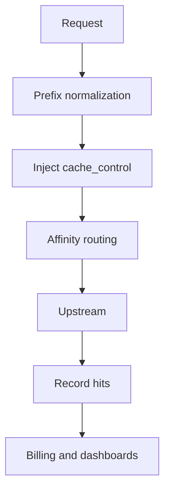
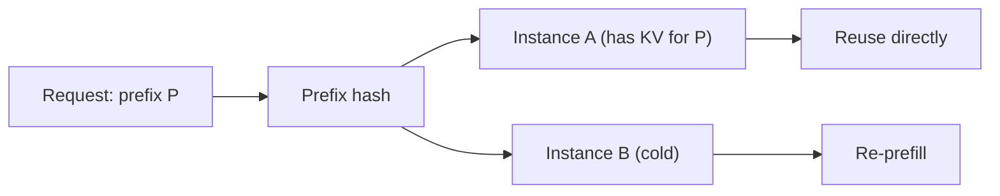

# KV Cache Proxy and Cost Optimization

A typical customer support agent carries 6,000 tokens of system prompt plus tool definitions and sends them verbatim on every turn. At standard input pricing, 80% of the money goes to a **repeated, byte-identical** prefix.

Providers have offered caching for a while, but they don't use it well by default: the prefix is in the wrong order, a timestamp is mixed in, or multiple replicas route to different instances, and the hit rate drops to zero. The gateway sits exactly where these problems can be handled uniformly.

## Key takeaways

- **Separate the three kinds of cache first**: provider prompt cache, self-hosted prefix/KV cache, and semantic cache. They solve different problems, and their pricing and consistency guarantees are completely different.
- **A cache hit requires a "perfectly identical prefix"**. A single changed byte invalidates everything from that point on.
- **The gateway's job is to stabilize the prefix, inject cache markers, route requests to instances that hold the cache, and count hits in billing.**
- **Cache writes can cost more than regular input**. Don't enable caching for short prefixes or one-off requests.
- **Multi-tenant deployments require prefix isolation**, otherwise you save nothing and may leak data.

## Three kinds of cache, don't conflate them

| Type | Hit condition | What you save | Consistency | Typical implementation |
| --- | --- | --- | --- | --- |
| Provider prompt cache | Same prefix + same model + same organization | Input token cost + time to first token | Strong (same model) | Anthropic `cache_control`, OpenAI automatic caching, DeepSeek context caching |
| Self-hosted prefix/KV cache | Same prefix lands on the same inference instance | Prefill compute | Strong (same model weights) | vLLM Automatic Prefix Caching, SGLang RadixAttention |
| Semantic cache | Semantic similarity | The entire call | Weak (may answer a different question) | Vector search + threshold |

The three can be layered, but **don't use semantic cache as a replacement for prefix cache**. Prefix cache is deterministic; semantic cache is probabilistic. The first saves money without changing the answer; the second saves money but may change the answer.

## Using provider prompt cache

The mechanisms differ by vendor, but they share one idea: explicitly or implicitly mark a reusable prefix.

### Anthropic

Anthropic marks cache breakpoints with `cache_control`, usually on system, tools, or a long context block:

```json
{
  "model": "claude-sonnet-4",
  "system": [
    {
      "type": "text",
      "text": "You are an enterprise knowledge base assistant... (long rules and examples)",
      "cache_control": { "type": "ephemeral" }
    }
  ],
  "messages": [
    { "role": "user", "content": "What was last quarter's renewal rate?" }
  ]
}
```

A few key constraints (defer to the official docs):

- Caching has a **minimum token threshold**; prefixes that are too short won't be cached.
- The default TTL is short; expired entries must be rewritten, and writes are usually billed at a higher rate.
- The cache is **organization-scoped**; the same prefix can be reused within the same organization.
- Only a limited number of breakpoints are supported, and their placement determines what can be hit.

### OpenAI

OpenAI enables caching automatically for longer prefixes with no explicit marker. `usage.prompt_tokens_details.cached_tokens` in the response tells you how much was cached. What the gateway can do is **keep the prefix stable** and record `cached_tokens` in billing.

### DeepSeek and Chinese model providers

Most of them offer automatic context caching and distinguish `prompt_cache_hit_tokens` from `prompt_cache_miss_tokens` in the response. Hits still depend on a byte-for-byte identical prefix.

### Gemini

Gemini's context caching comes in implicit and explicit forms; explicit caching requires creating a separate cache object and referencing it. The gateway has to handle that extra layer of cache object lifecycle, which is usually only worth it for very long fixed contexts, such as an entire manual.

## Four things the gateway needs to do



### 1. Prefix normalization

Turn requests that are "logically the same" into requests that are "byte-identical":

- Remove timestamps, random IDs, and the current date.
- Fix the JSON serialization (key ordering, no extra whitespace).
- Order tool definitions deterministically instead of relying on dict iteration order.
- Keep a stable order when merging multiple system blocks.

```python
def canonicalize_messages(messages: list[dict]) -> list[dict]:
    out = []
    for m in messages:
        content = m.get("content")
        if isinstance(content, str):
            content = content.strip()
        elif isinstance(content, list):
            content = [
                {k: v for k, v in part.items() if k in ("type", "text", "image_url")}
                for part in content
            ]
        out.append({"role": m["role"], "content": content})
    return out
```

::: warning Don't over-normalize
Stripping whitespace or rewording can change model behavior. Only normalize in ways that are **clearly side-effect free**: sort keys, remove random values, fix ordering. Any change that touches semantics needs separate evaluation.
:::

### 2. Inject cache markers

Taking Anthropic as an example, the gateway can automatically add `cache_control` to the last system block before forwarding, without the application team knowing:

```python
def inject_cache_control(body: dict, min_chars: int = 4000) -> dict:
    system = body.get("system")
    if isinstance(system, str):
        if len(system) < min_chars:
            return body
        body["system"] = [
            {"type": "text", "text": system, "cache_control": {"type": "ephemeral"}}
        ]
        return body

    if isinstance(system, list) and system:
        total = sum(len(b.get("text", "")) for b in system)
        if total < min_chars:
            return body
        last = dict(system[-1])
        last["cache_control"] = {"type": "ephemeral"}
        body["system"] = [*system[:-1], last]
    return body
```

A character count is only a rough proxy; the real threshold is token count. The more accurate approach is to estimate with a tokenizer, or configure a `min_prefix_tokens` per model.

Injection must be **idempotent**: if the caller already set `cache_control`, don't add another one, or you may exceed the breakpoint limit.

### 3. Affinity routing

For self-hosted inference (vLLM/SGLang), the cache lives **in the memory of a specific instance**. If round-robin sends the request to another machine, the cache is cold:



Use consistent hashing over the prefix hash to pin requests with the same prefix to the same instance:

```python
import hashlib
import bisect


class PrefixRouter:
    def __init__(self, instances: list[str], replicas: int = 128):
        self.ring: list[tuple[int, str]] = []
        for inst in instances:
            for i in range(replicas):
                h = int(hashlib.md5(f"{inst}#{i}".encode()).hexdigest(), 16)
                self.ring.append((h, inst))
        self.ring.sort()
        self.hashes = [h for h, _ in self.ring]

    def pick(self, prefix: str) -> str:
        h = int(hashlib.md5(prefix.encode()).hexdigest(), 16)
        idx = bisect.bisect_left(self.hashes, h) % len(self.ring)
        return self.ring[idx][1]
```

Edge cases to watch:

- **When instances scale up or down**, consistent hashing remaps some prefixes, so a short-term hit-rate dip is normal.
- **Hot prefixes** can saturate a single instance. Add a load ceiling: overflow to the next-best instance and accept a cold start once the threshold is crossed.
- Hash only the first N tokens of the prefix rather than the full text, and keep N fixed so the same prefix always produces the same hash.

### 4. Record cache hits

Extract cache fields from the response and write them into the usage event:

```python
def cache_fields(provider: str, usage: dict) -> dict:
    if provider == "anthropic":
        return {
            "cache_read_tokens": usage.get("cache_read_input_tokens", 0),
            "cache_write_tokens": usage.get("cache_creation_input_tokens", 0),
        }
    if provider == "deepseek":
        return {
            "cache_read_tokens": usage.get("prompt_cache_hit_tokens", 0),
            "cache_write_tokens": 0,
        }
    details = usage.get("prompt_tokens_details") or {}
    return {"cache_read_tokens": details.get("cached_tokens", 0), "cache_write_tokens": 0}
```

Hit rate is the core metric for this optimization: `cache_read_tokens / input_tokens`. When it drops, either the prefix got polluted or routing drifted.

## Prefix stabilization: the five most common saboteurs

| Saboteur | Example | Fix |
| --- | --- | --- |
| Timestamps | `Current time: 2026-10-30 12:34:56` at the top of system | Move it into the user message, or keep only the date |
| Random IDs | A fresh `session_uuid` concatenated into the prompt every time | Don't include it, or put it at the end |
| Dynamic ordering | Tool list comes from a `dict`, so the order is unstable | Sort deterministically |
| Multi-tenant concatenation | Tenant name placed inside the prefix | Accept isolation (if necessary), or move it to the suffix |
| Frequent version bumps | System copy changes on every release | Align release cadence with cache TTL |

A useful trick: **put stable content first and changing content last**. Cache matching is prefix-based, so the earlier the content, the more it is worth.

```text
[stable] Role definition + rules + few-shot examples + tool definitions
[less stable] Tenant config, knowledge base summary
[changing] Conversation history
[most volatile] Current user input, time, random seed
```

## Cost estimate

Assume system + tools come to 6,000 tokens, each turn adds 400 tokens of input, output is 300 tokens, and a model charges $3/M for input, $0.3/M for cache reads, and $3.75/M for cache writes:

| Approach | Input cost per turn | Cost per 1M turns |
| --- | ---: | ---: |
| No cache | 6400 × $3/M = $0.0192 | $19,200 |
| Prefix cache hit | 6000 × $0.3/M + 400 × $3/M = $0.0030 | $3,000 |
| Including amortized first write | About $0.0031 | About $3,100 |

That is roughly 84% savings. But this is the ideal case; in practice you also need to account for:

- Rewrite cost after the cache TTL expires.
- A hit rate below 100% (prefix changes, routing drift).
- Higher cache write pricing, which can make short-lived requests more expensive.

So before launch, compute the **break-even point**: how many times a prefix must be reused before caching pays off.

## Multi-tenancy and prefix isolation

Two strategies, each with a cost:

| Strategy | Hit rate | Isolation | When to use |
| --- | --- | --- | --- |
| Shared prefix | High (reused across tenants) | Low | Public general rules with no tenant data |
| Per-tenant prefix | Low (each tenant separate) | High | Prefix contains tenant config or knowledge base content |

In practice: **share the general rules, keep tenant data in its own segment**. That way the general part still hits across tenants, and the sensitive part stays invisible to others.

```text
[shared] You are an enterprise assistant. Follow these general rules...
[tenant A] Your company is A, and its product lines include...
[session] User: ...
```

Note that provider caches are organization-scoped. Sharing a prefix across tenants is fine for billing, but if tenant data leaks into the prefix, it becomes a data breach. **The shared segment must be reviewed to confirm it contains no tenant information.**

## Prefix cache for self-hosted inference

vLLM's Automatic Prefix Caching (APC) reuses KV by block hash by default. To make it actually work:

- Enable `enable_prefix_caching`.
- Keep the request prefix token-for-token identical (including the chat template).
- Pair it with affinity routing as described above, otherwise you can't reuse across instances.
- Monitor metrics such as `gpu_prefix_cache_hit_rate`.

SGLang's RadixAttention takes a similar approach and pays off clearly for multi-turn conversations and shared system prompts. In self-hosted setups, what you save is compute, which shows up as higher throughput and lower TTFT rather than a smaller invoice.

## Monitoring

| Metric | Description |
| --- | --- |
| `cache_read_tokens / input_tokens` | Hit rate, split by model and tenant |
| `cache_write_tokens` | Write volume; a sudden rise means the prefix is changing often |
| TTFT P95 | Usually drops sharply on a hit |
| Average input cost per request | The most direct cost-reduction metric |
| Prefix hash distribution | Whether prefixes are overly scattered, which affects affinity routing |

Three common causes of a sudden hit-rate drop: a new system prompt was released, routing rules changed, or an upstream started ignoring cache markers. Turn these three into the troubleshooting checklist for your alert.

## Anti-patterns

| Anti-pattern | Consequence |
| --- | --- |
| Prepending the current time to system | Hit rate drops to zero |
| Enabling cache for short prefixes | Write cost exceeds savings |
| Semantic cache without tenant isolation | Cross-tenant data leak |
| Round-robin routing for self-hosted inference | Cache is always cold |
| Injecting cache markers repeatedly | Exceeds the breakpoint limit, request fails |
| Optimizing the prefix but ignoring TTL | Write cost eats the savings |
| Treating a cache hit as a correctness guarantee | Semantic cache may return stale answers |

## Checklist

- [ ] You know whether you are using provider cache, self-hosted prefix cache, or semantic cache
- [ ] The prefix contains no timestamps, random IDs, or unstable ordering
- [ ] Stable content comes first, changing content comes last
- [ ] `cache_control` injection is idempotent and has a minimum length threshold
- [ ] Self-hosted inference has prefix caching enabled and affinity routing configured
- [ ] Cache read/write tokens flow into usage events and billing
- [ ] Hit rate is observable by model and tenant, with an alert on sudden drops
- [ ] Shared multi-tenant segments are reviewed and contain no tenant data
- [ ] You have computed the break-even point and don't blindly cache short prefixes
- [ ] Cache TTL matches your release cadence

## Next

Caching handles cost. Next, see how the gateway supports the agent layer on top: [Integrating with better-agent](./better-agent.md).
