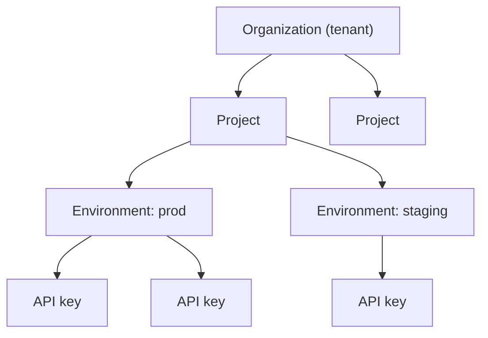
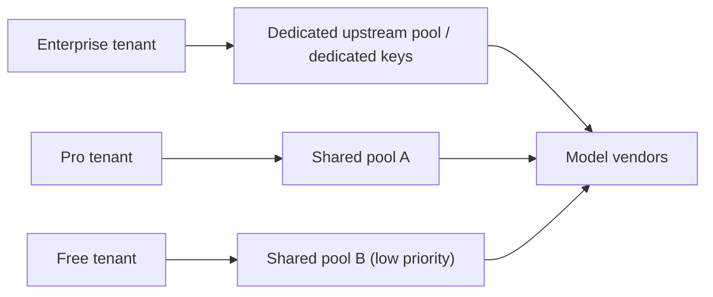

# Enterprise Multi-Tenancy and Quotas

The core tension in a multi-tenant gateway: **everyone wants to share one pool, but nobody wants to pay for someone else's peak.** With one shared quota, a single large customer's batch job pushes every small customer into 429s. With dedicated capacity reserved for every tenant, utilization collapses.

This page is about finding an operable balance between isolation and sharing.

## The short version

- **A tenant is not a user.** A tenant is the unit of billing and isolation; below it sit projects, environments and keys.
- **Quotas are multi-dimensional**: RPM, TPM, concurrency, budget, model allowlist, context cap. All of them.
- **Quotas inherit and override**: the plan sets defaults, projects can tighten, keys can tighten further, but nothing can exceed the layer above.
- **Isolation has six surfaces**: auth, quota, cache, logs, routing and data. Auth alone is not multi-tenancy.
- **Noisy neighbors need tiered resource pools**, not just rate limits.
- **Quota changes must be auditable**, or customers will ask who lowered their limit.

## Tenant model



| Layer | Role | Typical attributes |
| --- | --- | --- |
| Organization | Billing and contracting entity | Plan, total budget, region policy |
| Project | Cost ownership, permission boundary | Project budget, model allowlist |
| Environment | Separates production from test | Stricter test quotas |
| API key | Credential, call origin | Rate, expiry, IP restrictions |

Why this granularity? Because the real requirements are:

- Finance invoices by **tenant**.
- Engineering leads review cost by **project**.
- Test environments must not consume production quota.
- A leaked key can be revoked on its own without affecting other services.

## Quota dimensions

| Dimension | Unit | Purpose |
| --- | --- | --- |
| RPM | requests/minute | Prevent high-frequency small requests |
| TPM | tokens/minute | Prevent long context from eating the quota |
| Concurrency | in-flight requests | Prevent connection and GPU memory exhaustion |
| Daily/monthly budget | currency | Prevent runaway spend |
| Model allowlist | model list | Prevent unauthorized use of expensive models |
| Context cap | tokens | Prevent oversized single requests |
| Max output per request | tokens | Prevent runaway generation |
| Tool call count | calls/request | Prevent agent loops |

::: warning RPM and TPM are not substitutes
A request with 500k tokens once a minute looks perfectly healthy on RPM, but TPM is already blown. Conversely, a flood of 10-token probe requests maxes out RPM while TPM stays low. Limit both.
:::

## Plan design

Plans aren't invented from scratch; they usually come in three tiers by target customer intensity:

| Dimension | Free | Pro | Enterprise |
| --- | --- | --- | --- |
| RPM | 20 | 300 | Negotiable |
| TPM | 40k | 600k | Negotiable |
| Concurrency | 2 | 30 | Negotiable |
| Monthly budget | $5 | $500 | Contract amount |
| Models | Base models | All | All + dedicated deployment |
| Cache | Shared | Shared | Dedicated namespace |
| Log retention | 3 days | 30 days | 180 days |
| Support | Community | Ticket | Dedicated channel + SLA |

A plan's job is to **provide defaults**, not to be a hard ceiling. Enterprise customers will almost always ask to adjust something, so the quota system must support per-tenant overrides.

## Inheritance and overrides

Rule: **lower layers may only tighten, never loosen.**

```python
from dataclasses import dataclass, replace


@dataclass(frozen=True)
class Quota:
    rpm: int
    tpm: int
    concurrency: int
    monthly_budget_usd: float
    models: frozenset[str] | None   # None means unrestricted
    max_context_tokens: int


def merge_quota(base: Quota, override: Quota | None) -> Quota:
    if override is None:
        return base
    return Quota(
        rpm=min(base.rpm, override.rpm),
        tpm=min(base.tpm, override.tpm),
        concurrency=min(base.concurrency, override.concurrency),
        monthly_budget_usd=min(base.monthly_budget_usd, override.monthly_budget_usd),
        models=(
            base.models
            if override.models is None
            else (base.models & override.models if base.models else override.models)
        ),
        max_context_tokens=min(base.max_context_tokens, override.max_context_tokens),
    )
```

The `min` semantics matter: if a project config is wrong (say, 1M RPM), it still can't exceed the tenant plan's ceiling. A misconfiguration should make things stricter, never looser.

Budget is usually the exception — an enterprise customer may top up a project so the total exceeds the plan default. In that case the **tenant-level total** should act as the backstop rather than a plain `min`:

```python
def effective_budget(tenant_budget: float, project_budgets: list[float]) -> float:
    return min(tenant_budget, sum(project_budgets))
```

## The six isolation surfaces

| Surface | What happens without it | Approach |
| --- | --- | --- |
| Auth | Anyone with one key can use every model | Bind keys to tenant and scope |
| Quota | One tenant maxes out, everyone gets 429 | Tiered rate limits + resource pools |
| Cache | Tenant A reads tenant B's cached answer | Namespace cache keys by tenant |
| Logs | You see another customer's prompt while debugging | Tag logs by tenant + access control |
| Routing | Small customers get routed to expensive models | Restrict the target set by plan |
| Data | Fine-tuning, files and batches cross tenants | Enforce `tenant_id` filtering in storage |

Cache is the most overlooked surface. If a semantic cache matches only on prompt similarity, tenant A asking "what was our revenue last quarter" may hit tenant B's answer — that is a data leak, not a performance issue.

```python
def cache_key(tenant_id: str, model: str, messages: list[dict]) -> str:
    canonical = json.dumps(messages, sort_keys=True, ensure_ascii=False)
    digest = hashlib.sha256(canonical.encode()).hexdigest()
    return f"cache:{tenant_id}:{model}:{digest}"
```

The enterprise tier can also give each tenant its own Redis logical database or key prefix, with TTL and capacity caps, so one large tenant can't flush the cache for everyone else.

## Noisy-neighbor protection

Rate limits only guarantee "not over quota", not "no mutual interference". Real isolation needs tiered resources:



Concrete measures:

- **Dedicated upstream credentials**: large customers get their own vendor keys, so quotas don't contend.
- **Dedicated connection pools**: one `httpx.AsyncClient` per tenant tier, with `max_connections` capped, so connections can't be exhausted.
- **Dedicated queues / concurrency semaphores**: the Free tier has a low concurrency cap, and queue time doesn't count toward its timeout.
- **Priority scheduling**: under overload, reject Free first, then Pro, and touch Enterprise last.
- **Dedicated deployments**: Enterprise can point at self-hosted vLLM or a dedicated instance.

```python
POOL_LIMITS = {
    "free": {"max_connections": 50, "max_keepalive": 10},
    "pro": {"max_connections": 300, "max_keepalive": 60},
    "enterprise": {"max_connections": 800, "max_keepalive": 200},
}
```

## Order of quota checks

Order affects both performance and experience:

1. **Auth**: resolve the key to a tenant and plan (cache locally; don't hit the database every time).
2. **Model allowlist**: the cheapest check, rejecting unauthorized use first.
3. **RPM / concurrency**: Redis atomic operations.
4. **Context length**: check after parsing the body.
5. **TPM**: requires estimating input tokens plus reserving output tokens.
6. **Budget**: reserve, then settle.
7. **Forward.**

Putting cheap, certain checks first avoids expensive token estimation for requests that are doomed anyway.

## Quota storage design

Organize Redis keys by "dimension + layer + time window":

```text
q:{tenant}:{dim}:{window}          # tenant level
q:{tenant}:{project}:{dim}:{window}
q:{tenant}:{key}:{dim}:{window}
```

Time windows use sliding windows or token buckets, at minute granularity (RPM/TPM) and monthly (budget). Set the monthly key's TTL to the end of the calendar month plus one day, so nothing carries over.

Keep configuration in the database; Redis only holds counters:

```sql
CREATE TABLE tenant_quotas (
  tenant_id   TEXT PRIMARY KEY,
  plan        TEXT NOT NULL,
  rpm         INT NOT NULL,
  tpm         INT NOT NULL,
  concurrency INT NOT NULL,
  monthly_budget_usd NUMERIC(12, 2) NOT NULL,
  max_context_tokens INT NOT NULL,
  models      TEXT[],
  updated_at  TIMESTAMPTZ NOT NULL DEFAULT now(),
  updated_by  TEXT NOT NULL
);
```

`updated_by` and a change history table are not optional. When a customer asks "why did my limit shrink", you need evidence.

## Responses when quota is insufficient

Don't return a bare 429. The standard approach:

```http
HTTP/1.1 429 Too Many Requests
Content-Type: application/json
Retry-After: 17
X-RateLimit-Limit-Requests: 300
X-RateLimit-Remaining-Requests: 0
X-RateLimit-Reset-Requests: 2026-10-30T12:35:00Z
X-RateLimit-Limit-Tokens: 600000
X-RateLimit-Remaining-Tokens: 42130
X-RateLimit-Reset-Tokens: 2026-10-30T12:35:00Z
```

```json
{
  "error": {
    "type": "rate_limit_error",
    "code": "tpm_exceeded",
    "message": "TPM quota exceeded for tenant t_1001. Retry after 17s.",
    "limit": 600000,
    "used": 557870,
    "retry_after_seconds": 17
  }
}
```

SDKs handle `Retry-After` inconsistently, so include structured fields in the body as well. The error message **must not expose other tenants' information** — only the caller's own.

## Operational flow for quota changes

| Scenario | Flow |
| --- | --- |
| New tenant onboarding | Initialize from the plan, write an audit record |
| Temporary increase | Override with an expiry; reverts automatically |
| Plan upgrade | Effective immediately, prorated billing |
| Plan downgrade | Effective next billing cycle, to avoid mid-cycle incidents |
| Ban | Revoke all keys, keep read-only audit access |

Temporary increases must have a TTL. A "temporary" change without a TTL always becomes permanent, and nobody remembers why it was made.

## Metering and billing

Multi-tenant billing must break down to project, even environment:

```sql
SELECT
  tenant_id,
  project_id,
  sum(cost_usd) AS cost,
  sum(input_tokens) AS input_tokens,
  sum(output_tokens) AS output_tokens,
  count(*) AS requests
FROM usage_events
WHERE occurred_at >= date_trunc('month', now())
GROUP BY tenant_id, project_id
ORDER BY cost DESC;
```

Should test-environment cost appear on the invoice? **Include it but tag it separately**, and let customers decide about internal chargeback. Excluding it outright leaves test environments unconstrained.

## Anti-patterns

| Anti-pattern | Consequence |
| --- | --- |
| Tenant-level quotas only | One project's batch job drags down other projects in the same tenant |
| Cache keys without tenant | Cross-tenant data leak |
| Quotas only in process memory | The effective limit is N× with N replicas |
| All tenants share upstream keys | One tenant exceeds quota, everyone gets 429 |
| Temporary increases without expiry | Limits only go up |
| 429 without `Retry-After` | Clients retry frantically and make it worse |
| Quota changes without audit | You can't prove anything in a dispute |
| Free and paid tiers in the same pool at the same priority | Paying users suffer from free traffic |

## Checklist

- [ ] A clear tenant/project/environment/key four-layer model
- [ ] RPM, TPM, concurrency, budget, model allowlist and context cap are all covered
- [ ] Quota inheritance only tightens; the tenant total is the backstop
- [ ] Quota counters live in Redis and are consistent across replicas
- [ ] All six surfaces are isolated: auth, quota, cache, logs, routing, data
- [ ] Cache keys include the tenant namespace
- [ ] Tiered resource pools and priority scheduling prevent noisy neighbors
- [ ] 429 responses include full rate-limit headers and a structured error
- [ ] Quota changes are written to an audit table; temporary increases carry a TTL
- [ ] Billing can be split by tenant and project

## Next

With tenant isolation in place, the next cost lever is caching: [KV Cache Proxy and Cost Optimization](./kv-cache.md).
