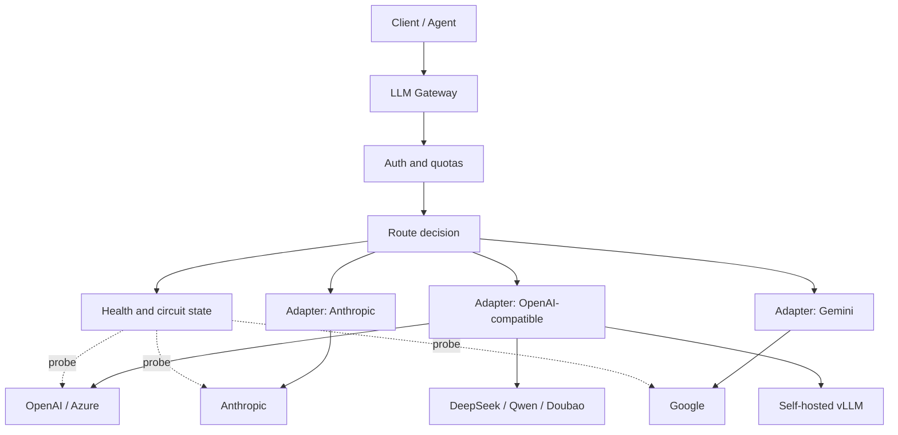
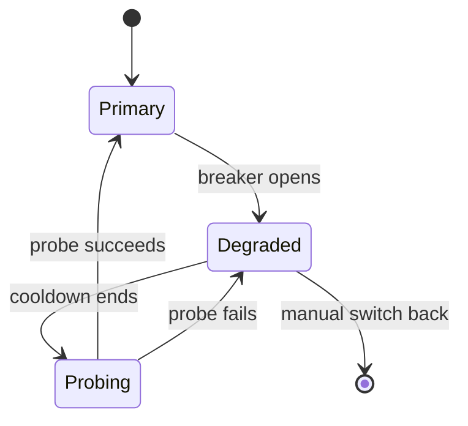

# Multi-Vendor Routing and Automatic Failover

A single vendor at 99.9% availability is unavailable for about 43 minutes a month — usually at the moment you least want it. Multi-vendor routing is not about looking impressive with more integrations; it gives you an exit on four dimensions: **capacity, geography, cost and capability**.

But "just add a fallback" is far harder than it looks: protocol differences, mismatched capabilities, session consistency, retry amplification. Get any one of them wrong and failover itself becomes the new outage.

## The short version

- **Multi-vendor routing rests on a unified protocol.** Expose only an OpenAI-compatible API and absorb the differences in an adapter layer.
- **Match failover by capability**, not by "does some model exist". If the backup model doesn't support tool calling, switching to it fails every tool request.
- **Combine passive detection with active probes**: passive watches real traffic; active verifies backups during off-peak hours.
- **Switching needs stickiness**: don't bounce one session back and forth between primary and backup.
- **The retry budget must be global**, or gateway retries × agent retries = exponential request growth.
- **Failover must be rehearsed.** An untested plan is no plan.

## Five motivations for going multi-vendor

| Motivation | Symptom | Main lever |
| --- | --- | --- |
| Capacity | 429s from the primary model at peak | Weighted splitting, overflow to a backup pool |
| Availability | Vendor outage, regional disruption | Health checks + automatic switching |
| Cost | Wasting a premium model on simple requests | Route by task difficulty / tenant plan |
| Capability | Long context, vision, tool calling | Route by capability tags |
| Compliance | Data residency, industry regulation | Route by tenant region policy |

Most teams start with availability and end up combining cost and capability routing.

## Overall architecture



Note where the adapters sit: **protocol adaptation happens after routing**. The routing layer deals with abstract targets and should not care which protocol they speak.

## Capability matrix

Before choosing backup models, write a capability table. The one below is illustrative; vendor docs are authoritative:

| Capability | Primary models | Requirement for backups |
| --- | --- | --- |
| Streaming | All | Must support |
| Tool calling | GPT / Claude / Qwen / DeepSeek | Backups must support it, or tool requests can't switch |
| JSON mode | Most support it, at different strictness | Validate the schema when structured output is required |
| Vision input | GPT-4o / Claude / Gemini / Qwen-VL | Tag by modality |
| Long context | Gemini / Claude / Qwen | Filter by `context_window` |
| Reasoning / thinking | o series / Claude thinking / DeepSeek-R1 | Output formats differ widely; mix with care |
| Chinese capability | Chinese models are usually stronger | Validate against an eval set, not a feeling |

Route by tag matching rather than hard-coded model names:

```yaml
targets:
  - name: gpt-4o
    provider: openai
    model: gpt-4o
    capabilities: [stream, tools, json, vision]
    context_window: 128000
    weight: 70

  - name: claude-sonnet
    provider: anthropic
    model: claude-sonnet-4
    capabilities: [stream, tools, json, vision, long_context]
    context_window: 200000
    weight: 30

  - name: qwen-max
    provider: dashscope
    model: qwen-max
    capabilities: [stream, tools, json]
    context_window: 32000
    weight: 0        # Backup only, excluded from normal splitting

  - name: deepseek-chat
    provider: deepseek
    model: deepseek-chat
    capabilities: [stream, tools, json]
    context_window: 64000
    weight: 0
```

When a request arrives, compute its required capability set first:

```python
def required_capabilities(body: dict) -> set[str]:
    caps = {"stream"} if body.get("stream") else set()
    if body.get("tools"):
        caps.add("tools")
    if body.get("response_format", {}).get("type") == "json_object":
        caps.add("json")
    if any(is_vision_part(m) for m in body.get("messages", [])):
        caps.add("vision")
    return caps
```

Then filter out targets whose `context_window` can't fit the request, and choose by policy. **This must happen before forwarding**; otherwise switching to a smaller-context model returns a 400 immediately.

## Failure detection

### Passive detection

Learn from real traffic; no extra cost:

| Signal | Verdict |
| --- | --- |
| Consecutive 5xx | Upstream failure |
| Consecutive timeouts | Network problem or upstream overload |
| Sudden jump in 429 share | Quota exhausted or rate limited |
| P95 latency doubles | Upstream degrading, not yet failing |
| Connection errors (DNS/TLS) | Regional network problem |

The weakness of passive detection is that it waits for a real request to fail. Hence active probing.

### Active probing

During off-peak hours, send a minimal request on a schedule (for example a "ping" with `max_tokens=1`) to verify:

- The network is reachable and credentials are valid.
- The model name is valid (vendors retire old models regularly).
- The response format is as expected.

```python
async def probe(target) -> ProbeResult:
    start = time.perf_counter()
    try:
        r = await client.post(
            target.url,
            json={
                "model": target.model,
                "messages": [{"role": "user", "content": "ping"}],
                "max_tokens": 1,
                "stream": False,
            },
            timeout=5.0,
        )
    except httpx.HTTPError as exc:
        return ProbeResult(ok=False, reason=type(exc).__name__)
    latency = (time.perf_counter() - start) * 1000
    if r.status_code == 401:
        return ProbeResult(ok=False, reason="auth_invalid")
    if r.status_code == 404:
        return ProbeResult(ok=False, reason="model_not_found")
    if r.status_code >= 500:
        return ProbeResult(ok=False, reason="upstream_5xx")
    return ProbeResult(ok=True, latency_ms=latency)
```

Don't probe too often: once every 30–60 seconds is enough, and spread probes across targets so probing itself doesn't become traffic.

::: tip Probing costs money too
`max_tokens=1` is still billed. 100 targets × once a minute × one day = 144,000 requests. Even at the cheapest price that is real money; tag probe traffic separately so you can strip it from the bill.
:::

## Error classification decides whether to switch

Not every error should trigger failover:

| Upstream response | Meaning | Switch? |
| --- | --- | --- |
| 401 / 403 | Our key or permission problem | ❌ Switching won't help; alert instead |
| 404 | Model does not exist | ✅ Switch, and mark the target unavailable |
| 400 | The request itself is invalid | ❌ Switching still returns 400 |
| 413 | Request body too large | ⚠️ May switch to a larger-context target |
| 429 | Rate limited | ✅ Switch, or wait and retry |
| 500 / 502 / 503 | Upstream failure | ✅ Switch |
| 504 / timeout | Upstream too slow | ✅ Switch (watch for duplicate billing) |
| Stream interrupted | Connection failure | ⚠️ Switch only if nothing has been emitted |

Write this table into code, not scattered `if` statements. A single classification function:

```python
RETRYABLE = {404, 408, 409, 425, 429, 500, 502, 503, 504}


def classify(status: int | None, exc: Exception | None) -> str:
    if exc is not None:
        if isinstance(exc, httpx.TimeoutException):
            return "timeout"
        return "transport"
    if status in (401, 403):
        return "auth"
    if status == 400:
        return "bad_request"
    if status == 413:
        return "too_large"
    if status in RETRYABLE:
        return "retryable"
    return "fatal"
```

## Switching strategy

### Immediate vs gradual

| Strategy | When to use | Risk |
| --- | --- | --- |
| Switch everything immediately | Clear upstream failure | Backup capacity may not hold |
| Ramp by percentage | Upstream degraded but not failed | Slow to complete |
| Switch new requests only | Protect in-flight streams | Old connections can still fail |

Recommendation: **when the breaker opens, switch all new requests and leave in-flight streams alone.** Switching after content has been emitted is pointless; the user just sees two mismatched halves of an answer.

### Stickiness

One session (`session_id` or `run_id`) should stay on the same target where possible:

- Keeps style consistent; the user doesn't feel that "a different person" took over.
- Exploits the vendor's prompt cache, improving hit rate.
- Avoids comprehension jumps caused by capability differences mid-conversation.

Implement it with consistent hashing or a Redis mapping with a TTL (say 30 minutes):

```python
async def sticky_target(session_id: str, candidates: list[str]) -> str | None:
    key = f"sticky:{session_id}"
    cached = await redis.get(key)
    if cached and cached in candidates:
        return cached
    return None
```

But stickiness must not override health: when a target's breaker opens you must switch, and update the mapping.

### Half-open probing

An open breaker can't stay closed forever. Half-open lets a few requests through:

- If the success rate clears the threshold → close the breaker and restore weight gradually.
- If it still fails → reopen, and back off the next probe (exponential).

```python
class CircuitBreaker:
    def __init__(self, failure_threshold=5, recovery_timeout=30.0, half_open_max=3):
        self.failure_threshold = failure_threshold
        self.recovery_timeout = recovery_timeout
        self.half_open_max = half_open_max
        self.failures = 0
        self.opened_at = 0.0
        self.state = "closed"
        self.half_open_inflight = 0

    def allow(self) -> bool:
        now = time.monotonic()
        if self.state == "closed":
            return True
        if self.state == "open":
            if now - self.opened_at >= self.recovery_timeout:
                self.state = "half_open"
                self.half_open_inflight = 0
            else:
                return False
        if self.half_open_inflight < self.half_open_max:
            self.half_open_inflight += 1
            return True
        return False

    def record(self, ok: bool) -> None:
        if ok:
            if self.state == "half_open":
                self.state = "closed"
                self.failures = 0
            else:
                self.failures = max(0, self.failures - 1)
        else:
            self.failures += 1
            if self.state == "half_open" or self.failures >= self.failure_threshold:
                self.state = "open"
                self.opened_at = time.monotonic()
```

In multi-replica deployments, either share breaker state in Redis or accept brief inconsistency from independent per-replica decisions. The former is more accurate, the latter simpler — **the key is to keep every replica from hammering a dead upstream in the same second**; add random jitter to the probe timing.

## Protocol differences that bite

Even after normalizing to the OpenAI format, some differences can't be fully erased:

| Difference | Symptom | Handling |
| --- | --- | --- |
| `temperature` range | Some 0–1, some 0–2 | Clamp per target |
| `max_tokens` semantics | Whether reasoning tokens are included | Set conservatively, or adjust per model |
| system message location | OpenAI inside messages, Anthropic top-level | Convert in the adapter |
| Tool schema | Different JSON Schema subsets | Simplify the schema, drop unsupported fields |
| Stop sequences | Different count limits | Truncate to the limit |
| Parallel tool calls | Varying support | Serialize when unsupported |
| Empty content | Some reject, some accept | Normalize to `null` or a placeholder |
| Stream end marker | `[DONE]` vs named events | Unify in the adapter |

The subtlest one is **output style**. With the same prompt, the primary model emits a Markdown table while the backup emits plain text; the primary asks a clarifying question while the backup answers directly. If the product depends on format, add a post-processing or prompt-compensation layer after switching.

## Experience consistency after switching



A few product-level decisions:

- **Do you tell users the model changed?** Usually not, but if the style difference is obvious, return an `x-gateway-model` header so the frontend can hint at it.
- **Which model do you bill for?** Bill the target actually called, and keep the "extra or saved cost caused by fallback" in the invoice.
- **How do you count SLA?** Are fallback requests successes or failures? Track a separate "fallback success rate"; don't mix it into the primary model SLI.

## Drills

Failover that has never been rehearsed will most likely run for the first time during a real outage.

| Drill | Method | Expected |
| --- | --- | --- |
| Primary 429 | Burn quota with a test key | Automatic overflow to the backup, error rate bounded |
| Primary 5xx | Point at a mock returning 500 | Breaker opens after N failures |
| Network timeout | Inject latency with toxiproxy | First-token timeout triggers switching |
| Backup unavailable | Disable primary and backup together | A clear error, no infinite retries |
| Config error | Deliberately misspell a model name | Validation fails at startup, not at runtime |
| Capacity shortfall | Keep only a single backup target | Rate limiting kicks in, no collapse |

Run drills **outside production**, but keep config from the same source as production. Mock upstreams are far cheaper than hitting real vendors, and far more controllable.

## Cost impact

Failover changes your cost structure:

- Backup models are usually more expensive (the pricier vendor is often the steadier one).
- Retries cause duplicate billing, especially timeouts where the upstream had already generated output.
- Cross-region calls add network cost.

So your routing configuration must answer: **what does one hour of fallback cost extra?** Compute that number, put it in the plan, and during an incident you'll know whether to switch or to rate limit.

## Anti-patterns

| Anti-pattern | Consequence |
| --- | --- |
| Backup model lacks tool support | Every tool request fails after switching |
| Every error triggers switching | A 400 becomes a 400 elsewhere, with extra latency |
| No retry budget | Gateway × agent retries multiply traffic tenfold |
| No session stickiness | Style flips mid-conversation, cache misses entirely |
| Breaker without half-open | Still rejecting traffic after upstream recovers |
| No context length validation | Switching to a small-window model returns 400 |
| No drills | You discover the config typo during a real outage |
| Untagged probe traffic | A mysterious line item on the bill |

## Checklist

- [ ] OpenAI-compatible protocol externally; differences absorbed in adapters
- [ ] Targets carry `capabilities` and `context_window` metadata
- [ ] Requests are filtered by capability and context before target selection
- [ ] The error classification table lives in code; non-retryable errors don't switch
- [ ] Passive detection plus active probes, with identifiable probe traffic
- [ ] Breakers have half-open and backoff; state is consistent across replicas or acceptably so
- [ ] Session stickiness has a TTL and yields to health state
- [ ] The fallback path has its own SLI and cost accounting
- [ ] The retry budget applies globally, preventing double amplification
- [ ] Failover drills run at least quarterly

## Next

Multi-vendor routing answers "where to call". Next comes "who can use how much": [Enterprise multi-tenancy and quotas](./multi-tenant.md).
