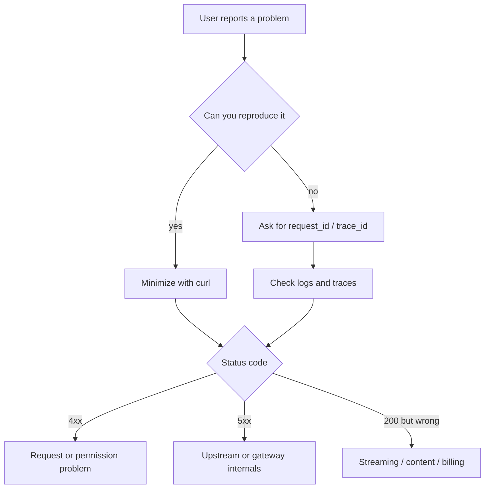

# Common Issues Troubleshooting Handbook

This page is an index-style companion to the chapters before it: when all you have is a symptom (an error, slowness, a wrong bill), start here to quickly narrow down likely causes and how to verify them.

## Overall triage order



Three principles:

1. **Ask for the `request_id` first.** Without it you can only guess.
2. **Use curl to bypass the client** and rule out the SDK and business code.
3. **Change one variable at a time**, or you will not know which change took effect.

## Quick reference

| Symptom | Most likely cause | Check first |
| --- | --- | --- |
| 401 | Wrong, expired or cross-environment key | `key_id`, tenant status |
| 403 | Model not on the allowlist, IP restriction | Key scopes |
| 404 | Model name does not exist, route group is empty | `model_alias`, target configuration |
| 400 context length | Input + output exceeds the window | Token estimate |
| 400 tools | Invalid schema, model does not support it | Tool definition, capability tags |
| 413 | Request body too large, tool result too large | Body size, per-request cap |
| 429 (local) | RPM/TPM/concurrency/budget | `X-RateLimit-*` headers |
| 429 (upstream) | Vendor quota | `upstream_status`, vendor console |
| 502 | Upstream returned an invalid response, auth failure | Upstream response body |
| 503 | No healthy target, all circuits open | Circuit state, health checks |
| 504 | Upstream timeout | Phase timings, time to first token |
| 200 but slow | Slow upstream, pool queuing | TTFT, pool wait |
| Stream interrupted | Proxy buffering, inter-chunk timeout | Section-by-section curl |
| Duplicate billing | Retries, client reconnects | `attempt`, `request_id` |
| Cache miss | Prefix changed, routing drift | `cache_read_tokens` |
| Memory growing | Buffers, connection leaks | RSS, FDs, inflight |

## Authentication

### 401 Unauthorized

| Check | Method |
| --- | --- |
| Does the key exist? | Look it up by `key_id` |
| Is it expired? | `expires_at` |
| Was it revoked? | `revoked_at` |
| Are environments mixed up? | A test key pointed at the production URL |
| Header format | `Authorization: Bearer lgw_live_...` |
| Did a proxy rewrite it? | Capture what is actually sent |

```bash
curl -sS -D - https://gateway.example.com/v1/models \
  -H "Authorization: Bearer $KEY" | head -20
```

If the gateway returns 401 and the upstream also returns 401, distinguish them: the gateway's 401 means "you should not be here", while an upstream 401 should be wrapped as a 502 (`upstream_auth_error`). Otherwise users will think their own key is wrong.

### 403 Forbidden

Common cases:

- The model is not in the key's allowlist.
- The tenant is restricted to certain regions.
- The IP is not on the allowlist.
- The request uses a model that requires a higher plan.

Error messages must be specific, for example `model_not_allowed: gpt-4o is not enabled for plan free`, rather than a vague forbidden.

## Models and routing

### 404 Model Not Found

Check in this order:

1. Does `model_alias` exist in the routing configuration?
2. Is the route group empty (all targets filtered out)?
3. Has the upstream model name been retired?
4. Does the vendor require a regional endpoint (such as Azure's deployment name)?

```bash
curl -sS https://gateway.example.com/v1/models -H "Authorization: Bearer $KEY"
```

The gateway should expose `/v1/models` returning **the aliases visible to the current tenant**, not every model the upstream has.

### 503 No Healthy Target

Returned when all targets are circuit-broken or fail probing. Check:

- Circuit state (`gateway_circuit_state`).
- Health probe results.
- Whether backup targets are configured.
- Whether rate limiting left no available target.

Including each target's state in the response body saves a lot of back-and-forth:

```json
{
  "error": {
    "type": "service_unavailable",
    "code": "no_healthy_target",
    "targets": [
      { "name": "gpt-4o", "state": "open", "reason": "5xx_rate_high" },
      { "name": "qwen-max", "state": "open", "reason": "auth_invalid" }
    ]
  }
}
```

## Requests

### 400 Context Length Exceeded

```bash
# Rough estimate of input tokens
python -c "import sys; print(len(open(sys.argv[1]).read())//3)" prompt.txt
```

Check:

- Whether the tool schemas are included (easily overlooked).
- Whether an entire document was stuffed into the system message.
- Whether `max_tokens` is set too high, pushing input + output over the limit.
- How multimodal content is converted to tokens.

The gateway should intercept this before forwarding and return actionable advice, rather than passing the upstream's raw 400 through.

### 400 Tool Schema Invalid

Common causes:

- `parameters` is not valid JSON Schema.
- Fields the model does not support are used (such as `$ref` or complex `oneOf`).
- A field in `required` does not exist in `properties`.
- The tool name is empty or contains illegal characters.

```python
def validate_tool(tool: dict) -> list[str]:
    fn = tool.get("function", {})
    errors = []
    if not fn.get("name"):
        errors.append("function.name is required")
    params = fn.get("parameters", {})
    if params.get("type") != "object":
        errors.append("parameters.type must be object")
    props = params.get("properties", {})
    for key in params.get("required", []):
        if key not in props:
            errors.append(f"required field {key} not in properties")
    return errors
```

### 413 Payload Too Large

| Source | Threshold | Handling |
| --- | --- | --- |
| Request body size | Gateway config, e.g. 10MB | Compress or batch on the client |
| Input tokens per request | Plan configuration | Compress the context |
| A single tool result | Gateway cap, e.g. 16k | Paginate or summarize |
| Image size | Vendor limit | Downscale |

Note that reverse proxies also enforce body limits (Nginx `client_max_body_size`). The error may come from the proxy, not the gateway.

## Rate limiting

### Distinguishing local 429 from upstream 429

```http
HTTP/1.1 429 Too Many Requests
X-Gateway-Limit-Source: local
X-RateLimit-Limit-Tokens: 600000
X-RateLimit-Remaining-Tokens: 0
```

| Source | Characteristics | Handling |
| --- | --- | --- |
| Local rate limit | Has `X-RateLimit-*`, `upstream_status` is empty | Wait for the window to reset or raise the limit |
| Upstream rate limit | `upstream_status=429`, may carry the upstream's `Retry-After` | Switch targets, slow down, contact the vendor |

The worst case is an upstream 429 returned as a 500: clients retry aggressively and amplify the problem.

### Concurrency saturated

Symptom: high latency, `inflight` near its cap, no upstream errors.

```promql
sum(gateway_inflight_requests) by (model_alias)
```

Handling:

- Lower the per-tenant concurrency cap.
- Expand the upstream connection pool and instance count.
- Queue long requests separately so they do not consume slots needed by short ones.

## Timeouts

### Telling the four timeouts apart

| Timeout | Error characteristics | Root cause |
| --- | --- | --- |
| connect | Fails during connection setup | DNS, network, TLS |
| write | Fails while sending the body | Request too large, upstream not reading |
| read (first byte) | Times out waiting for response headers | Upstream queuing, model has not started |
| read (inter-chunk) | Stream stops midway | Upstream stalled, connection dropped |

Logging a `phase` field (`connect`/`write`/`first_byte`/`stream`) is far more useful than logging only `timeout`.

### Slow first token but normal total duration

Possible causes:

- Input is too long, so prefill is slow.
- Upstream queuing (especially at peak).
- Routing to a slow model.
- The gateway is waiting on quota or a cache lock.

Look at the correlation between TTFT and `input_tokens`, and at the TTFT distribution across `model_target` values.

## Streaming

See [SSE drops, packet coalescing and partial frames](./sse-issues.md) for details. The three fastest checks are:

```bash
# 1. Direct to the upstream
curl -N -sS https://api.upstream.com/v1/chat/completions ...

# 2. Direct to the gateway
curl -N -sS http://localhost:8000/v1/chat/completions ...

# 3. Through the proxy
curl -N -sS https://gateway.example.com/v1/chat/completions ...
```

Whichever step starts returning everything at once is where the problem is.

## Billing

### Duplicate billing

| Cause | Characteristics | Handling |
| --- | --- | --- |
| Gateway retries | Multiple `attempt` rows for one `request_id` | Bill only the last attempt, or bill what the upstream actually charged |
| Client reconnects | Multiple `request_id`s with similar content | Disable automatic reconnects in the client |
| Queue redelivery | The same `event_id` repeated | Idempotency key |
| Resend after a broken stream | Two calls, the second complete | Dedupe at the product layer |

If reconciliation shows internal charges are double the vendor's, check the share of requests with `attempt > 1` first.

### Cache misses

Check in order:

1. Did the prefix change (timestamps, random IDs, tool ordering)?
2. Is the TTL too short?
3. Was the request routed to a different instance (self-hosted cache)?
4. Are tenant prefixes isolated (per-tenant prefixes reduce cross-tenant hits)?
5. Did the model change version?

The moment `cache_read_tokens` drops sharply usually lines up with a release.

## Performance

### High latency but low CPU

Typically IO wait or queuing:

- Connection pool exhausted: look at `pool` wait time.
- Redis round trips: 5 RTTs per request add up to tens of milliseconds.
- Slow upstream: look at the upstream span.
- Lock contention: cache singleflight locks, quota locks.

### Memory keeps growing

| Cause | Check |
| --- | --- |
| Unreleased buffers | Does the streaming response accumulate the full text? |
| Connection leak | `inflight` versus FD count |
| Log buffering | Is the async log queue unbounded? |
| Unbounded cache | Does the local cache set a maxsize? |
| Unbounded request body | Are large bodies read into memory? |

```bash
# Watch the FD count
ls /proc/$(pgrep -f uvicorn | head -1)/fd | wc -l
```

A steadily rising FD count almost certainly means connections or files are not closed.

## Useful commands

```bash
# With status code and duration
curl -sS -o /dev/null -w "%{http_code} %{time_total}s\n" \
  https://gateway.example.com/healthz

# Phase-by-phase timings
curl -sS -o /dev/null -w \
  "dns=%{time_namelookup} connect=%{time_connect} tls=%{time_appconnect} ttfb=%{time_starttransfer} total=%{time_total}\n" \
  https://gateway.example.com/v1/models

# Resolution and connectivity
dig +short api.openai.com
openssl s_client -connect api.openai.com:443 -servername api.openai.com </dev/null 2>/dev/null | head -5

# Connection state
ss -s
ss -tan state established | wc -l
```

## Incident handling process

1. **Stop the bleeding**: shift traffic, degrade, rate-limit, roll back. Get users working again before investigating causes.
2. **Scope it**: is it the gateway, the upstream or the client? Reproduce with a minimal curl.
3. **Locate it**: use traces to find the slow span, logs to find the error code, metrics to see the trend.
4. **Fix it**: changing configuration beats changing code, and changing code beats changing architecture.
5. **Verify**: re-run the same path and confirm the metrics recover.
6. **Review**: timeline, root cause, blast radius, follow-up items and owners.

Stopping the bleeding and locating the cause should run in parallel. Do not wait until you understand the problem before acting: much of the damage in an incident comes from recovering too slowly, not from the problem being too hard.

## Anti-patterns

| Anti-pattern | Consequence |
| --- | --- |
| No `request_id` | Cannot locate the specific request |
| Passing upstream errors straight through | Users see errors they cannot understand |
| Retrying a 401 as if it were a 500 | Amplifies useless traffic |
| Logging a single `timeout` | You do not know which phase stalled |
| Looking at averages only | Long-tail problems stay hidden |
| Changing code first during an incident | Introduces new variables and widens the impact |
| Not preserving the scene | Reviews rely on memory alone |

## Checklist

- [ ] Every response carries `request_id` and `trace_id`
- [ ] Error bodies are standardized with `type`, `code` and actionable information
- [ ] Local 429s are distinguished from upstream 429s
- [ ] Timeouts record the specific phase
- [ ] Upstream 401/403 are wrapped as 502 instead of passed through
- [ ] Streaming problems have a section-by-section reproduction method
- [ ] Billing events are idempotent and retries are identifiable
- [ ] Cache hit rate is observable by model and over time
- [ ] Memory, FD and connection counts are monitored
- [ ] The team has a one-page, executable incident process

## Next

After troubleshooting comes deployment and operations: [Docker Compose deployment](../06-deploy/docker-compose.md).
