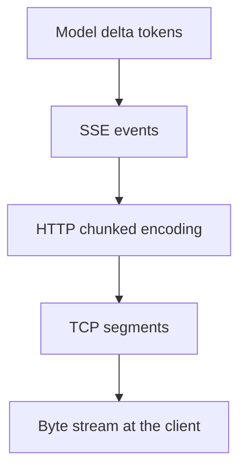

# SSE Disconnects, Coalesced Chunks, and Split Frames

When streaming output breaks, the hard part is that **it usually looks fine**: HTTP 200, the first 20 tokens arrive normally, then it stops. The client reports no error, the gateway logs show nothing unusual, and the only signal is the user saying "it stopped halfway".

This page works through the layers the data passes through: TCP segmentation → HTTP chunked → SSE events → model deltas. Any one of them can be the source.

## Key takeaways

- **`aiter_bytes()` gives you network chunks, not SSE events.** You must buffer on `\n\n` and then parse.
- **A single UTF-8 character can be split across two chunks.** Use an incremental decoder; don't call `decode()` on each chunk separately.
- **The gateway must disable buffering**: Nginx's `proxy_buffering` and CDN response buffering both turn streaming into "return everything at once".
- **A mid-stream error cannot change the status code.** The headers are already out; you can only report it with an SSE error event.
- **Cancel the upstream request the moment the client disconnects**, or you keep paying for content nobody reads.
- **Don't resend the whole request automatically** unless you can guarantee idempotency; otherwise you double-bill and produce two spliced answers.

## The minimum you need to know about SSE

An SSE response looks like this:

```text
event: message
data: {"id":"chatcmpl-1","choices":[{"delta":{"content":"你"}}]}

data: {"id":"chatcmpl-1","choices":[{"delta":{"content":"好"}}]}

: keep-alive

data: [DONE]

```

The rules:

- One field per line, in `field: value` form.
- **A blank line ends an event.**
- `data:` can appear multiple times; the complete payload is the lines joined together.
- Lines starting with `:` are comments, commonly used as heartbeats.
- Line endings can be `\n`, `\r\n`, or `\r`.

OpenAI-compatible APIs usually use only `data:` and signal the end with `data: [DONE]`. Anthropic uses named events (`message_start`, `content_block_delta`, and so on); the structure differs, but the delimiting rules are the same.

## The four layers



| Layer | Boundary | Common problems |
| --- | --- | --- |
| Model delta | Defined by the vendor | Empty deltas, role-only first chunk |
| SSE event | Blank line | Coalesced chunks, partial events, multi-line data |
| HTTP chunked | chunk size | Proxy reassembly, buffering |
| TCP | MSS | Multi-byte characters split apart |

**Key insight: one TCP packet may contain 3 SSE events, or only half of one. Any code that assumes "one read = one event" is wrong.**

## The wrong way

```python
# ❌ Typical mistake: decode per chunk and split per chunk
async for chunk in upstream.aiter_bytes():
    text = chunk.decode("utf-8")          # multi-byte characters get truncated
    for line in text.split("\n"):          # events can span multiple chunks
        if line.startswith("data: "):
            handle(json.loads(line[6:]))   # blank-line boundaries ignored
```

This code often "works" in local testing because local network chunks happen to line up. In production, with large responses, proxies, and compression, it starts failing at random.

## The correct parser

```python
import codecs
import json
from typing import AsyncIterator


class SSEParser:
    def __init__(self) -> None:
        self._decoder = codecs.getincrementaldecoder("utf-8")()
        self._buffer = ""
        self._data_lines: list[str] = []
        self._event = "message"

    def feed(self, chunk: bytes) -> list[dict]:
        events: list[dict] = []
        self._buffer += self._decoder.decode(chunk)

        # Normalize newlines first, then split events on blank lines
        self._buffer = self._buffer.replace("\r\n", "\n").replace("\r", "\n")
        while "\n\n" in self._buffer:
            raw, self._buffer = self._buffer.split("\n\n", 1)
            evt = self._parse_block(raw)
            if evt is not None:
                events.append(evt)
        return events

    def _parse_block(self, block: str) -> dict | None:
        data_lines: list[str] = []
        event = "message"
        for line in block.split("\n"):
            if not line or line.startswith(":"):
                continue
            field, _, value = line.partition(":")
            if value.startswith(" "):
                value = value[1:]
            if field == "data":
                data_lines.append(value)
            elif field == "event":
                event = value
            elif field == "id":
                pass
        if not data_lines:
            return None
        return {"event": event, "data": "\n".join(data_lines)}

    def flush(self) -> list[dict]:
        rest = self._buffer.strip()
        self._buffer = ""
        if not rest:
            return []
        evt = self._parse_block(rest)
        return [evt] if evt else []
```

Using it:

```python
parser = SSEParser()
async for chunk in upstream.aiter_bytes():
    for evt in parser.feed(chunk):
        await forward(evt)
for evt in parser.flush():
    await forward(evt)
```

Three details are worth calling out:

1. **`codecs.getincrementaldecoder`** caches incomplete UTF-8 bytes and keeps decoding when the next chunk arrives.
2. **Normalize newlines before splitting on blank lines**, so mixed `\r\n\r\n` and `\n\n` don't break the split.
3. **`flush()`** handles a final event with no trailing blank line. Many servers don't send that blank line; skip the flush and you lose the last chunk.

## Buffering while forwarding

Even with correct parsing, buffering at any layer in between destroys the streaming experience:

### Nginx

```nginx
location /v1/ {
    proxy_pass http://gateway;
    proxy_http_version 1.1;

    proxy_set_header Connection "";
    proxy_buffering off;
    proxy_cache off;
    proxy_request_buffering off;

    proxy_read_timeout 300s;
    proxy_send_timeout 300s;

    add_header X-Accel-Buffering no;
    chunked_transfer_encoding on;
}
```

`X-Accel-Buffering: no` is an instruction to Nginx that disables buffering even when the application can't change its config. The gateway can also add this response header itself.

### On the application side

```python
return StreamingResponse(
    relay(),
    media_type="text/event-stream",
    headers={
        "Cache-Control": "no-cache, no-transform",
        "Connection": "keep-alive",
        "X-Accel-Buffering": "no",
    },
)
```

`no-transform` matters: some CDNs compress or rewrite `text/*`, which destroys the SSE format outright.

### Proxy and CDN checklist

| Component | What to check |
| --- | --- |
| Nginx / Envoy | `proxy_buffering`, buffer sizes, read timeouts |
| Cloudflare / cloud CDN | Whether `text/event-stream` is buffered, whether the timeout is 100 seconds |
| API Gateway (cloud provider) | Integration timeout, response streaming toggle |
| Service Mesh | Whether the sidecar buffers, idle timeout |
| Load balancer | Idle connection reclamation time |

A quick test: have the gateway emit a comment line `: ping\n\n` every second and watch with `curl -N` whether it arrives each second. If it all shows up at once after a few seconds, something in the middle is buffering.

## Timeouts

Streaming requests need timeouts at several levels:

| Timeout | Meaning | Suggested |
| --- | --- | --- |
| Connect timeout | TCP/TLS handshake | 5-10s |
| First byte timeout | From sending the request to receiving response headers | 30-60s |
| First token timeout | Until the first visible delta | 60-120s (longer for reasoning models) |
| Inter-chunk timeout | Between two chunks | 60-120s |
| Total duration | The whole request | 300-600s |

The one most often missed is the **inter-chunk timeout**. The upstream may have connected and sent a few tokens, then stalled. Without an inter-chunk timeout, that connection hangs indefinitely, holding concurrency and GPU memory.

```python
async def iter_with_idle_timeout(aiter, idle_seconds: float):
    it = aiter.__aiter__()
    while True:
        try:
            chunk = await asyncio.wait_for(it.__anext__(), timeout=idle_seconds)
        except StopAsyncIteration:
            return
        except asyncio.TimeoutError:
            raise GatewayError(504, "upstream_idle_timeout", "no data within idle window")
        yield chunk
```

## Errors mid-stream

Once response headers are sent (status 200), you can't change the status to 500. Errors can only be conveyed by in-stream events:

```text
event: error
data: {"error":{"type":"upstream_error","code":"upstream_timeout","message":"..."}}

```

Implementation notes:

- After sending an error event, **don't send `[DONE]`**, or the client treats the stream as a normal end.
- If some content was already forwarded, the client needs to know "this answer is incomplete".
- Log a `stream_error` entry with the number of tokens already forwarded.

```python
async def relay():
    sent_any = False
    try:
        async for evt in upstream_events():
            sent_any = True
            yield encode(evt)
    except GatewayError as exc:
        yield encode({"event": "error", "data": json.dumps({"error": exc.to_dict()})})
        logger.warning("stream.error", extra={"fields": {"code": exc.code, "sent_any": sent_any}})
```

::: warning Clients must recognize error events
Many OpenAI SDKs only parse `data:` and silently ignore `event: error`, which looks like "the stream just ended". If you write your own client, handle error events explicitly. If you use a third-party SDK, consider putting errors inside `data:` as well, marked with an identifiable field.
:::

## Client disconnects

Closing the page, switching networks, or locking the phone all break the connection. The gateway must:

1. Detect the disconnect (`request.is_disconnected()` or the framework's abort callback).
2. Cancel the upstream request.
3. Stop billing (or bill only for the portion already produced).

```python
async def relay(request: Request, upstream):
    try:
        async for chunk in upstream.aiter_bytes():
            if await request.is_disconnected():
                break
            yield chunk
    finally:
        await upstream.aclose()
```

A bare `break` isn't enough; you must explicitly close the upstream response, or the httpx connection stays in the pool until it times out.

## Reconnecting after a drop

Most LLM APIs **don't support resuming from a breakpoint**. That means:

- Reconnect = regenerate = bill again.
- Content already emitted can't be continued from where it stopped.

So the strategy should be "don't reconnect automatically". Instead:

| Scenario | Handling |
| --- | --- |
| No tokens emitted yet | Safe to retry |
| Partial content already emitted | Don't auto-retry; tell the user and let them decide |
| Idempotent scenarios (batch generation) | Dedupe by request ID; the server returns the cached result |

If you absolutely must continue, it can only be done at the application layer: send the generated text as an assistant message and add "continue from this sentence". But that isn't true continuation; the model may repeat itself or change style.

## Debugging techniques

### curl

```bash
curl -N -sS https://gateway.example.com/v1/chat/completions \
  -H "Authorization: Bearer $KEY" \
  -H "Content-Type: application/json" \
  -d '{"model":"chat-default","stream":true,"messages":[{"role":"user","content":"Count to 20"}]}'
```

`-N` disables curl's own buffering. If output appears piece by piece, the path is fine; if it all arrives at once at the end, the problem is buffering.

### Byte-by-byte observation

```bash
curl -N ... | while IFS= read -r line; do
  printf '%s %s\n' "$(date +%H:%M:%S.%3N)" "$line"
done
```

Timestamps expose exactly how long it stalled.

### Packet capture

```bash
sudo tcpdump -i any -A -s 0 'tcp port 443' | grep -A 2 'data:'
```

Note that with HTTPS you only see ciphertext; capture plaintext on the gateway side, or use `mitmproxy`.

### Isolate the variable

Test segment by segment: client → proxy → gateway → upstream:

1. Hit the upstream directly and confirm upstream streaming is fine.
2. Hit the gateway directly and confirm forwarding is fine.
3. Go through the proxy/CDN and confirm there's no buffering.
4. Use the real client SDK and confirm parsing is fine.

Whichever segment starts returning everything at once is where the problem lives.

## Symptom reference

| Symptom | Likely cause | Check |
| --- | --- | --- |
| Everything at once | Proxy buffering | `X-Accel-Buffering`, CDN config |
| Bursts every 4KB | Buffer size | Nginx `proxy_buffer_size` |
| Garbled CJK or question marks | Per-chunk decode | Use an incremental decoder |
| Last event occasionally missing | No flush | Add `flush()` |
| Stops after 20 tokens | Inter-chunk timeout / upstream stall | Add an idle timeout |
| Status 200 with no content | Upstream returned an empty stream | Check the upstream response body |
| Duplicate output | Client reconnected and resent | Disable automatic reconnect |
| Stream dies at 60s at the proxy | Proxy read timeout | Raise `proxy_read_timeout` |

## Anti-patterns

| Anti-pattern | Consequence |
| --- | --- |
| Splitting directly per chunk | Coalesced or split frames fail at random |
| `decode("utf-8")` on each chunk | Multi-byte characters corrupted |
| Ignoring the final event | Lose `[DONE]` or usage |
| Gateway buffers by default | Streaming degrades to one-shot |
| Changing the status code on a mid-stream error | Headers already sent, client never sees it |
| Not closing upstream when the client disconnects | Resource leak plus continued billing |
| Automatic resend after a drop | Double billing, mangled spliced answers |
| Testing only a direct local connection | Problems surface only after a proxy is in the path |

## Checklist

- [ ] Using an incremental UTF-8 decoder
- [ ] Splitting events on blank lines, supporting `\n`, `\r\n`, and `\r`
- [ ] Supporting multi-line `data:` joining
- [ ] Calling `flush()` on the residual buffer at the end
- [ ] Response headers include `no-cache, no-transform` and `X-Accel-Buffering: no`
- [ ] Proxy/CDN buffering disabled and timeouts raised
- [ ] First-token and inter-chunk timeouts configured separately
- [ ] In-stream errors use an error event and don't send `[DONE]`
- [ ] Client disconnect cancels upstream and releases the connection
- [ ] No automatic reconnect once content has been emitted
- [ ] The real path verified with `curl -N`

## Next

Beyond streaming, the other frequent problem is context: [Long Context and Performance Limits](./long-context.md).
