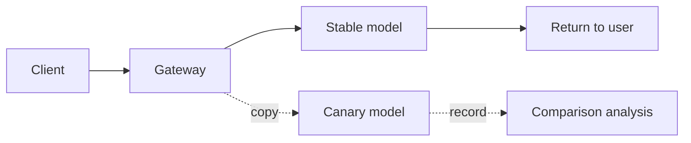

# Model Version Canaries

Model changes come from two sources: **you switch deliberately** (to a cheaper or stronger model), and **the vendor silently upgrades** (same model name, different behavior). The first can be canaried. The second can only be contained with pinned versions plus monitoring.

Either way, the risk is higher than an ordinary code release: code bugs are usually deterministic, while model behavior changes are **statistical**. The error rate does not move, but answer quality quietly degrades.

## The short version

- **Pin model names to versions.** Pin where you can; monitor for drift where you cannot.
- **Canary with stable bucketing**, so the same tenant or session always lands on the same side.
- **Evaluate quality separately.** Normal latency and error rates do not mean the answers got better.
- **Canary stages need automatic rollback conditions**, not someone watching a dashboard.
- **Shadow traffic is expensive.** Use it only for critical changes.
- **Rollback is a configuration change**, not a release.

## Two kinds of change

| Change | Example | Controllability | Strategy |
| --- | --- | --- | --- |
| Deliberate switch | gpt-4o to gpt-4o-mini, Claude 3.5 to 4 | High | Canary + evaluation |
| Vendor upgrade | Same model name, updated weights, changed defaults | Low | Pinned version + drift monitoring |
| Parameter change | Temperature defaults, max output | Medium | Config canary |
| Prompt change | Revised system prompt | High | Separate from model canaries |

::: warning Same name does not mean the same model
A vendor may update weights or inference configuration without changing the model name. Your evaluation baseline suddenly breaks one day, with no release record anywhere. That is why you log `gen_ai.response.model`: it sometimes returns the actual dated version.
:::

## Pinning versions

Prefer dated model identifiers:

```yaml
targets:
  - name: gpt-4o-2024-08-06
    provider: openai
    model: gpt-4o-2024-08-06
    aliases: [gpt-4o-stable]
```

If the vendor only offers a floating alias:

- Log `response.model` from responses and watch whether it changes.
- Run a fixed evaluation set weekly and compare it against the baseline.
- When you detect drift, switch to another region/version, or temporarily lower that model's weight.

## Canary dimensions

| Dimension | Suitable for | Notes |
| --- | --- | --- |
| By tenant | B2B, can be agreed with customers | Coordinate with large customers |
| By traffic percentage | B2C, large sample | Requires stable bucketing |
| By request characteristics | Try low-risk cases first | Characteristics must be explainable |
| Internal staff | First line of validation | High-quality feedback |
| By region | Compliance or latency optimization | Watch data boundaries |

The most common progression is "internal, then 1%, 5%, 20%, 50%, 100%", observing at least one business cycle per stage (say a full day), not a few hours.

## Stable bucketing

You cannot use `random.random()`: the same user may land on different sides on each request, the experience jumps, and your metrics are polluted.

```python
import hashlib


def bucket(key: str, salt: str = "model-canary-v1") -> int:
    digest = hashlib.sha256(f"{salt}:{key}".encode()).hexdigest()
    return int(digest[:8], 16) % 10_000   # 0..9999


def pick_variant(tenant_id: str, rollout_pct: float) -> str:
    threshold = int(rollout_pct * 100)
    return "canary" if bucket(tenant_id) < threshold else "stable"
```

Key points:

- **The bucketing key must be stable**: tenant ID, key ID or session ID, never a request ID.
- **Version the salt**: changing it reshuffles everyone, so do it only when necessary.
- **Increase the percentage monotonically**: going from 1% to 5% keeps the original 1% in the canary, avoiding flip-flopping.
- **Keep a session consistent**: prefer `session_id` over `tenant_id` so a multi-turn conversation does not switch models midway.

## Configuration structure

```json
{
  "version": "2026-10-30.1",
  "routes": {
    "chat-default": {
      "stable": { "target": "gpt-4o-2024-08-06", "weight": 1.0 },
      "canary": { "target": "gpt-4o-mini-2024-07-18", "weight": 1.0 },
      "rollout_pct": 5.0,
      "salt": "canary-2026-10-30"
    }
  }
}
```

`version` must appear in logs and response headers:

```http
X-Gateway-Config-Version: 2026-10-30.1
X-Gateway-Variant: canary
```

When something goes wrong, you can immediately tell which configuration a given request used.

## Evaluating quality

Latency, error rate and cost are necessary metrics, but they do not tell you whether the answer is any good.

| Method | Cost | Suitable for |
| --- | --- | --- |
| Fixed eval set + exact match | Low | Classification, extraction, format-sensitive tasks |
| LLM-as-judge | Medium | Open-ended Q&A, writing |
| Human sampling | High | High-risk, highly subjective work |
| Business metrics | Low (but slow) | Conversion, adoption, complaint rates |
| User feedback | Low | Thumbs up/down, retry rate |

### Caveats for LLM-as-judge

- **Position bias**: the judge may prefer the first or the longer answer. Swap the order and run twice.
- **Self-preference**: model A judging model A scores itself higher. Use a third-party model where possible.
- **Be specific in the rubric**: do not ask "which is better", ask "does it include X, does it follow format Y, does it contain factual errors".
- **Keep human calibration**: periodically validate the judge against human labels.

```python
JUDGE_PROMPT = """You are a strict reviewer. Score each dimension from 1 to 5 and give your reasoning:
1. Factual accuracy
2. Adherence to the required output format
3. Whether it answers the user's actual question
Do not award points for length or tone.

User question: {question}
Reference answer: {reference}
Answer under review: {answer}

Output JSON: {{"accuracy": n, "format": n, "relevance": n, "reason": "..."}}
"""
```

## Shadow traffic

Copy production requests to the new model, record them, and never return them:



Advantages: real distribution, no user risk.
Drawbacks: **double the cost**, side effects (tool calls cannot be copied), extra upstream load.

So use shadow traffic only for:

- Final validation before a critical model switch.
- Long-tail requests that offline tests cannot cover.
- A 1%-5% sample, not everything.

Strip side effects when copying: do not repeat write operations, and do not double-charge the tenant (book the cost to the platform).

## Automatic rollback

Someone must watch a canary stage, but no one can watch for 24 hours. Set automatic rollback conditions:

| Metric | Threshold | Observation window |
| --- | --- | --- |
| Error rate | 2 percentage points above stable | 5 minutes |
| P95 TTFT | 50% above stable | 10 minutes |
| Timeout rate | Absolute value > 1% | 5 minutes |
| Unit cost | 30% above expected | 30 minutes |
| Quality score | 0.3 below baseline (5-point scale) | Each eval batch |
| User retry rate | 20% above stable | 30 minutes |

```python
async def canary_guard(metrics, rollout: float) -> bool:
    if rollout <= 0:
        return False
    if metrics.error_rate_delta > 0.02:
        return True
    if metrics.ttft_p95_ratio > 1.5:
        return True
    if metrics.quality_delta < -0.3:
        return True
    return False
```

Rolling back means setting `rollout_pct` to 0 and recording an event. **Do not automatically change code or redeploy.** A configuration rollback is faster and safer.

## Monitoring vendor drift

Even without a switch, verify regularly:

```python
async def nightly_eval(model_target: str, golden_set: list[dict]) -> dict:
    scores = []
    for case in golden_set:
        resp = await call_model(model_target, case["messages"])
        scores.append({
            "case_id": case["id"],
            "exact_match": resp.text.strip() == case["expected"].strip(),
            "latency_ms": resp.latency_ms,
            "tokens": resp.usage.total_tokens,
        })
    return summarize(scores)
```

Compare against last week's baseline and alert if any of the three changes materially:

- Accuracy drops by more than 3%.
- Average output tokens change by more than 20% (it may have become verbose or truncating).
- Refusal or empty-answer rate rises.

The goal is not to catch the vendor out; it is to **spot changes before users complain**.

## Change process

```text
1. Proposal: why switch, expected benefit, risks
2. Offline evaluation: golden set + human sampling
3. Shadow traffic (optional): 1%-5%, compare
4. Canary: internal -> 1% -> 5% -> 20% -> 50%
5. Full rollout: 100%, keep the stable config for a week
6. Cleanup: remove the old target, update docs
```

Every step needs an **explicit pass criterion** and an **owner**. Canaries without criteria always end up as "it ran for a day without incident, ship it".

## Decoupling from prompt changes

If you change the model and the prompt at the same time, you cannot attribute problems. Principles:

- Change one variable at a time.
- Route prompt changes through a separate canary channel.
- The two can share an evaluation set, but record results separately.

If you must change both, ship the prompt first (validated against the stable model), then switch the model (with the new prompt).

## Rollback drills

- Run a "config rollback" drill at least monthly.
- Record the time from deciding to roll back to it taking effect.
- Verify that metrics recover and no canary requests remain.
- Check that logs let you find the config version before and after the change.

## Anti-patterns

| Anti-pattern | Consequence |
| --- | --- |
| Bucketing with a random number | The same user's experience jumps and metrics are distorted |
| Bucketing per request | A multi-turn conversation switches models midway |
| Watching error rate only | Quality regressions go unnoticed |
| Jumping the canary percentage | 1% straight to 50% concentrates risk |
| No automatic rollback | Incidents at night go unhandled |
| Full shadow traffic | Double the cost, and the upstream gets hammered |
| Changing model and prompt together | Problems cannot be attributed |
| Rolling back by redeploying | Too slow, and may introduce new variables |
| Not pinning model versions | A vendor upgrade invalidates your baseline |

## Checklist

- [ ] Pinnable models are pinned to dated versions
- [ ] `gen_ai.response.model` is logged and monitored for drift
- [ ] Canaries bucket on a stable key with a monotonically increasing percentage
- [ ] Configuration has a version number that appears in logs and response headers
- [ ] A fixed eval set covers the core scenarios
- [ ] LLM-as-judge is calibrated for position and self-preference bias
- [ ] Shadow traffic is sampled, stripped of side effects, and costed separately
- [ ] Canary stages have automatic rollback thresholds and observation windows
- [ ] Rollback is a configuration change that takes effect in minutes
- [ ] Model and prompt changes are decoupled
- [ ] A drift monitoring job runs weekly
- [ ] A rollback drill runs every quarter

## Next

With deployment and change management done, the final chapter looks at the ecosystem: [advanced LiteLLM configuration](../07-ecosystem/litellm.md).
